# Лабораторная работа №3. Облачные сети. Amazon VPC

| | |
|---|---|
| **Студент** | Daniel Mihai |
| **Группа** | `I2402` |
| **Специальность** | Informatică |
| **Номер `k`** | 7, поэтому `X = k % 30 = 7` и VPC `10.7.0.0/16` |
| **Уровень** | продвинутый (Часть 1 и Часть 2, задания 1–14) |
| **Приложение** | TimeCapsule из ЛР2 (Laravel 12, PHP 8.4, PostgreSQL 16) |
| **Регион** | `eu-central-1` (Frankfurt) |
| **Репозиторий** | https://github.com/danielmihai-cloud/timecapsule |
| **Схема сети** | [docs/architecture/network-lab3.png](../architecture/network-lab3.png) (исходник [network-lab3.drawio](../architecture/network-lab3.drawio)) |
| **ADR** | [docs/adr/0002-database-placement.md](../adr/0002-database-placement.md) |
| **Скрипты NAT** | [scripts/nat-up.sh](../../scripts/nat-up.sh), [scripts/nat-down.sh](../../scripts/nat-down.sh) |

Отчёт ЛР2 остался в корне репозитория: [README.md](../../README.md).

> **Как выполнялась работа.** Роль «моего компьютера» играл AWS CloudShell в `eu-central-1`: в нём настроен
> `~/.ssh/config` с `ProxyJump` через bastion, оттуда же запускались AWS CLI и скрипты NAT. Приватный ключ
> никуда не копировался: перед каждым подключением строка `Match exec` в `~/.ssh/config` кладёт на нужный
> экземпляр временный публичный ключ через EC2 Instance Connect (он действует 60 секунд). Экземпляры
> запущены с ключом `danielmihai-keypair`, поэтому с MacBook работает конфигурация из условия (см. задание 5).
> На время работы в `bastion-sg` было добавлено правило SSH с адреса CloudShell, после работы оно удалено.
> Мой домашний IP на скриншотах закрыт (`188.237.x.x`), пароли сгенерированы в CloudShell и в отчёт не попали.

### Ресурсы

| Ресурс | Имя | ID |
|---|---|---|
| VPC | `timecapsule-dev-vpc` | `vpc-03a7bddba207a62c8` |
| Подсети | `timecapsule-dev-public-a` / `-public-b` / `-private-a` / `-private-b` | `subnet-0595c1c8b4f76ee32` / `subnet-0bdd73dfad65f7b20` / `subnet-0005fe1f99ce5ebad` / `subnet-0aa5e7b48eb3b3796` |
| Internet Gateway | `timecapsule-dev-igw` | `igw-07c8cea49faed3796` |
| Таблицы маршрутов | `timecapsule-dev-public-rt` / `timecapsule-dev-private-rt` | `rtb-0bd714b89014814b7` / `rtb-08ea5451d9d24ed7f` |
| Security Group | `timecapsule-dev-bastion-sg` / `-web-sg` / `-db-sg` | `sg-0f12344a15628a3d1` / `sg-006025d3f22a219dc` / `sg-0852d10b2be0cac93` |
| bastion | `timecapsule-dev-bastion` | `i-0c1122208e2b7dc9e`, `10.7.1.149` |
| web-server (Часть 1) | `timecapsule-dev-web` | `i-0b7b7673d571dad7b`, `10.7.0.110`, завершён в задании 8 |
| db-server | `timecapsule-dev-db` | `i-0b517bf66674ee99c`, `10.7.10.127` |
| app-server | `timecapsule-dev-app` | `i-08dd33ebb505096f4`, `10.7.0.88`, Elastic IP `3.64.208.134` |
| Elastic IP | `timecapsule-dev-app-eip` | `eipalloc-08f2987094f4f8851` |
| Приватная зона | `timecapsule.internal` | `Z03960203IZOV9GNSV06I` |

На всех ресурсах теги `Name`, `Project=timecapsule`, `Environment=dev`, `Owner=danielmihai`, `Lab=lab3`.

## Содержание

- [Часть 1. Базовый уровень](#часть-1-базовый-уровень)
- [Часть 2. Продвинутый уровень](#часть-2-продвинутый-уровень)
- [Архитектура и ADR](#архитектура-и-adr)
- [Итог](#итог)
- [Контрольные вопросы](#контрольные-вопросы)
- [Вывод](#вывод)
- [Источники](#источники)

---

## Часть 1. Базовый уровень

### Задание 1. План адресов

| Подсеть | Зона доступности | Диапазон | Первый и последний адрес, доступный экземплярам | Сколько адресов доступно экземплярам |
|---|---|---|---|---|
| `public-a` | `eu-central-1a` | `10.7.0.0/24` | `10.7.0.4` – `10.7.0.254` | 251 |
| `public-b` | `eu-central-1b` | `10.7.1.0/24` | `10.7.1.4` – `10.7.1.254` | 251 |
| `private-a` | `eu-central-1a` | `10.7.10.0/24` | `10.7.10.4` – `10.7.10.254` | 251 |
| `private-b` | `eu-central-1b` | `10.7.11.0/24` | `10.7.11.4` – `10.7.11.254` | 251 |

**Почему доступных адресов не 256? Какие адреса подсети `10.7.0.0/24` занимает AWS и для чего? Сколько ещё подсетей `/24` поместится в VPC?**
В каждой подсети AWS резервирует 5 адресов: `10.7.0.0` — адрес сети, `10.7.0.1` — маршрутизатор VPC,
`10.7.0.2` — DNS-сервер (в VPC это всегда база диапазона VPC + 2), `10.7.0.3` — резерв AWS на будущее,
`10.7.0.255` — широковещательный адрес (широковещания в VPC нет, но адрес не выдаётся). Остаётся 256 − 5 = 251,
столько же консоль показывала в колонке Available IPv4 addresses у новых подсетей. В `/16` помещается 256
подсетей `/24`, занято 4, значит, свободно ещё 252.

### Задание 2. VPC и подсети

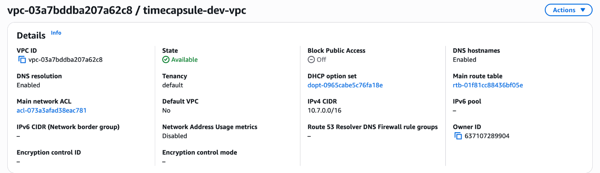
`timecapsule-dev-vpc`: `10.7.0.0/16`, DNS resolution и DNS hostnames включены.

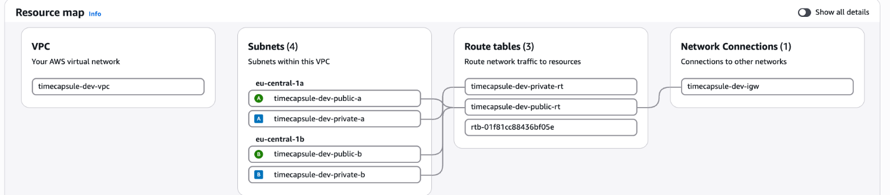
Resource map VPC: четыре подсети в двух зонах, таблицы `public-rt`/`private-rt` и Internet Gateway.

При проверке исправлено то, что было сделано до начала отчёта: тег `Name` у VPC был `vpc-timecapsule-dev`
(плюс лишний ключ `Name ` с пробелом), подсеть `10.7.10.0/24` в `eu-central-1a` называлась `private-b`
вместо `private-a`, у тегов `Project`/`Environment`/`Owner`/`Lab` были пустые значения.

**Является ли подсеть `public-a` сейчас публичной? Почему?**
Нет. Публичной подсеть делает не название, а маршрут `0.0.0.0/0` в Internet Gateway в её таблице маршрутов.
Сразу после создания подсеть неявно связана с основной таблицей VPC, где есть только маршрут `local`,
а Internet Gateway ещё не создан. К тому же экземпляры в ней пока не получали бы публичный адрес.

### Задание 3. Internet Gateway и таблицы маршрутов

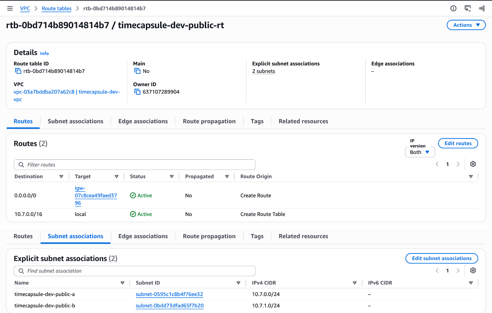
`timecapsule-dev-public-rt`: `0.0.0.0/0` → `timecapsule-dev-igw` и `local`, связана с `public-a` и `public-b`.

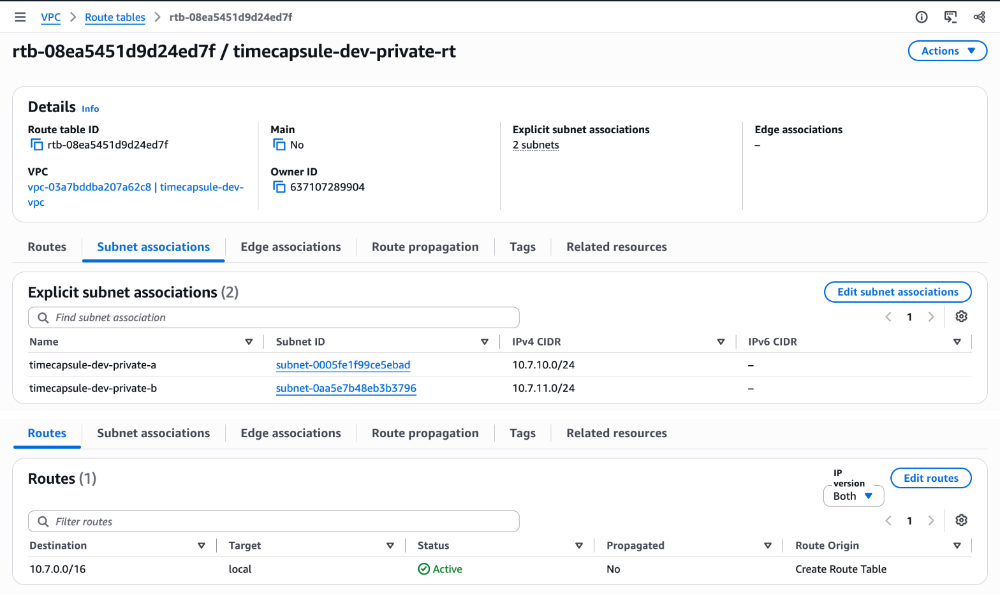
`timecapsule-dev-private-rt`: только `local`, связана с `private-a` и `private-b`.

`timecapsule-dev-igw` подключён к VPC (состояние Attached), у `public-a` и `public-b` включён
`Enable auto-assign public IPv4 address`.

**Какой маршрут есть в обеих таблицах, хотя вы его не добавляли? Что он даёт? Куда уйдёт пакет из `private-a`, адресованный `8.8.8.8`?**
Маршрут `10.7.0.0/16 → local` AWS создаёт в каждой таблице сам, удалить его нельзя. Он связывает все подсети
VPC между собой, в том числе в разных зонах доступности. Пакет из `private-a` на `8.8.8.8` не совпадает ни с
одним маршрутом `private-rt`, поэтому маршрутизатор VPC его отбрасывает: из VPC он не выйдет, отправитель
получит только таймаут (это видно в заданиях 5 и 7).

### Задание 4. Security Group

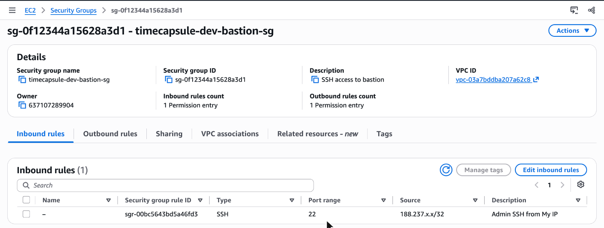
`timecapsule-dev-bastion-sg`: SSH 22 только с моего адреса `/32`.

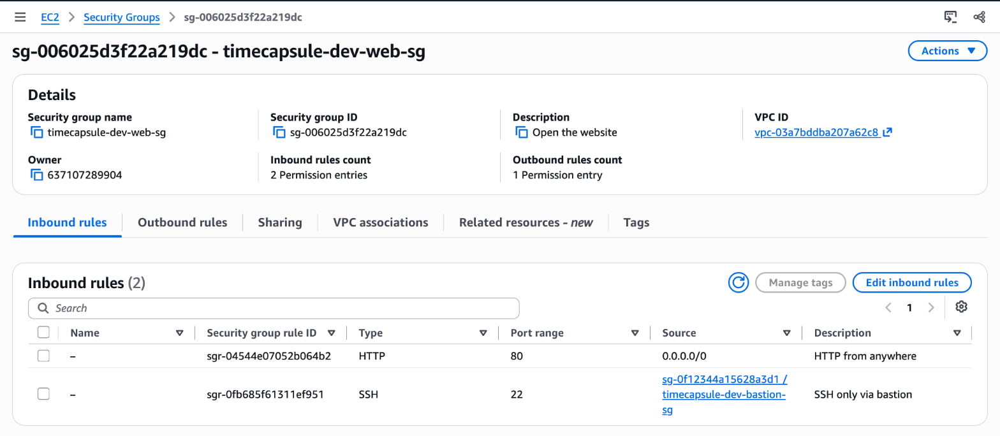
`timecapsule-dev-web-sg`: HTTP 80 из `0.0.0.0/0`, SSH 22 только от `bastion-sg`.

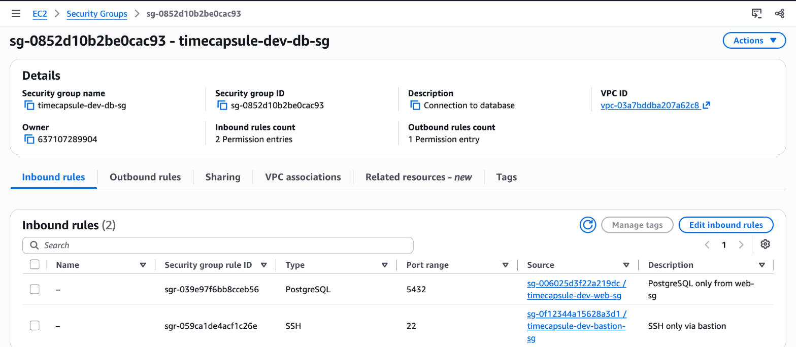
`timecapsule-dev-db-sg`: PostgreSQL 5432 только от `web-sg`, SSH 22 только от `bastion-sg`.

До исправления у всех правил был тип Custom TCP и порт 0 (значения новой строки по умолчанию), а SSH-правила
лежали в двух лишних группах `web-ssh-sg` и `db-ssh-sg`. Правила переписаны по таблице, лишние группы удалены,
у групп есть тег `Name`.

**Почему в `db-sg` источником указана группа `web-sg`, а не адрес веб-сервера или диапазон `10.7.0.0/16`?**
Источник-группа разрешает трафик от любого сетевого интерфейса с `web-sg`, какой бы у него ни был IP. В задании 8
`web-server` (`10.7.0.110`) заменил `app-server` (`10.7.0.88`), и доступ к базе заработал без правки правил.
Диапазон `10.7.0.0/16` пустил бы к базе все серверы VPC, включая bastion и будущие экземпляры, что нарушает
принцип наименьших привилегий.

### Задание 5. Экземпляры

Все три экземпляра — Amazon Linux 2023, `t3.micro`, ключ `danielmihai-keypair`, теги на экземплярах и дисках.
`bastion` в `public-b` с публичным IP и `bastion-sg`, `web-server` в `public-a` с публичным IP, `web-sg` и
User data из условия, `db-server` в `private-a` без публичного IP с `db-sg`.


Страница `http://54.93.215.183`: имя `web-server` и его приватный адрес из `10.7.0.0/24` — User data отработал.

`~/.ssh/config` в CloudShell. Отличие от условия одно: вместо `.pem` используется ключ CloudShell, который
перед подключением доставляется через EC2 Instance Connect.

```text
Host *
    StrictHostKeyChecking accept-new
    IdentitiesOnly yes
    ServerAliveInterval 30

# EC2 Instance Connect: before connecting, push the CloudShell public key to the instance
Match exec "~/bin/eic-push %n"

Host bastion
    HostName 63.178.72.70
    User ec2-user
    IdentityFile ~/.ssh/eic_ed25519

Host web
    HostName 10.7.0.110
    User ec2-user
    IdentityFile ~/.ssh/eic_ed25519
    ProxyJump bastion

Host db
    HostName 10.7.10.127
    User ec2-user
    IdentityFile ~/.ssh/eic_ed25519
    ProxyJump bastion
```

`~/bin/eic-push` находит экземпляр по тегу `Name` и кладёт на него публичный ключ:

```bash
#!/bin/bash
case "$1" in bastion|web|db|app) name="timecapsule-dev-$1" ;; *) exit 1 ;; esac
id=$(aws ec2 describe-instances --region eu-central-1 --filters "Name=tag:Name,Values=$name" \
     "Name=instance-state-name,Values=running" --query 'Reservations[0].Instances[0].InstanceId' --output text)
[ -n "$id" ] && [ "$id" != "None" ] && aws ec2-instance-connect send-ssh-public-key --region eu-central-1 \
     --instance-id "$id" --instance-os-user ec2-user --ssh-public-key "file://$HOME/.ssh/eic_ed25519.pub" >/dev/null 2>&1
exit 1   # блок Match пустой, скрипт нужен только ради побочного действия
```

С MacBook для защиты подходит конфигурация из условия (ключ лежит в `~/Downloads`, как в ЛР2):

```text
Host bastion
    HostName <публичный IP bastion>
    User ec2-user
    IdentityFile ~/Downloads/danielmihai-keypair.pem

Host app
    HostName 10.7.0.88
    User ec2-user
    IdentityFile ~/Downloads/danielmihai-keypair.pem
    ProxyJump bastion

Host db
    HostName 10.7.10.127
    User ec2-user
    IdentityFile ~/Downloads/danielmihai-keypair.pem
    ProxyJump bastion
```

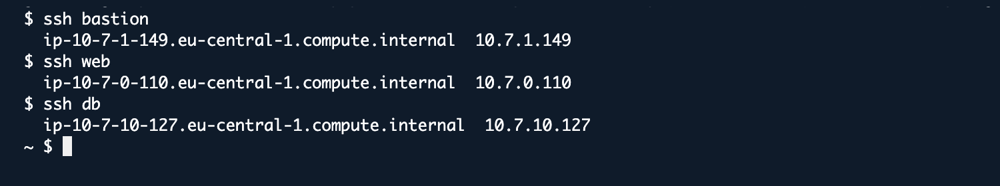
`ssh bastion`, `ssh web` и `ssh db` по очереди (в цикле, на каждом сервере выполнена `hostname`): все три подключения прошли, к `web` и `db` — через bastion.

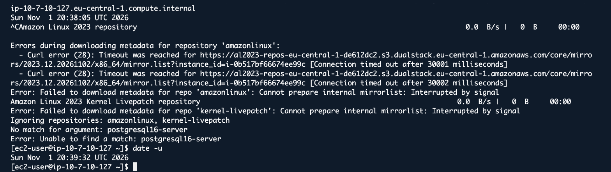
`sudo dnf -y install postgresql16-server` на `db-server` (команда запущена в 20:38:05): полторы минуты таймаутов до репозитория в S3, затем Ctrl+C.

**Почему `db-server` не может скачать пакеты, хотя `web-server` это делает? Что нужно добавить в сеть, чтобы это стало возможно, и при этом `db-server` остался недоступным из интернета?**
У `db-server` нет публичного адреса, а в `private-rt` нет маршрута `0.0.0.0/0`, поэтому пакеты к репозиторию
отбрасываются; у `web-server` есть и публичный IP, и маршрут в Internet Gateway. Нужен NAT Gateway в публичной
подсети и маршрут `0.0.0.0/0 → NAT` в `private-rt`: NAT подменяет адрес отправителя своим Elastic IP и пропускает
обратно только ответы на исходящие соединения, а входящее соединение из интернета ему некуда переслать.

### Задание 6. Временный NAT Gateway

NAT Gateway `timecapsule-dev-nat-a` создан в консоли (Zonal, `public-a`, Public, новый Elastic IP, обязательные
теги). Адрес из формы тегов не получает, поэтому тег `Name=timecapsule-dev-nat-a-eip` и обязательные теги добавлены
ему отдельно (`aws ec2 create-tags`); после перехода шлюза в Available маршрут `0.0.0.0/0` → NAT добавлен в `private-rt`.

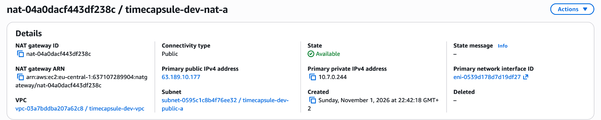
`timecapsule-dev-nat-a` в состоянии Available, его внешний адрес `63.189.10.177`.

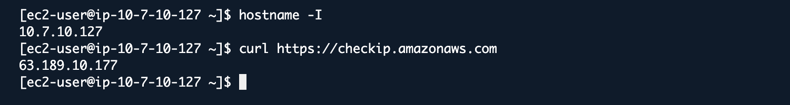
`curl https://checkip.amazonaws.com` на `db-server` вернул `63.189.10.177` — адрес NAT Gateway.

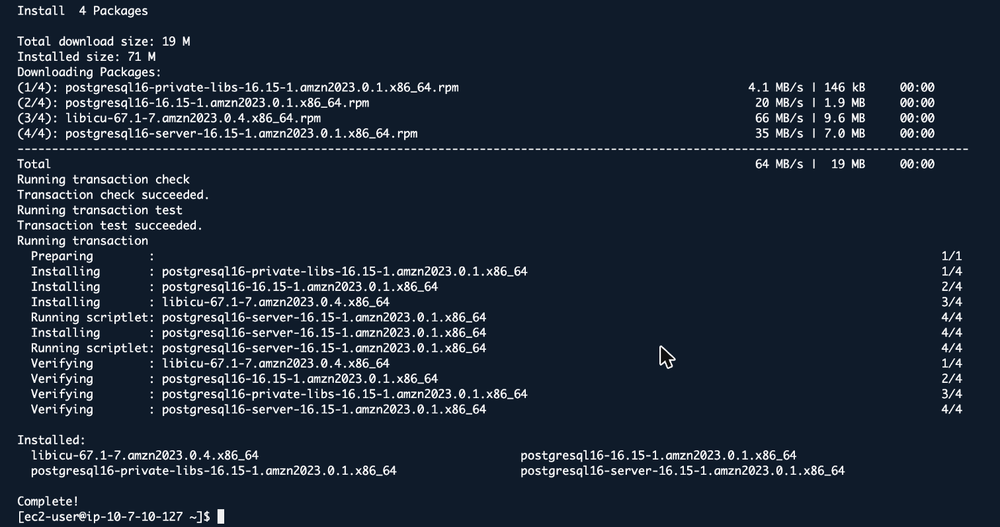
`sudo dnf -y update && sudo dnf -y install postgresql16-server` через NAT: установлен PostgreSQL 16.15.

```bash
sudo postgresql-setup --initdb
sudo sed -i "s/^#listen_addresses = 'localhost'/listen_addresses = '*'/" /var/lib/pgsql/data/postgresql.conf
echo "host  all  all  10.7.0.0/24  scram-sha-256" | sudo tee -a /var/lib/pgsql/data/pg_hba.conf
sudo systemctl enable --now postgresql
# пользователь и база для проверки; пароль сгенерирован в CloudShell и передан через переменную psql:
ssh db "sudo -u postgres psql -v pw=$(cat ~/.lab3-student.pw)" <<'SQL'
CREATE USER student WITH PASSWORD :'pw';
CREATE DATABASE lab3 OWNER student;
SQL
```

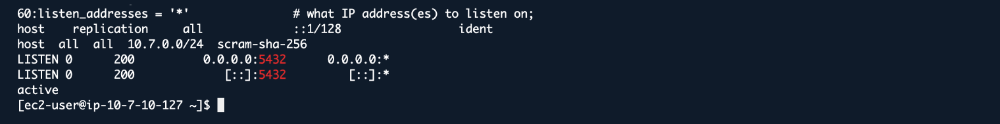
`listen_addresses = '*'`, строка для `10.7.0.0/24` в `pg_hba.conf`, PostgreSQL слушает `0.0.0.0:5432` и запущен.

**Какой адрес вернула первая команда? Сравните его с Elastic IP NAT Gateway. Почему это не адрес `db-server`?**
`63.189.10.177` — ровно Primary public IPv4 шлюза `timecapsule-dev-nat-a`. У `db-server` есть только приватный
`10.7.10.127`, который в интернете не маршрутизируется. NAT Gateway заменяет адрес отправителя своим Elastic IP и
по таблице соединений возвращает ответы `db-server`, поэтому сайт видит адрес шлюза.

**Доступ к базе теперь ограничивают три механизма: отсутствие публичного адреса и маршрута в Internet Gateway, Security Group `db-sg` и файл `pg_hba.conf`. Что делает каждый из них? Что произойдёт, если ошибиться только в одном?**
Отсутствие адреса и маршрута делает сервер недостижимым из интернета на уровне сети: к нему просто не по чему
обратиться. `db-sg` фильтрует трафик на сетевом интерфейсе внутри VPC: 5432 только от `web-sg`, 22 только от
`bastion-sg`. `pg_hba.conf` решает уже в самом PostgreSQL, какой пользователь, в какую базу, с каких адресов и
каким способом входит. Ошибка в одном механизме прикрыта двумя другими: например, правило 5432 ← `0.0.0.0/0` в
`db-sg` откроет порт только для серверов VPC, а для них остаются `pg_hba.conf` и пароль.

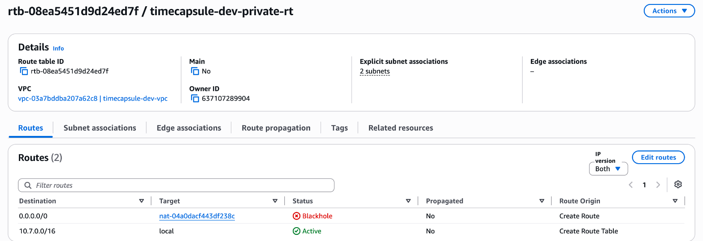
После удаления шлюза маршрут `0.0.0.0/0` в `private-rt` перешёл в состояние Blackhole; затем он удалён.

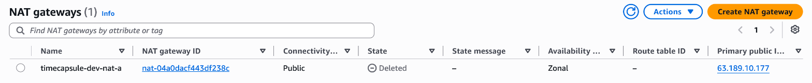
`timecapsule-dev-nat-a` в состоянии Deleted; Elastic IP `timecapsule-dev-nat-a-eip` освобождён.

**Почему PostgreSQL продолжает работать после удаления NAT Gateway? Что придётся сделать, когда на `db-server` понадобится установить обновления безопасности?**
NAT нужен только для соединений, которые `db-server` сам открывает в интернет, а подключения к PostgreSQL идут
изнутри VPC по маршруту `local`; пакеты уже установлены на диск. Для обновлений придётся снова временно поднять
NAT Gateway, выполнить `sudo dnf -y update` и убрать шлюз — в задании 13 это делают скрипты `nat-up.sh` и `nat-down.sh`.

### Задание 7. Проверки

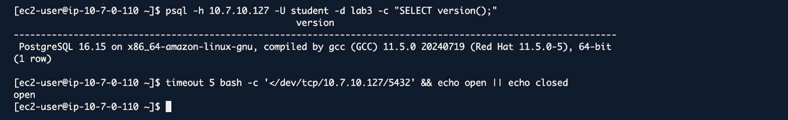
С `web-server`: `psql` к `lab3` вернул версию PostgreSQL 16.15, порт 5432 `open`. Пароль `psql` взял из
`~/.pgpass` (права 600), записанного туда из CloudShell, поэтому не спрашивал его и на экране его нет.


С `bastion` тот же порт `closed`.

**Почему с `web-server` порт открыт, а с `bastion` нет, хотя оба сервера в одной VPC и маршрут между ними есть?**
Маршрут `local` только доставляет пакеты, а решение принимает `db-sg` на интерфейсе `db-server`. Правило 5432
разрешает источник `web-sg`; у bastion группа `bastion-sg`, поэтому его SYN молча отбрасывается и проверка
заканчивается таймаутом.

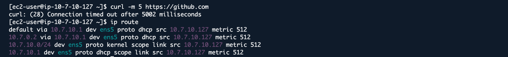
С `db-server` `curl -m 5 https://github.com` обрывается по таймауту; маршрут по умолчанию ведёт на маршрутизатор VPC `10.7.10.1`.

**Почему запрос не проходит? Можно ли из интернета подключиться к порту 5432 `db-server`? Объясните по цепочке: маршрут, адрес, фильтры.**
Имя `github.com` разрешается через DNS VPC (`10.7.0.2`), но в `private-rt` для публичного адреса нет маршрута,
и маршрутизатор VPC отбрасывает пакет. Из интернета подключиться нельзя: у `db-server` нет публичного адреса,
приватный `10.7.10.127` в интернете не маршрутизируется, а Internet Gateway транслирует только адреса экземпляров,
у которых есть публичный IP. Даже если бы пакет дошёл, его отбросили бы `db-sg` (5432 только от `web-sg`)
и `pg_hba.conf` (только `10.7.0.0/24` и пароль).

**Network ACL.** «Мой компьютер» в этой работе — CloudShell, поэтому правило 90 `Deny` поставлено на его адрес
`3.123.28.174/32` (он же был в правиле `bastion-sg`). Роль «телефона в мобильной сети» играл браузер на моём
ноутбуке: у него другой внешний адрес.

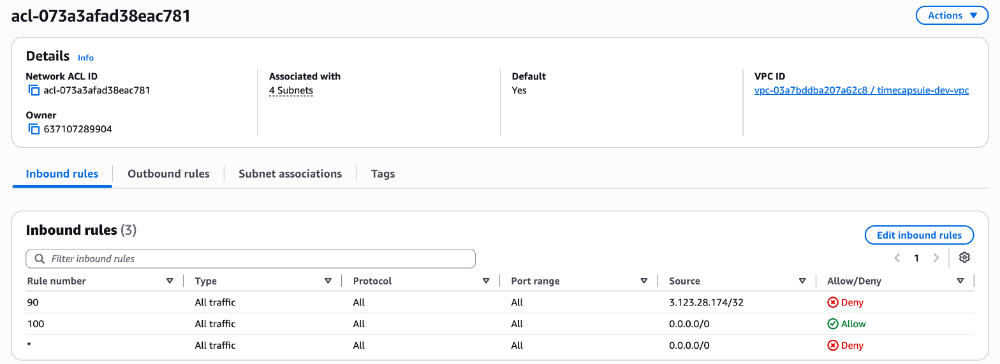
Network ACL по умолчанию для `timecapsule-dev-vpc` (связан со всеми 4 подсетями): правило 90 `Deny` для адреса CloudShell перед правилом 100 `Allow`.


Из CloudShell не проходит ни `ssh bastion`, ни запрос к сайту `web-server`.


В то же время браузер с другим адресом открывает сайт: страница загружена заново (`fetch` с `cache: 'no-store'` вернул 200).


После удаления правила 90 SSH и сайт из CloudShell снова работают.

**Почему заблокировано и SSH, и сайт, хотя вы не меняли ни одной Security Group? Почему с телефона сайт открывается? Почему правило должно иметь номер меньше 100?**
Network ACL фильтрует трафик на границе подсети до Security Group и не помнит соединений; правило 90 запрещает
весь трафик с моего адреса во все подсети VPC, поэтому и SSH к bastion, и HTTP к `web-server` отбрасываются,
не дойдя до групп. С другого адреса правило 90 не совпадает, срабатывает правило 100 `Allow`. Правила проверяются
по возрастанию номеров до первого совпадения: запрет с номером больше 100 никогда бы не сработал, потому что
правило 100 разрешает всё раньше.

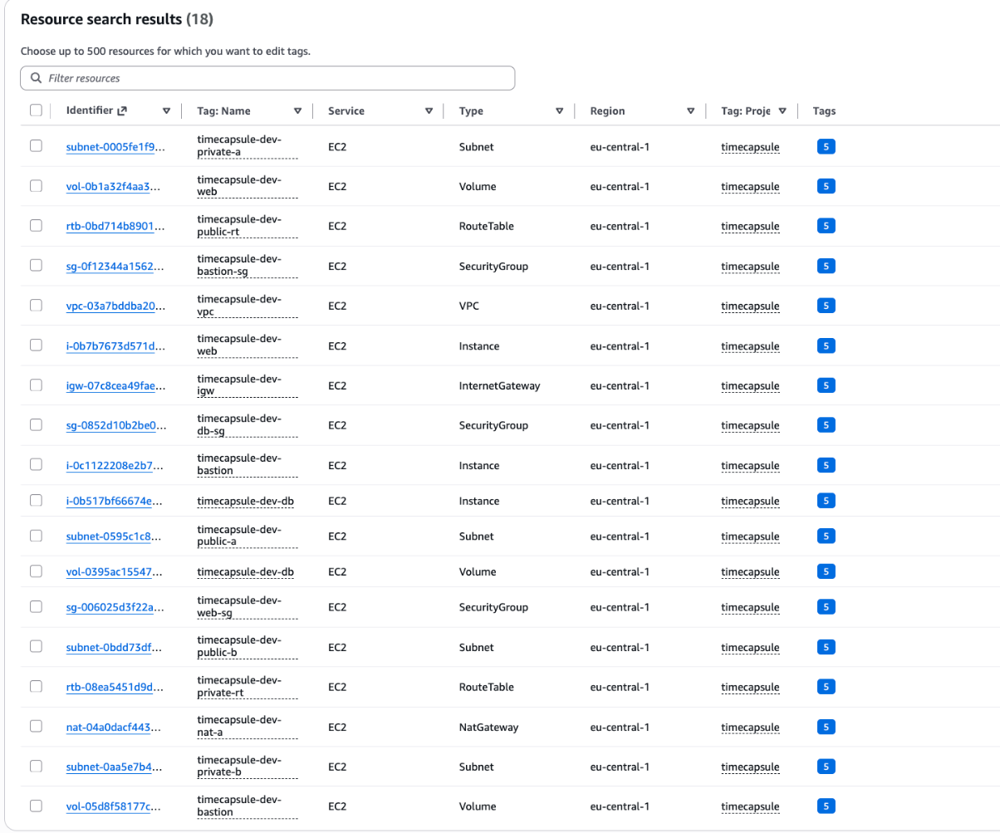
Tag Editor, `eu-central-1`, `Project = timecapsule`: 18 ресурсов с 5 тегами — VPC, 4 подсети, Internet Gateway, 2 таблицы маршрутов, 3 Security Group, 3 экземпляра, 3 диска и удалённый NAT Gateway (виден около часа после удаления).

**Как по тегам найти все ресурсы, которые нужно удалить после окончания проекта? Зачем нужен тег `Owner`, если аккаунт у вас личный?**
В Tag Editor (или `aws resourcegroupstaggingapi get-resources --tag-filters Key=Project,Values=timecapsule`)
выбрать регион, все типы ресурсов и тег `Project=timecapsule` (при необходимости `Lab=lab3`), выгрузить список в
CSV и удалять по нему; эти же теги в Billing показывают расходы проекта. `Owner` нужен потому, что соглашение
должно работать одинаково в любом аккаунте: доступ к аккаунту может получить преподаватель или команда, ресурсы
создают скрипты, а политики тегов и отчёты по расходам работают, только если тег стоит везде.

Экземпляры не останавливались между частями: Часть 2 выполнялась сразу после Части 1. Остановка — в разделе [Итог](#итог).

---

## Часть 2. Продвинутый уровень

### Задание 8. Перенос сервера ЛР2 в новую сеть

Из запущенного `webserver` ЛР2 (`i-05f2b6c4d88f8b084`) создан образ `timecapsule-dev-app-lab2`
(`ami-0309a4426d5aaf0ea`, теги на образе и снимке), из него в `public-a` с `web-sg` запущен `timecapsule-dev-app`
(`i-08dd33ebb505096f4`, `10.7.0.88`). В `~/.ssh/config` добавлена запись `Host app` по образцу `web`,
`web-server` из Части 1 завершён.

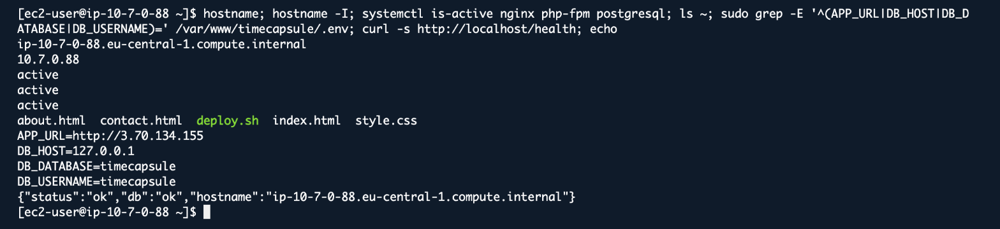
`ssh app`: на новом сервере без всякой установки работают nginx, PHP-FPM и локальный PostgreSQL, в домашней папке `deploy.sh` и сайт из ЛР2, в `.env` ещё старые `APP_URL` и `DB_HOST=127.0.0.1`, `/health` отвечает `ok`.

**Что содержит образ? Какие данные из ЛР2 оказались на `app-server` без всякой установки? Где сейчас хранится база данных приложения?**
Образ — это снимок корневого диска EBS и описание запуска (архитектура, разметка дисков, способ загрузки).
На `app-server` сразу оказались система со всеми пакетами (nginx, PHP 8.4, Composer, PostgreSQL 16), конфигурация
nginx, код в `/var/www/timecapsule` с `vendor`, `.env` с `APP_KEY`, загруженные файлы, `deploy.sh` и даже
журнал входов. База в этот момент хранится локально на `app-server` (`DB_HOST=127.0.0.1`) — это копия базы ЛР2
на момент снимка, независимая от исходного сервера.

### Задание 9. Elastic IP

Выделен `timecapsule-dev-app-eip` (`3.64.208.134`, `eipalloc-08f2987094f4f8851`) с тегами и привязан к `timecapsule-dev-app`.

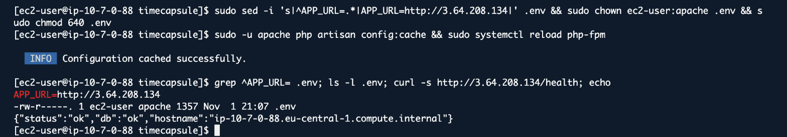
`APP_URL=http://3.64.208.134`, кэш настроек Laravel пересобран, PHP-FPM перезагружен, `/health` по Elastic IP — `ok`.

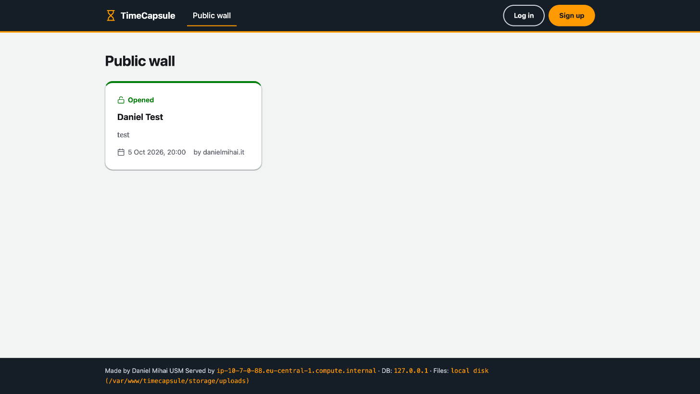
TimeCapsule по Elastic IP: капсула «Daniel Test» пользователя из ЛР2 (`danielmihai.it`) на Public wall, в подвале `app-server` (`ip-10-7-0-88`) и пока локальная база `127.0.0.1`.

Пользователь ЛР2 на месте (в базе 2 пользователя и 2 капсулы, см. задание 12), но пароль от его аккаунта не
сохранился, поэтому данные ЛР2 показаны через Public wall, которая открывается без входа.

**Почему Elastic IP нужен `app-server`, но не нужен bastion? Сколько стоит Elastic IP, пока сервер остановлен, и почему? Когда в следующих работах перед сервером появится балансировщик нагрузки, понадобится ли Elastic IP?**
Адрес `app-server` знают пользователи и `APP_URL`, его смена ломает ссылки; адрес bastion нужен только мне, и
новый достаточно вписать в `~/.ssh/config`, а сам bastion можно держать остановленным. Elastic IP стоит $0,005 в
час всегда, в том числе у остановленного сервера: AWS берёт плату за каждый публичный IPv4, потому что адрес
закреплён за аккаунтом и недоступен другим. С балансировщиком Elastic IP не понадобится: точкой входа станет
DNS-имя балансировщика, а серверы приложения уйдут в приватные подсети.

### Задание 10. База данных приложения на `db-server`

На `db-server` созданы пользователь `timecapsule` с новым случайным паролем (сгенерирован в CloudShell) и база
`timecapsule`; строка `pg_hba.conf` из задания 6 заменена на более строгую.

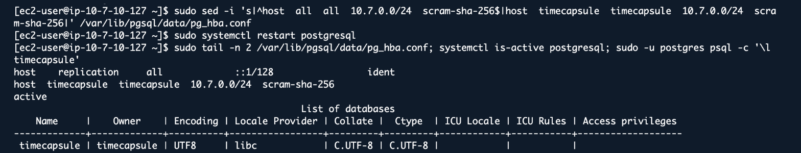
`pg_hba.conf` пускает только пользователя `timecapsule` в базу `timecapsule` из `10.7.0.0/24`, PostgreSQL перезапущен, база принадлежит `timecapsule`.

**Зачем для базы в отдельной сети нужен новый сильный пароль, если порт 5432 и так закрыт Security Group?**
Security Group защищает только от чужих адресов, а любой, кто получит доступ к `app-server` (уязвимость в коде,
украденный ключ), окажется в `web-sg` и дотянется до 5432. Старый пароль ЛР2 лежит в `.env` старого сервера и
в снимке образа, то есть уже разошёлся по копиям. Новый длинный случайный пароль не подобрать перебором,
а `scram-sha-256` не передаёт его по сети в открытом виде.

### Задание 11. Приватная зона Route 53

Зона `timecapsule.internal` (Private, связана с `timecapsule-dev-vpc`, теги) и запись `db` типа A на `10.7.10.127` с TTL 60.

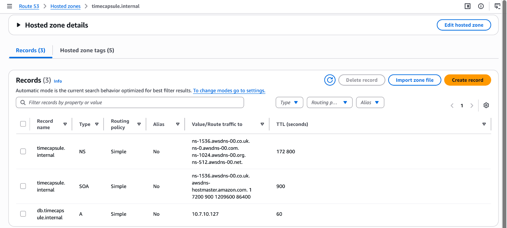
Записи зоны `timecapsule.internal`: NS, SOA и `db.timecapsule.internal A 10.7.10.127`, TTL 60.

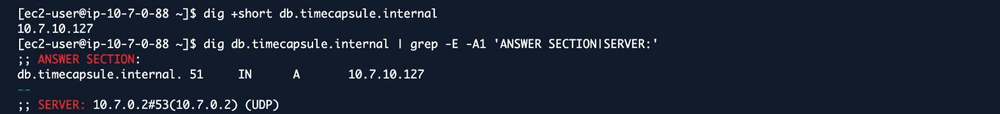
С `app-server` имя разрешается в `10.7.10.127`, отвечает DNS-сервер VPC `10.7.0.2`.


Из CloudShell (вне VPC) `dig` возвращает пустой ответ, `nslookup` — `NXDOMAIN`.

**Почему с `app-server` имя находится, а с вашего компьютера нет? Что придётся изменить, если `db-server` пересоздадут с другим адресом?**
Приватная зона связана только с `timecapsule-dev-vpc`, и отвечает на неё лишь Route 53 Resolver внутри этой VPC
(`10.7.0.2`); публичный DNS и резолвер CloudShell о ней не знают. Если `db-server` пересоздадут, достаточно
поменять адрес в записи `db`: через TTL (60 секунд) приложение начнёт ходить на новый сервер, `.env` не меняется.

### Задание 12. Перенос данных и переключение приложения

Пароли старой и новой базы записаны на `app-server` в `~/.pgpass` (права 600), поэтому команды из условия
выполнены без ввода паролей на экране; после переноса дамп и `~/.pgpass` удалены.

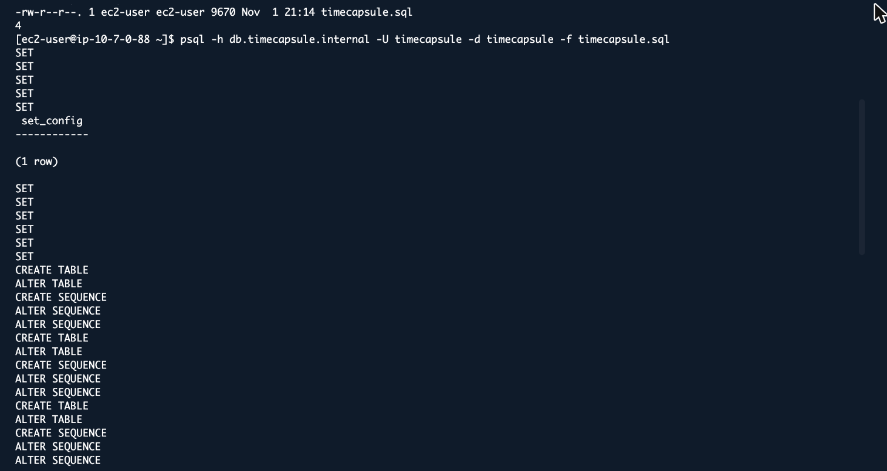
`pg_dump` локальной базы ЛР2 в `timecapsule.sql` и загрузка в новую базу `psql -h db.timecapsule.internal ... -f timecapsule.sql` без ошибок.

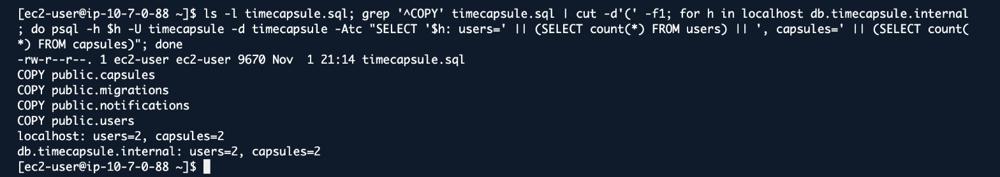
В старой и новой базе одинаково: 2 пользователя и 2 капсулы.

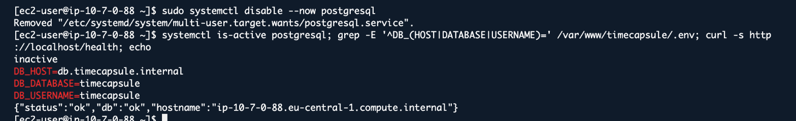
`DB_HOST=db.timecapsule.internal` и новый `DB_PASSWORD` в `.env`, `config:cache`, reload PHP-FPM; локальный PostgreSQL выключен (`inactive`), а `/health` отвечает `"db":"ok"`.

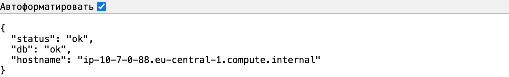
`/health` в браузере по Elastic IP.

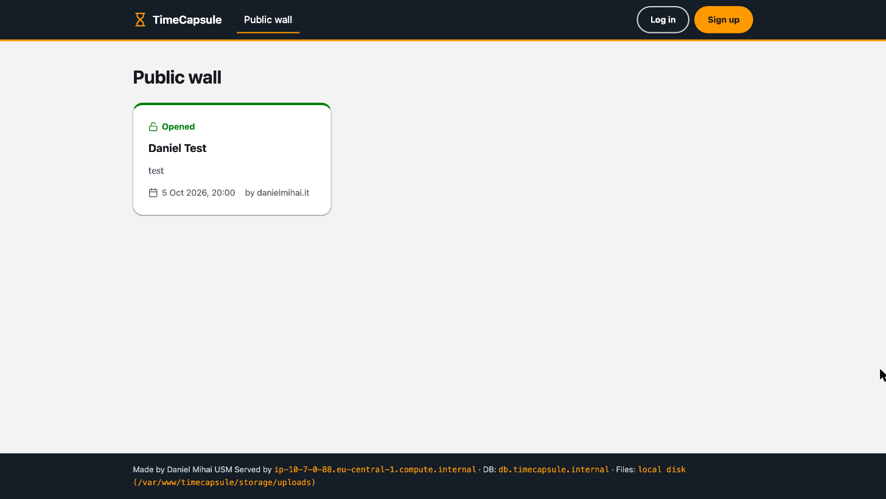
Капсула из ЛР2 на месте, в подвале теперь `DB: db.timecapsule.internal`.

Образ `timecapsule-dev-app-lab2` (`ami-0309a4426d5aaf0ea`) и его снимок `snap-0818db1b061eb71ce` больше не нужны:
приложение работает с новой базой. Они удаляются вручную в консоли EC2 (AMIs → Deregister AMI, затем Snapshots →
Delete snapshot); пока снимок существует, он оплачивается.

**Файлы, которые пользователи прикрепили к капсулам, переехали вместе с образом, а не вместе с базой. Где они лежат? Что с ними будет, если `app-server` удалить?**
Они лежат в `/var/www/timecapsule/storage/uploads` на корневом диске EBS `app-server` (в подвале: Files: local
disk). У корневого диска включён Delete on termination, поэтому при удалении `app-server` файлы пропадут навсегда,
а в базе останутся ссылки на несуществующие файлы. Чтобы файлы пережили сервер, их выносят в S3 или на отдельный
том EBS со снапшотами.

### Задание 13. Деплой и обслуживание

**Новая версия.** В подвал `resources/views/layouts/app.blade.php` добавлена строка «LR3» (коммит `aca2a17 LR3: add footer line`), выпуск — вариант B: `ssh app ./deploy.sh`.

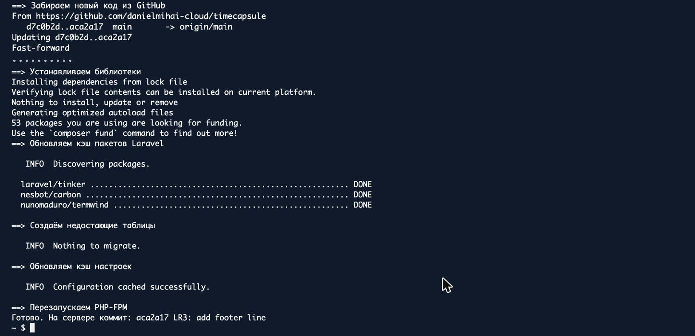
`ssh app ./deploy.sh` из CloudShell через bastion (середина вывода с перечнем файлов `git pull` пропущена): на сервере коммит `aca2a17`.

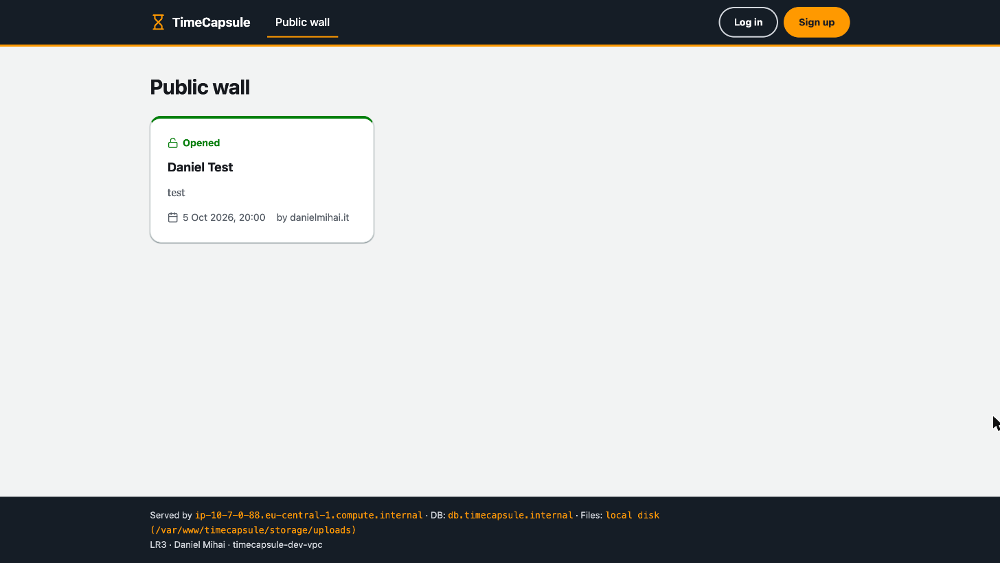
Строка «LR3 · Daniel Mihai · timecapsule-dev-vpc» в подвале, база `db.timecapsule.internal`.

**Почему в самом `deploy.sh` (или в командах варианта A) ничего менять не пришлось?**
`deploy.sh` выполняется на самом сервере и работает только с локальными путями и командами (`git pull` с GitHub,
`composer`, `artisan`, PHP-FPM), о сети и адресах он ничего не знает. Изменился только путь до сервера, а его
прячет `~/.ssh/config`: `ssh app` сам идёт через bastion. Адрес базы скрипт берёт из `.env` и пересобирает кэш
настроек, поэтому новое `DB_HOST` подхватилось автоматически.

**Отказ базы.** `db-server` остановлен, затем запущен снова; на `app-server` ничего не менялось.

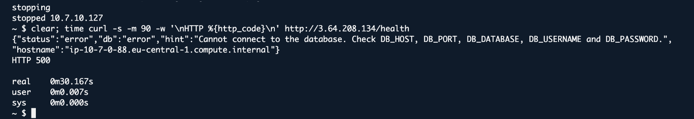
При остановленном `db-server` `/health` ответил HTTP 500 и `"db":"error"` только через 30 секунд.

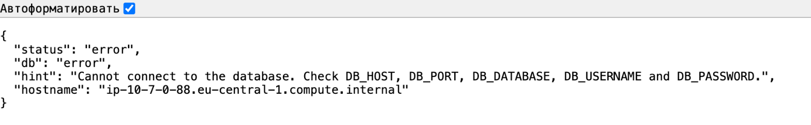
То же в браузере.

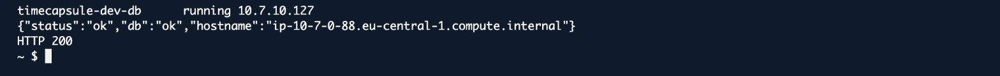
После запуска `db-server` сохранил адрес `10.7.10.127`, приложение заработало само.

**Что показал `/health` и почему? Изменился ли приватный адрес `db-server` после остановки и запуска?**
`/health` вернул HTTP 500 с `"status":"error","db":"error"` и подсказкой проверить настройки базы: имя по-прежнему
разрешалось в `10.7.10.127`, но остановленный сервер не отвечал, и приложение ждало соединения около 30 секунд.
Приватный адрес не изменился: он принадлежит основному сетевому интерфейсу, который сохраняется при
Stop/Start, поэтому запись `db` осталась верной и после запуска (PostgreSQL включён в автозапуск) всё заработало
без правок.

**Обновление пакетов на `db-server` (вариант B, специальность Informatică).** Скрипты
[`scripts/nat-up.sh`](../../scripts/nat-up.sh) и [`scripts/nat-down.sh`](../../scripts/nat-down.sh): ID подсети и
таблицы в переменных в начале, `AWS_REGION=eu-central-1`, `set -euo pipefail`, имена и обязательные теги через
`--tag-specifications`, ID шлюза и адреса в файле `scripts/.nat-state`, который добавлен в `.gitignore`.
Скрипты загружены в репозиторий через веб-интерфейс GitHub, поэтому бит исполнения выставлен в CloudShell
(`chmod +x`).

```bash
git clone https://github.com/danielmihai-cloud/timecapsule.git && cd timecapsule
chmod +x scripts/*.sh
./scripts/nat-up.sh
ssh db      # на db-server: curl -s https://checkip.amazonaws.com; sudo dnf -y update --refresh; exit
./scripts/nat-down.sh
```

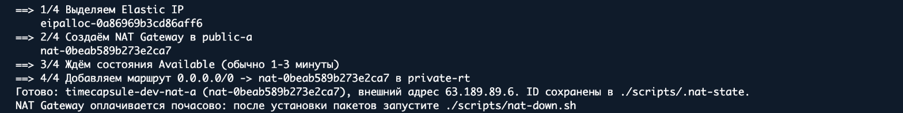
`nat-up.sh`: Elastic IP, NAT Gateway в `public-a`, ожидание Available, маршрут в `private-rt`.

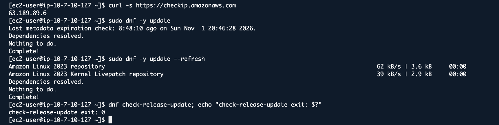
`db-server` выходит в интернет с адреса нового шлюза `63.189.89.6`; `dnf update --refresh` скачал свежие метаданные — обновлений нет, система актуальна, новой версии Amazon Linux тоже нет.

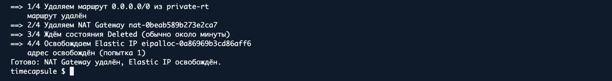
`nat-down.sh`: маршрут удалён, шлюз удалён, Elastic IP освобождён с первой попытки.

**Почему `nat-down.sh` должен освобождать Elastic IP только после того, как NAT Gateway удалён?**
Пока шлюз существует, Elastic IP привязан к его сетевому интерфейсу, а отвязать его от NAT Gateway вручную
нельзя: `release-address` вернёт ошибку, и из-за `set -e` скрипт остановится, оставив шлюз работать. Поэтому
порядок — маршрут, шлюз, ожидание `Deleted`, адрес; и даже после `Deleted` шлюз отпускает адрес не сразу, поэтому
в скрипте несколько попыток с паузой.

---

## Архитектура и ADR

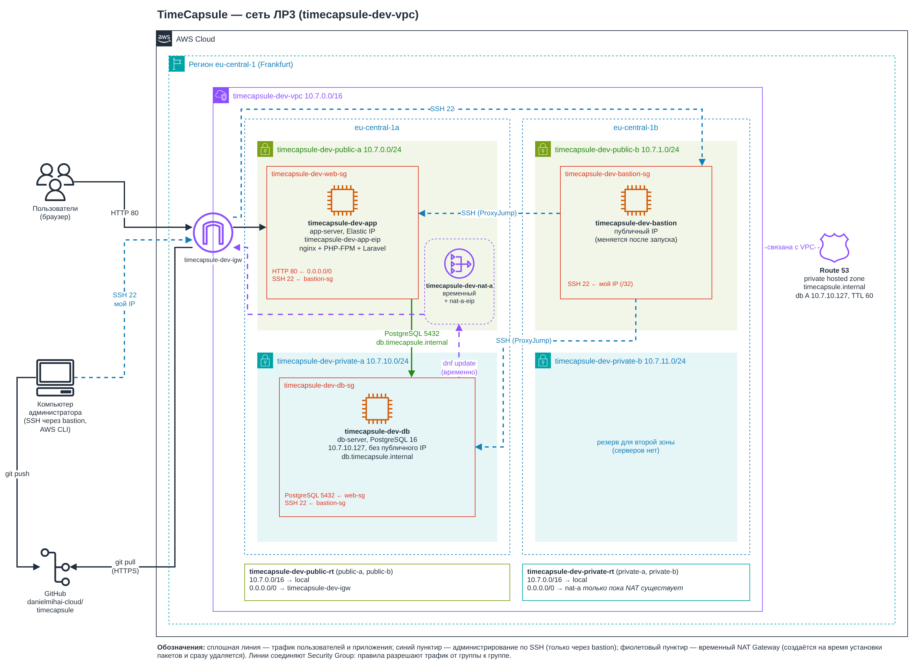

Схема обновлена по сравнению с ЛР2 ([deployment.png](../architecture/deployment.png)) и нарисована в draw.io
с иконками AWS ([исходник](../architecture/network-lab3.drawio)), отдельным файлом, чтобы отчёт ЛР2 не изменился.
Вне AWS — пользователи, компьютер администратора и GitHub. Внутри региона `eu-central-1` —
`timecapsule-dev-vpc` с двумя зонами и четырьмя подсетями, Internet Gateway на границе VPC, три сервера в своих
Security Group, приватная зона Route 53 и временный NAT Gateway пунктиром. Линии соединяют группы, потому что
правила разрешают трафик от группы к группе.

Решение о размещении базы: [ADR-0002. Где размещать базу данных](../adr/0002-database-placement.md). В нём
сравниваются база на сервере приложения, на отдельном сервере в публичной подсети, в приватной подсети
(выбрано) и Amazon RDS.

## Итог

После работы удалено временное правило CloudShell в `bastion-sg` (осталось только SSH с моего IP),
`bastion`, `app-server` и `db-server` остановлены. `webserver` из ЛР2 больше не нужен — его приложение и данные
теперь в `timecapsule-dev-vpc`; он завершается вручную (Instance state → Terminate) вместе с удалением образа ЛР2.

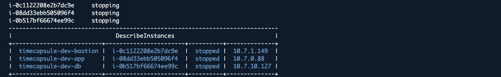
`timecapsule-dev-bastion`, `timecapsule-dev-app` и `timecapsule-dev-db` в состоянии stopped, приватные адреса сохранены.

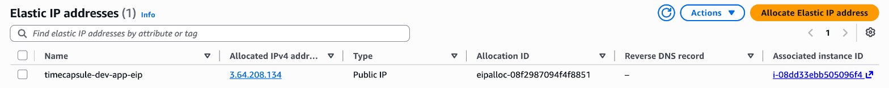
В Elastic IPs остался только `timecapsule-dev-app-eip`, привязанный к `app-server`.

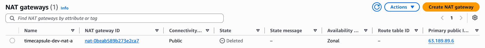
В NAT gateways нет шлюзов в состоянии Available: шлюз из `nat-up.sh` в состоянии Deleted, шлюз из задания 6 уже пропал из списка.

VPC, подсети, Security Group и зона Route 53 оставлены для следующих работ.

## Контрольные вопросы

**1. Как проходит запрос пользователя от браузера до базы данных? Какие маршруты и какие правила фильтрации он проходит на каждом шаге?**
Браузер отправляет HTTP-запрос на Elastic IP `3.64.208.134`; Internet Gateway заменяет его на приватный
`10.7.0.88`, Network ACL `public-a` пропускает трафик (правило 100), `web-sg` — порт 80 из `0.0.0.0/0`.
nginx передаёт запрос PHP-FPM, Laravel разрешает `db.timecapsule.internal` через DNS VPC (`10.7.0.2`, приватная
зона) в `10.7.10.127` и открывает TCP 5432: маршрут `local` из `public-rt`, Network ACL `private-a`, `db-sg`
(5432 от `web-sg`), затем `pg_hba.conf` (пользователь `timecapsule`, база `timecapsule`, `10.7.0.0/24`,
`scram-sha-256`). Ответы идут тем же путём: Security Group запоминает соединения, Network ACL по умолчанию
пропускает всё, Internet Gateway подставляет обратно Elastic IP.

**2. Злоумышленник знает приватный IP `db-server`. Что ему нужно получить, чтобы подключиться к базе?**
Сам по себе приватный адрес бесполезен: из интернета он не маршрутизируется. Нужно оказаться внутри VPC в группе
`web-sg` — то есть взломать `app-server` (уязвимость приложения или SSH через bastion, а для этого приватный ключ
и разрешённый в `bastion-sg` адрес) — и знать пароль `timecapsule`, который лежит в `.env` на том же сервере.
Другой путь — учётные данные AWS с правом менять Security Group, маршруты и адреса.

**3. Чем временный NAT Gateway лучше постоянного, и какие неудобства он создаёт?**
Он стоит центы вместо ~$38 в месяц, а большую часть времени у базы нет пути в интернет: вредоносный код не
сможет ничего скачать или отправить данные наружу. Неудобства: обновления ставятся вручную и с задержкой,
о процедуре легко забыть (тогда база без исправлений) или забыть удалить шлюз (тогда растёт счёт), каждый раз
приходится ждать создания шлюза, а внешние сервисы с базы недоступны.

**4. Как изменится схема, если приложение должно пережить отказ зоны `eu-central-1a`? Каких ресурсов для этого не хватает?**
Сейчас в `eu-central-1a` и `app-server`, и `db-server`, и NAT Gateway, а `public-b`/`private-b` почти пустые.
Нужны второй сервер приложения в `public-b` (лучше Auto Scaling Group по двум зонам) за Application Load
Balancer, реплика базы в `private-b` с переключением (или RDS Multi-AZ), загруженные файлы и сессии в общем
хранилище (S3, база или Redis), а не на локальном диске, и, если NAT станет постоянным, по шлюзу в каждой зоне.

## Вывод

В регионе `eu-central-1` вручную построена сеть `timecapsule-dev-vpc`: план адресов, четыре подсети в двух зонах,
Internet Gateway и две таблицы маршрутов, три Security Group, ссылающиеся друг на друга, bastion для SSH.
Проверено, что подсеть становится публичной только маршрутом в Internet Gateway, что приватный сервер выходит в
интернет только через NAT Gateway, а Network ACL срабатывает раньше Security Group. Приложение ЛР2 перенесено
образом на `app-server` с Elastic IP, база вынесена на `db-server` в приватной подсети с доступом по имени
`db.timecapsule.internal`, данные переехали через `pg_dump`. Для обслуживания базы написаны скрипты
временного NAT Gateway, выпуск новой версии остался одной командой `ssh app ./deploy.sh`. По ходу работы
исправлены ошибки предварительной настройки (правила Security Group с портом 0, имена и теги), а все ресурсы
названы и помечены по соглашению.

## Источники

1. Лекция 5 «Виртуальные сети в облаке. Amazon VPC», Hands-on 5.1.
2. Условие лабораторной работы №3: [MSU-Courses/cloud-computing, Lab/03_Cloud_Networking](https://github.com/MSU-Courses/cloud-computing/tree/main/Lab/03_Cloud_Networking).
3. Amazon VPC User Guide: Subnet CIDR blocks, Route tables, Internet gateways, NAT gateways, Security groups, Network ACLs.
4. Amazon VPC pricing (NAT Gateway, публичные IPv4-адреса).
5. Amazon EC2 User Guide: EC2 Instance Connect, Elastic IP addresses, Create an AMI.
6. Amazon Route 53 Developer Guide: Working with private hosted zones.
7. PostgreSQL 16 Documentation: `pg_hba.conf`, `pg_dump`, файл паролей `.pgpass`.
8. AWS Architecture Icons, draw.io.
