# Лабораторная работа №4. Облачные хранилища. Amazon S3

| | |
|---|---|
| **Студент** | Daniel Mihai |
| **Группа** | `I2402` |
| **Специальность** | Informatică |
| **Уровень** | продвинутый (Часть 1 и Часть 2, задания 1–14) |
| **Приложение** | TimeCapsule из ЛР2 и ЛР3 (Laravel 12, PHP 8.4, PostgreSQL 16) |
| **Регион** | `eu-central-1` (Frankfurt) |
| **Репозиторий** | https://github.com/danielmihai-cloud/timecapsule |
| **Модуль хранения** | [app/Services/CapsuleStorage.php](../../app/Services/CapsuleStorage.php) |
| **Схема** | [docs/architecture/storage-lab4.png](../architecture/storage-lab4.png) (исходник [storage-lab4.svg](../architecture/storage-lab4.svg)) |
| **ADR** | [docs/adr/0003-attachment-storage.md](../adr/0003-attachment-storage.md) |

Отчёты прошлых работ: ЛР2 — [README.md](../../README.md), ЛР3 — [docs/lab3/README.md](../lab3/README.md).

> **Как выполнялась работа.** Вся работа сделана под IAM-пользователем `cloudstudent` (группа `Admins`), не под
> root: в задании 8 роль берёт на себя пользователь, а root этого сделать не может. Команды выполнялись в
> AWS CloudShell `eu-central-1`. `nickname` в именах — `danielmihai`, как в теге `Owner` из ЛР3.
> К `app-server` CloudShell подключался по SSH через bastion, как в ЛР3: перед каждым подключением
> `~/bin/eic-push` кладёт на экземпляр временный публичный ключ через EC2 Instance Connect, а в `bastion-sg` на
> время работы было добавлено правило SSH с адреса CloudShell (после работы удалено). Подписанные URL на
> скриншотах уже просрочены; там, где ссылка видна целиком, токен сессии и подпись размыты или обрезаны.

### Ресурсы

| Ресурс | Имя | ARN / ID |
|---|---|---|
| Бакет S3 | `timecapsule-dev-uploads-danielmihai` | `arn:aws:s3:::timecapsule-dev-uploads-danielmihai` |
| Правило жизненного цикла | `timecapsule-dev-noncurrent` | префикс `uploads/` |
| Политика IAM | `timecapsule-dev-app-s3` | `arn:aws:iam::637107289904:policy/timecapsule-dev-app-s3` |
| Тестовая роль | `timecapsule-dev-s3-tester` | `arn:aws:iam::637107289904:role/timecapsule-dev-s3-tester` |
| Роль сервера | `timecapsule-dev-app-role` | `arn:aws:iam::637107289904:role/timecapsule-dev-app-role` + профиль экземпляра с тем же именем |
| app-server (из ЛР3) | `timecapsule-dev-app` | `i-08dd33ebb505096f4`, `10.7.0.88`, Elastic IP `3.64.208.134` |

На новых ресурсах теги `Name`, `Project=timecapsule`, `Environment=dev`, `Owner=danielmihai`, `Lab=lab4`.

## Содержание

- [Часть 1. Базовый уровень](#часть-1-базовый-уровень)
- [Часть 2. Продвинутый уровень](#часть-2-продвинутый-уровень)
- [Архитектура и ADR](#архитектура-и-adr)
- [Итог](#итог)
- [Контрольные вопросы](#контрольные-вопросы)
- [Вывод](#вывод)
- [Источники](#источники)

---

## Часть 1. Базовый уровень

### Задание 1. Бакет и объекты в консоли

Бакет `timecapsule-dev-uploads-danielmihai`: тип General purpose, ACLs disabled (Bucket owner enforced),
Block all public access, версионирование выключено, шифрование SSE-S3, пять обязательных тегов.

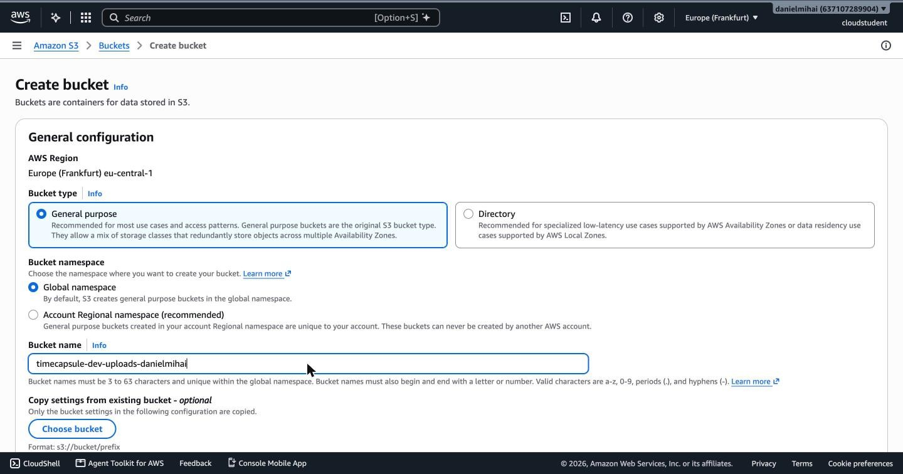
Регион `eu-central-1`, тип General purpose, имя бакета.

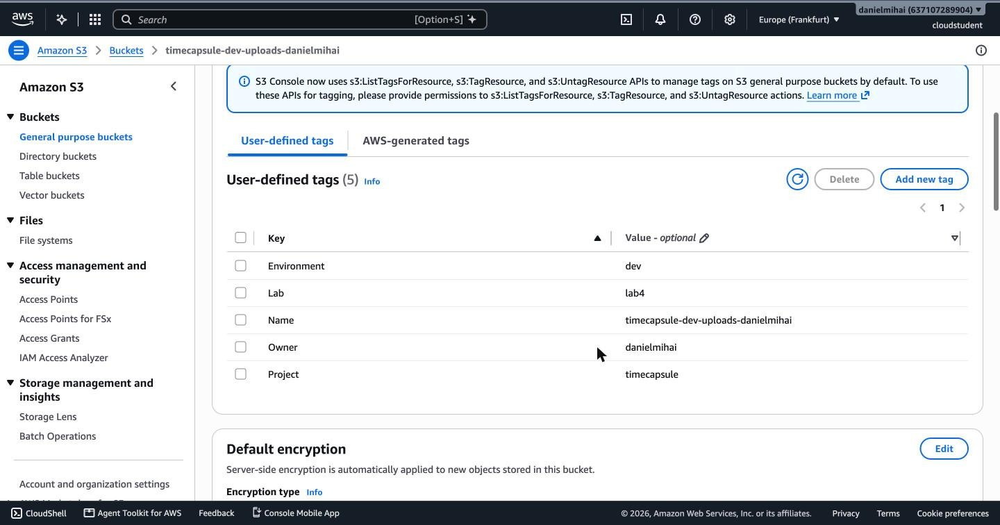
Properties → Tags: `Name`, `Project=timecapsule`, `Environment=dev`, `Owner=danielmihai`, `Lab=lab4`.

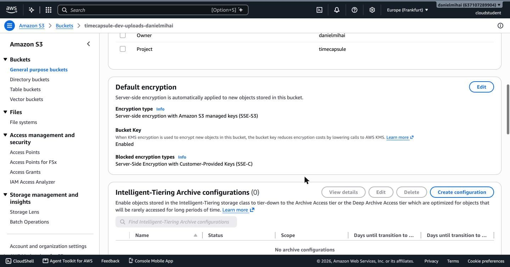
Properties → Default encryption: SSE-S3 (ключи под управлением Amazon S3).

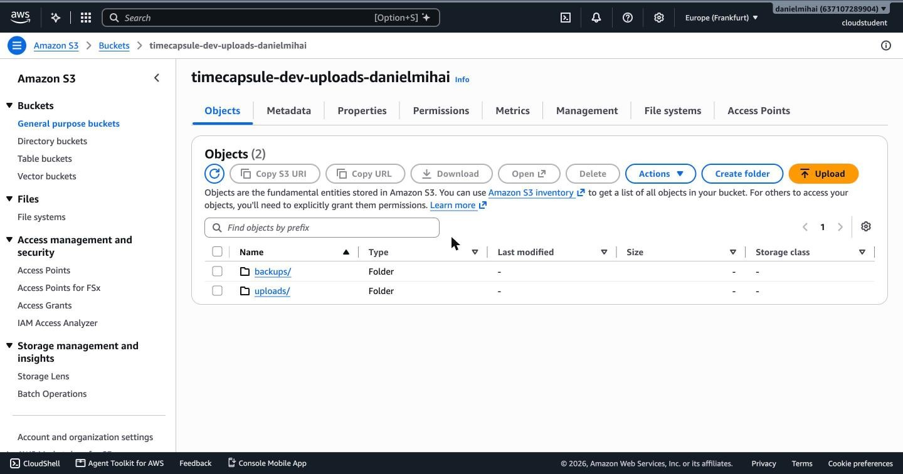
В бакете созданы «папки» `uploads/` и `backups/`.

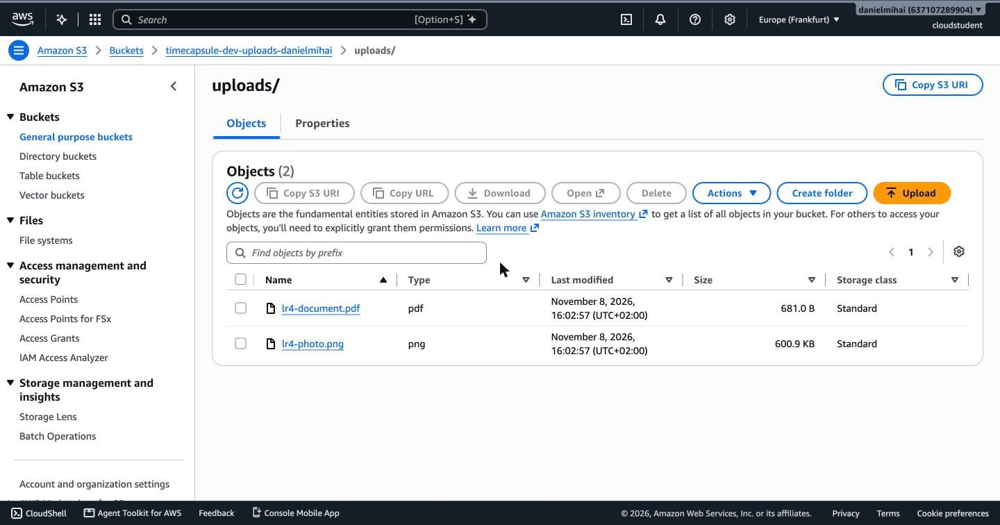
В `uploads/` загружены картинка `lr4-photo.png` (600,9 КБ) и PDF `lr4-document.pdf`.

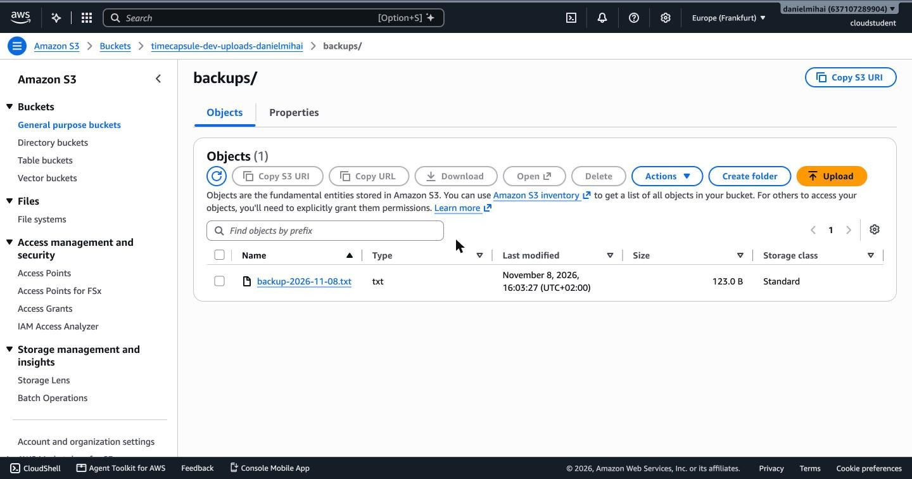
В `backups/` — текстовый файл `backup-2026-11-08.txt`.

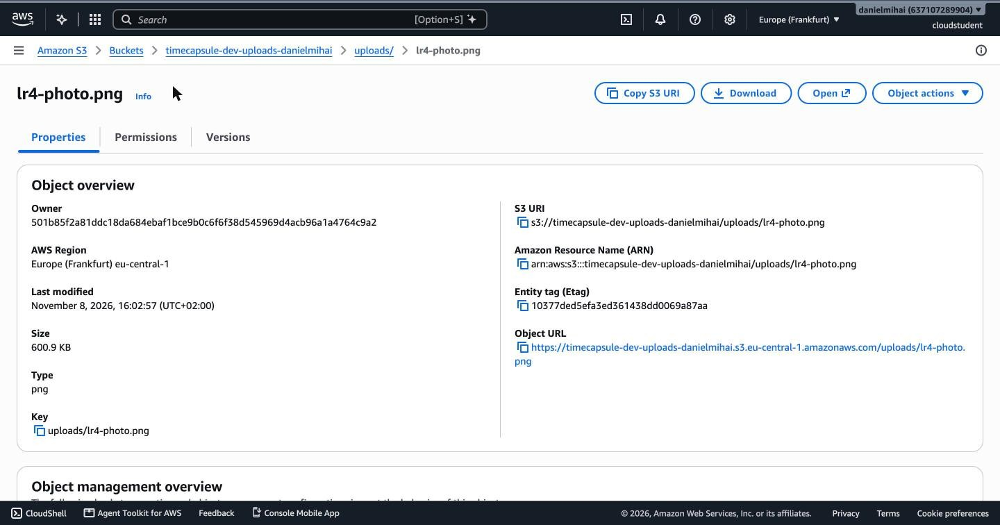
Свойства `lr4-photo.png`: ключ `uploads/lr4-photo.png`, ETag `10377ded5efa3ed361438dd0069a87aa`, Object URL
`https://timecapsule-dev-uploads-danielmihai.s3.eu-central-1.amazonaws.com/uploads/lr4-photo.png`.

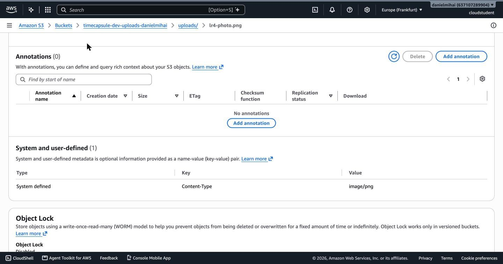
Системные метаданные: `Content-Type: image/png`.

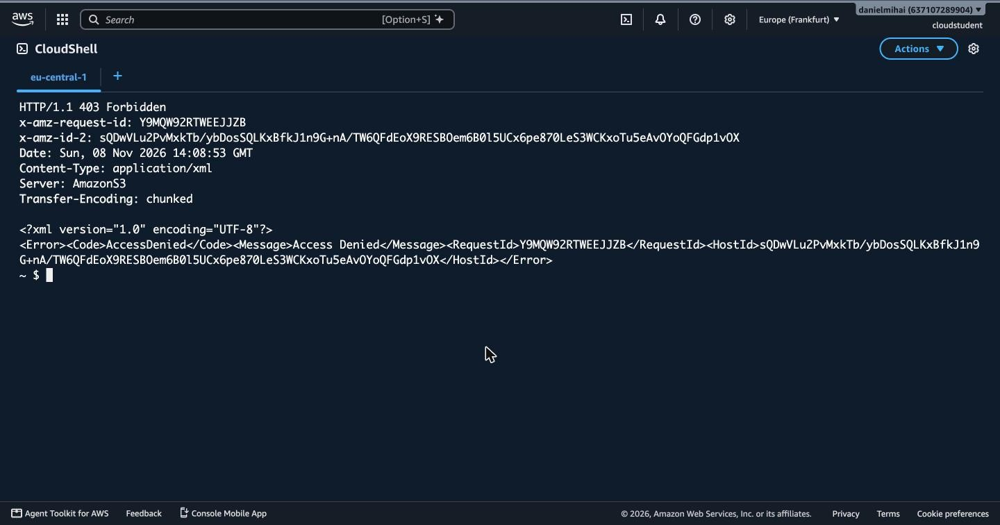
Запрос Object URL без подписи (так его отправляет браузер): `HTTP/1.1 403 Forbidden`, `AccessDenied`. В браузере
ответ тот же — XML с `<Code>AccessDenied</Code>`.

**Какой ключ у картинки? Почему Object URL не открывается, хотя вы владелец бакета? Что на самом деле создала
кнопка Create folder?**
Ключ — `uploads/lr4-photo.png`: в S3 нет папок, это просто строка-имя объекта, в которой есть `/`. Object URL
открывается в браузере анонимным запросом без подписи: куки консоли относятся к `console.aws.amazon.com`, а S3
видит запрос от `*` (anonymous). Анонимному участнику ничего не разрешено, а Block Public Access не дал бы и
разрешить, поэтому S3 отвечает 403 — что я владелец, S3 узнаёт только из подписи запроса (SigV4).
Кнопка Create folder создала пустой объект размером 0 байт с ключом `uploads/` (и `backups/`), который
консоль показывает как папку; он виден в выводе `aws s3 ls --recursive` в задании 2.

### Задание 2. Объекты из командной строки

```bash
BUCKET=timecapsule-dev-uploads-danielmihai
mkdir -p lab4/2026/10 && cd lab4
echo "photo placeholder" > photo.txt
echo "october report"    > 2026/10/report.txt
echo "october report 2"  > 2026/10/report-2.txt
aws s3 cp photo.txt s3://$BUCKET/uploads/photo.txt
aws s3 sync 2026 s3://$BUCKET/uploads/2026
```

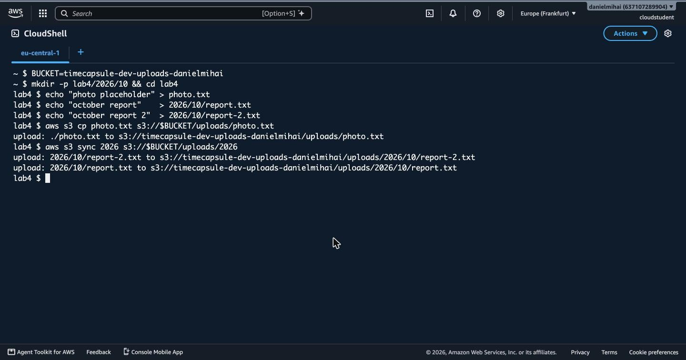
`aws s3 cp` загрузил один файл, `aws s3 sync` — оба отчёта, сохранив путь `2026/10/`.

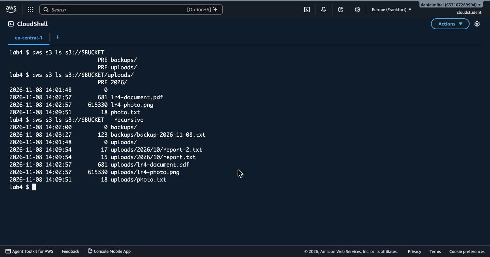
Три способа посмотреть содержимое: корень бакета, `uploads/` и `--recursive`.

```text
$ aws s3 ls s3://$BUCKET
                           PRE backups/
                           PRE uploads/
$ aws s3 ls s3://$BUCKET/uploads/
                           PRE 2026/
2026-11-08 14:01:48          0
2026-11-08 14:02:57        681 lr4-document.pdf
2026-11-08 14:02:57     615330 lr4-photo.png
2026-11-08 14:09:51         18 photo.txt
$ aws s3 ls s3://$BUCKET --recursive
2026-11-08 14:02:00          0 backups/
2026-11-08 14:03:27        123 backups/backup-2026-11-08.txt
2026-11-08 14:01:48          0 uploads/
2026-11-08 14:09:54         17 uploads/2026/10/report-2.txt
2026-11-08 14:09:54         15 uploads/2026/10/report.txt
2026-11-08 14:02:57        681 uploads/lr4-document.pdf
2026-11-08 14:02:57     615330 uploads/lr4-photo.png
2026-11-08 14:09:51         18 uploads/photo.txt
```

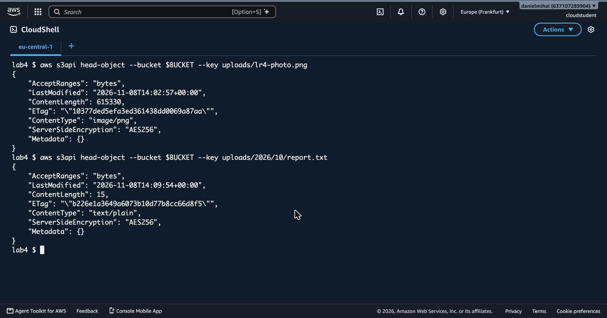
Метаданные без скачивания: у картинки `ContentType: image/png`, у `report.txt` — `text/plain`; у обоих
`ServerSideEncryption: AES256` (SSE-S3 по умолчанию).

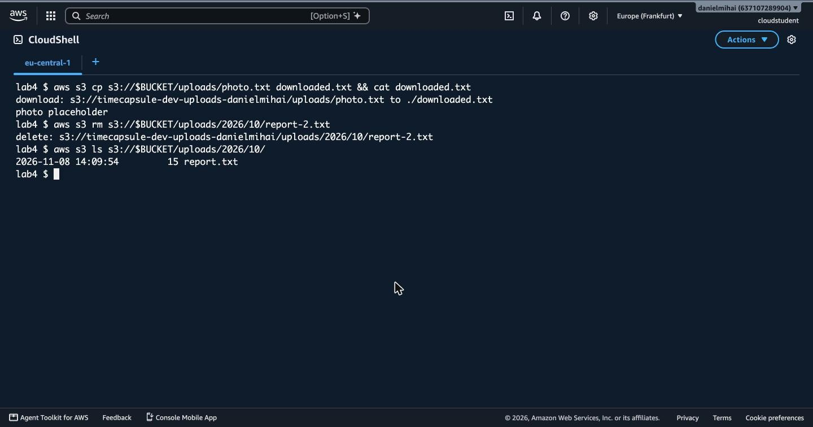
`photo.txt` скачан (`photo placeholder`), `report-2.txt` удалён — в `uploads/2026/10/` остался только
`report.txt`.

**Почему первая команда `ls` показывает `PRE uploads/` и `PRE backups/`, а третья показывает полные ключи?
Какой `Content-Type` получил `report.txt`, хотя вы его не указывали?**
`aws s3 ls s3://бакет` вызывает `ListObjectsV2` с разделителем `/`: S3 группирует ключи до первого `/` и
возвращает их как общие префиксы (`CommonPrefixes`), CLI печатает их как `PRE`. С `--recursive` разделитель не
передаётся, и S3 возвращает все ключи целиком — видно, что «папки» это только часть имени, а пустые объекты
`uploads/` и `backups/` созданы кнопкой Create folder. `report.txt` получил `Content-Type: text/plain`: AWS CLI
определил тип по расширению `.txt` (по таблице MIME-типов) и передал его в заголовке `PutObject`, а S3 сохранил
как системные метаданные. Если бы расширение было неизвестно, тип был бы `binary/octet-stream`.

### Задание 3. Политика бакета: только HTTPS

```json
{
  "Version": "2012-10-17",
  "Statement": [
    {
      "Sid": "DenyInsecureTransport",
      "Effect": "Deny",
      "Principal": "*",
      "Action": "s3:*",
      "Resource": [
        "arn:aws:s3:::timecapsule-dev-uploads-danielmihai",
        "arn:aws:s3:::timecapsule-dev-uploads-danielmihai/*"
      ],
      "Condition": {
        "Bool": { "aws:SecureTransport": "false" }
      }
    }
  ]
}
```

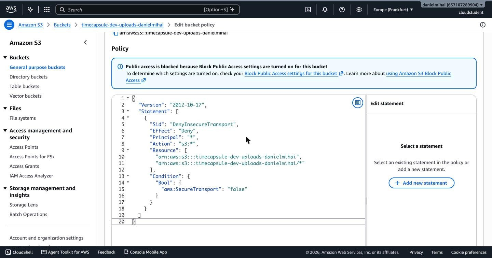
Политика в редакторе Permissions → Bucket policy.

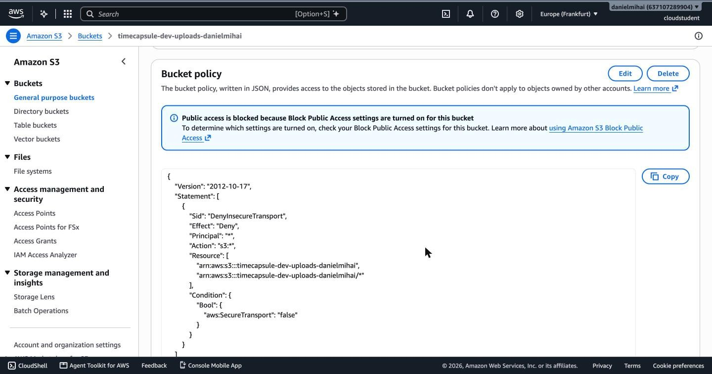
Политика сохранена, при этом Block public access остаётся включённым.

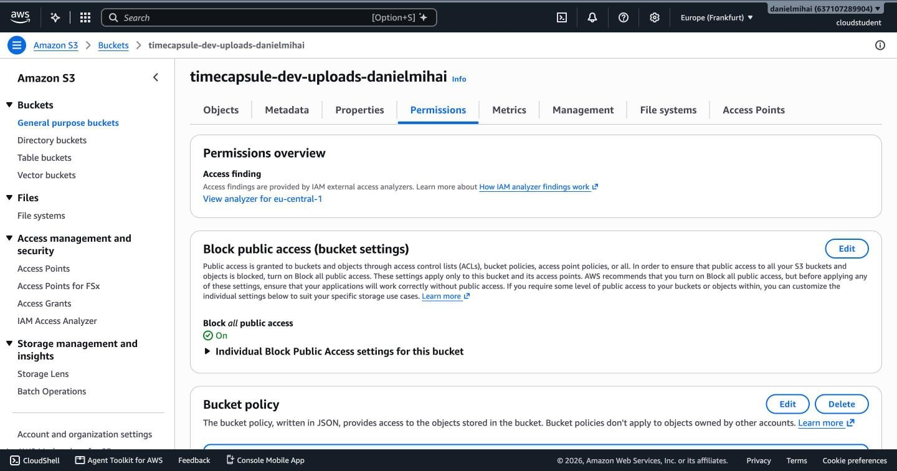
Block all public access — On.

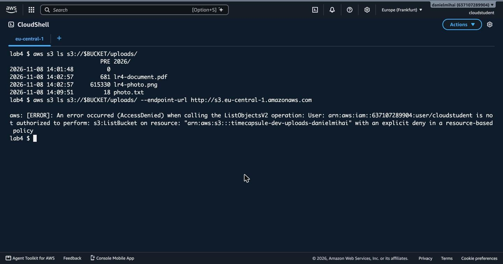
По HTTPS список `uploads/` возвращается, по `http://s3.eu-central-1.amazonaws.com` — `AccessDenied ... with an
explicit deny in a resource-based policy`.

**Почему вторая команда получает `AccessDenied`, хотя у вас права администратора? Почему Block Public Access не
помешал сохранить политику с `"Principal": "*"`?**
AWS сначала ищет явные запреты: явный `Deny` в любой применимой политике (здесь — в политике бакета) перекрывает
любые `Allow`, в том числе `AdministratorAccess`. Запрос по `http://` даёт `aws:SecureTransport = false`, условие
выполняется, и запрет срабатывает — в тексте ошибки так и написано: explicit deny in a resource-based policy.
Block Public Access (`BlockPublicPolicy`) отклоняет только политики, которые **дают** доступ публичным участникам
(`Allow` для `*` без ограничивающих условий). `Deny` для `*` никому ничего не разрешает, поэтому политика не
считается публичной и сохраняется.

### Задание 4. Версионирование и защита от удаления

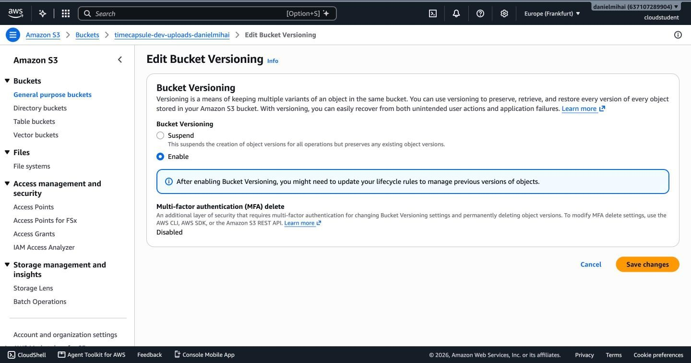
Properties → Bucket Versioning → Enable.

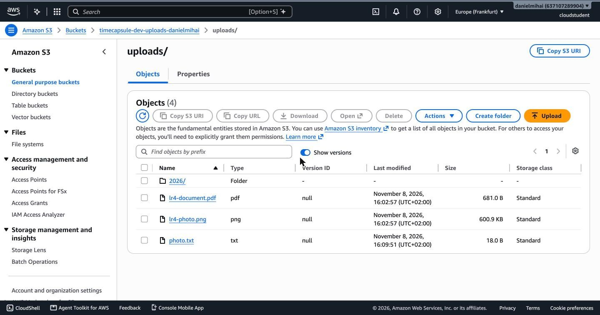
У файлов, загруженных до включения версионирования, Version ID — `null`.

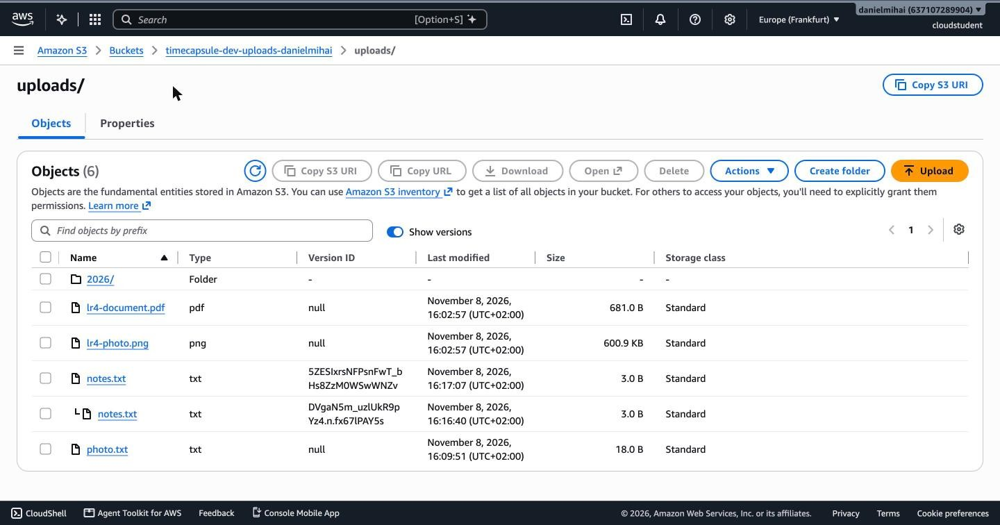
`notes.txt` загружен дважды (`v1`, затем `v2`): две версии, у каждой свой идентификатор, текущая — верхняя
(`5ZESIxrs…`).

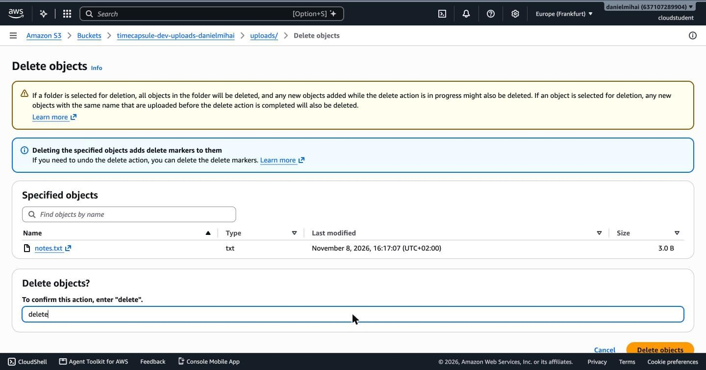
Удаление при выключенном Show versions: консоль предупреждает, что будут **добавлены маркеры удаления**, и
просит ввести `delete`.

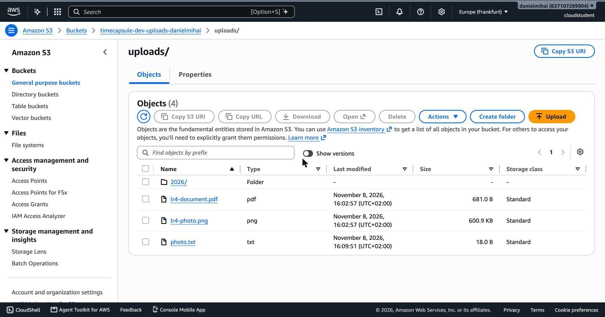
`notes.txt` пропал из обычного списка.


С Show versions видно, что произошло: поверх двух версий появился маркер удаления (Delete marker, 0 Б,
`PW4pfTwA…`), а обе версии на месте.

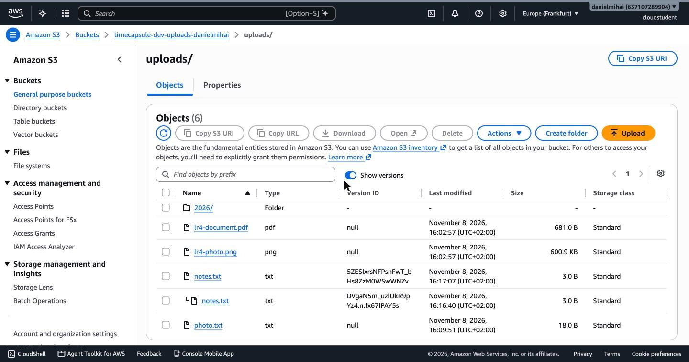
После удаления маркера `notes.txt` вернулся; `aws s3 cp s3://$BUCKET/uploads/notes.txt -` вывел `v2` (верхняя
строка на скриншоте ниже).

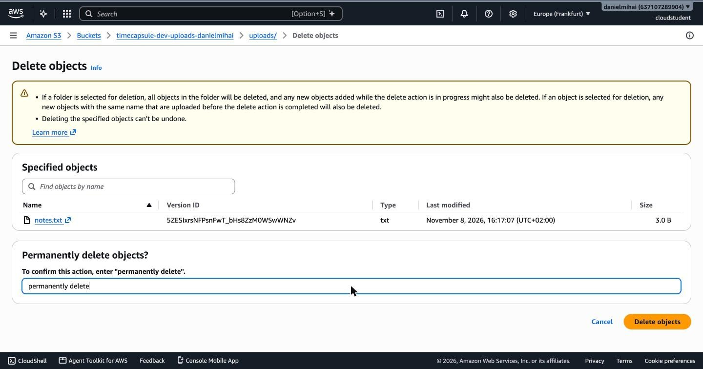
Удаление конкретной версии `v2`: консоль предупреждает, что это **нельзя отменить**, и требует ввести
`permanently delete`.

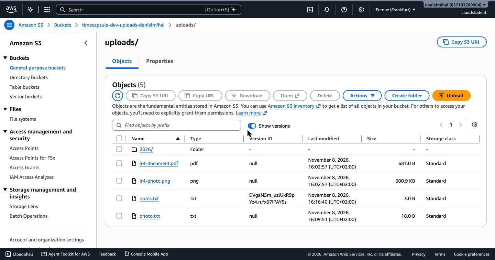
После удаления версии `v2` у `notes.txt` осталась одна версия `DVgaN5m_…` — текущая.

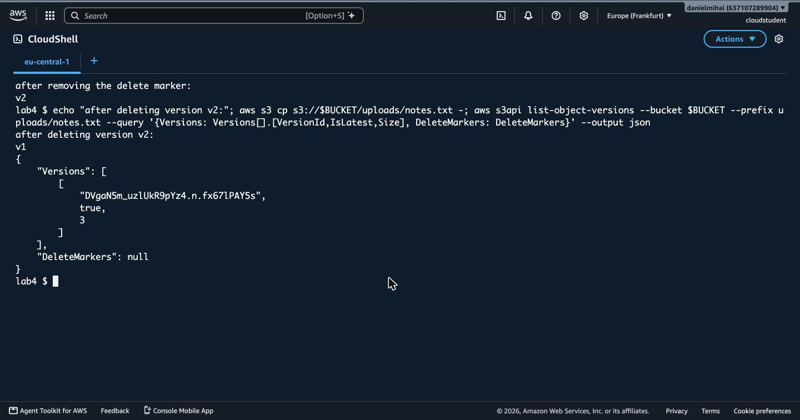
Содержимое до и после отката: `v2` → `v1`; `list-object-versions` показывает одну версию с `IsLatest: true`
и ни одного маркера удаления.

**Чем удаление в шаге 3 отличается от удаления в шаге 5? Какое из них можно отменить? Какой из двух способов
защищает от случайного удаления, а какой нужно запрещать приложению?**
В шаге 3 был `DeleteObject` без идентификатора версии: в бакете с версионированием S3 ничего не стирает, а
кладёт новую «версию»-маркер удаления, и объект просто перестаёт быть виден. Это отменяется удалением маркера —
так и восстановлен `notes.txt`. В шаге 5 был `DeleteObject` с `versionId`: эта версия стирается окончательно,
отменить нельзя (поэтому консоль и просит `permanently delete`). От случайного удаления защищает первый способ:
пока приложение может делать только его, любые «удаления» обратимы. Второй способ (`s3:DeleteObjectVersion`)
нужно запрещать приложению — в политике `timecapsule-dev-app-s3` (задание 7) его нет.

### Задание 5. Правило жизненного цикла

Management → Create lifecycle rule: имя `timecapsule-dev-noncurrent`, фильтр по префиксу `uploads/`
(`backups/` правило не затрагивает), три действия.

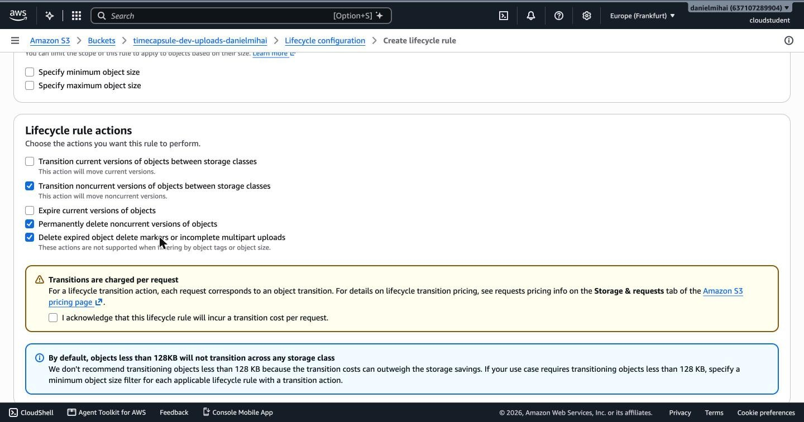
Выбраны переход неактуальных версий, их удаление и удаление незавершённых загрузок; консоль предупреждает,
что переходы оплачиваются за запрос и что объекты меньше 128 КБ по умолчанию не переходят.

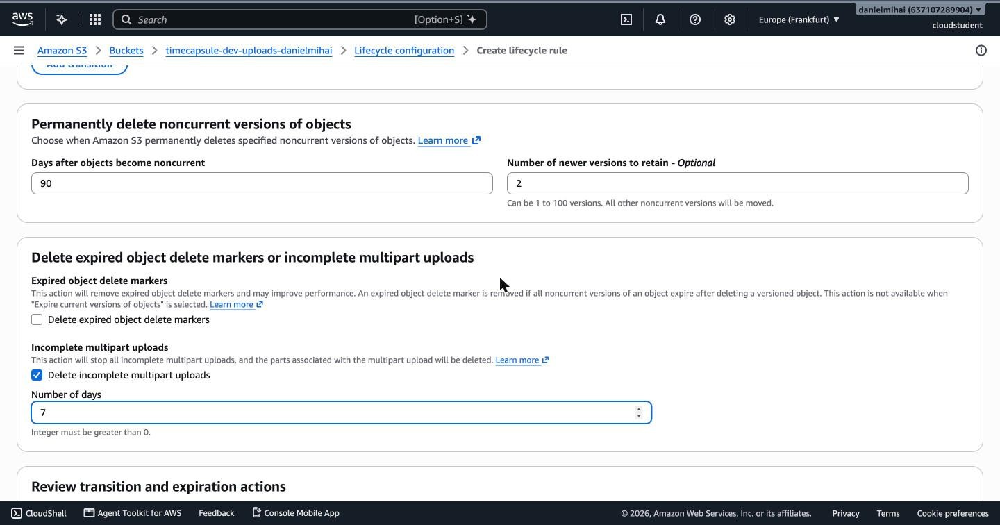
Неактуальные версии удаляются через 90 дней, сохраняются 2 самые новые; незавершённые загрузки — через 7 дней.

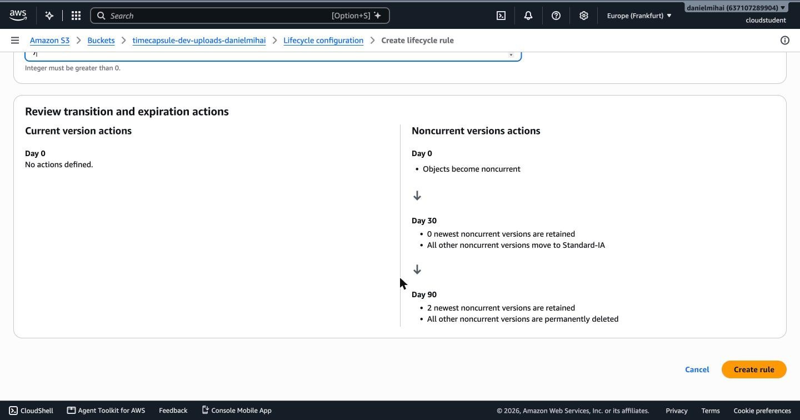
Блок Review transition and expiration actions: день 0 — объект становится неактуальным, день 30 — все
неактуальные версии переходят в Standard-IA, день 90 — две самые новые неактуальные версии сохраняются,
остальные удаляются навсегда.

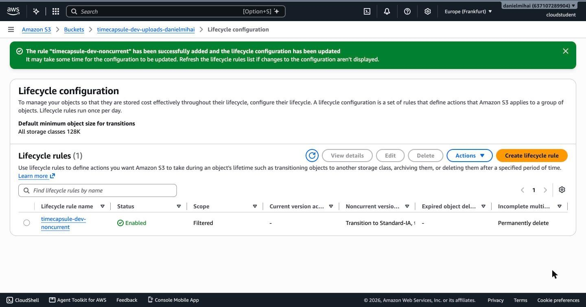
Правило `timecapsule-dev-noncurrent` — Enabled, Filtered.

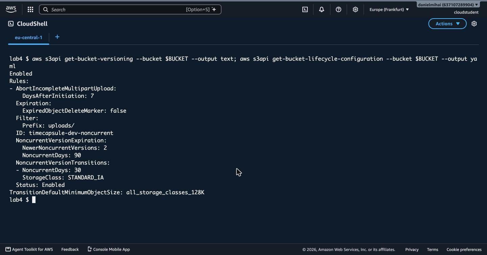
То же из CLI: версионирование `Enabled`, `NoncurrentVersionTransitions` 30 дней → `STANDARD_IA`,
`NoncurrentVersionExpiration` 90 дней с `NewerNoncurrentVersions: 2`, `AbortIncompleteMultipartUpload` 7 дней,
`TransitionDefaultMinimumObjectSize: all_storage_classes_128K`.

**Как поведёт себя правило для файла, который перезаписывали 10 раз за неделю? Какие версии и когда окажутся в
Standard-IA, какие будут удалены? Почему наши маленькие тестовые файлы в Standard-IA не попадут? Что такое
незавершённая загрузка частями и почему за неё приходится платить?**
У файла будет 11 версий: текущая и 10 неактуальных. Отсчёт идёт от момента, когда версия стала неактуальной
(её перезаписали), а не от загрузки. Каждая неактуальная версия через 30 дней после этого переходит в
Standard-IA (если она не меньше 128 КБ), текущая версия остаётся в Standard. Через 90 дней удаляются все
неактуальные версии, кроме двух самых новых: в итоге останутся текущая и две предыдущие (они так и лежат в
Standard-IA), а восемь старых удалятся по очереди, на 90–97-й день после недели перезаписей. S3 выполняет
правила раз в сутки, поэтому возможна задержка в день. Наши файлы — от 3 байт до 600 КБ, а с сентября
2024 года S3 по умолчанию не переводит объекты меньше 128 КБ (`TransitionDefaultMinimumObjectSize`): в
Standard-IA каждый объект оплачивается как минимум за 128 КБ и 30 дней, а переход стоит отдельного запроса,
так что для мелких файлов это только дороже. Большие файлы CLI и SDK загружают частями
(`CreateMultipartUpload` → `UploadPart` → `CompleteMultipartUpload`). Если клиент упал и не вызвал
`Complete` или `Abort`, уже загруженные части остаются в бакете: в списке объектов их не видно, но место они
занимают и оплачиваются как обычное хранение, пока загрузку не прервут. Действие `AbortIncompleteMultipartUpload`
через 7 дней удаляет такие части.

### Задание 6. Подписанные URL

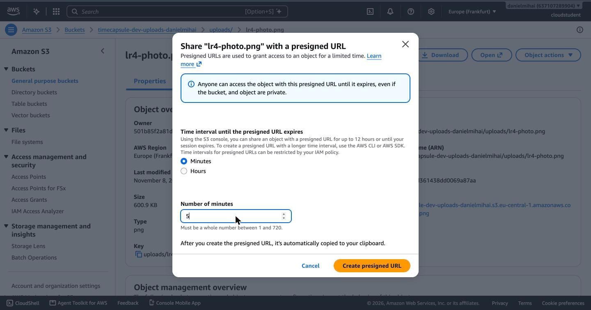
Object actions → Share with a presigned URL для `lr4-photo.png`, срок 5 минут.

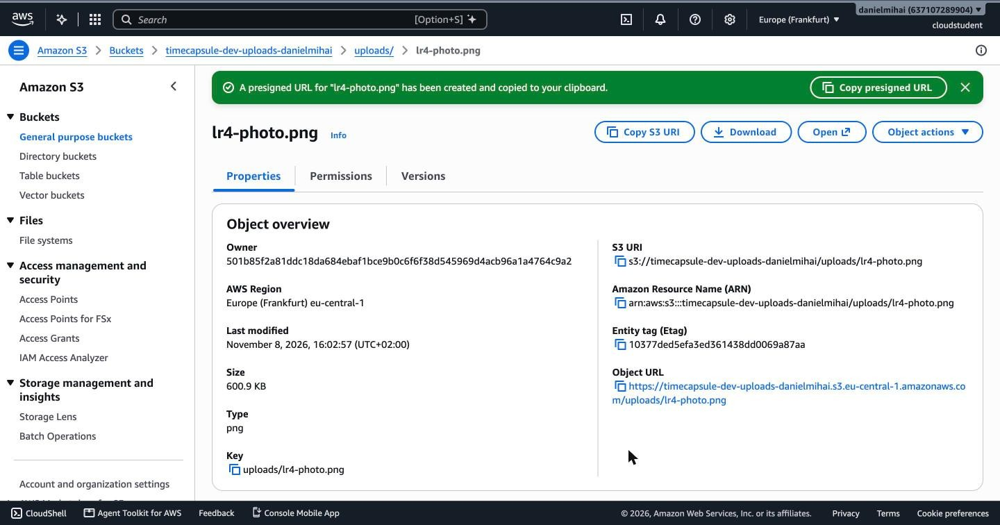
Ссылка создана и скопирована в буфер обмена: `X-Amz-Expires=300`, `X-Amz-Date=20261108T142307Z`.

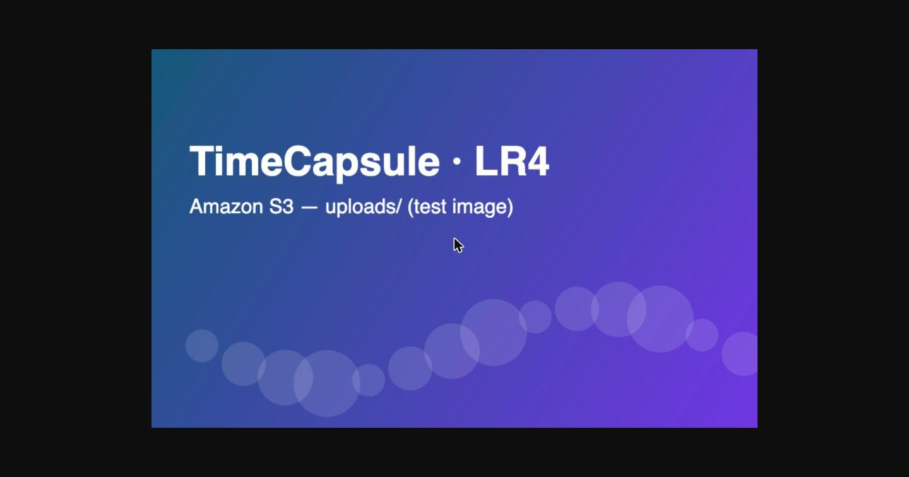
По подписанной ссылке картинка открывается, хотя бакет закрыт.

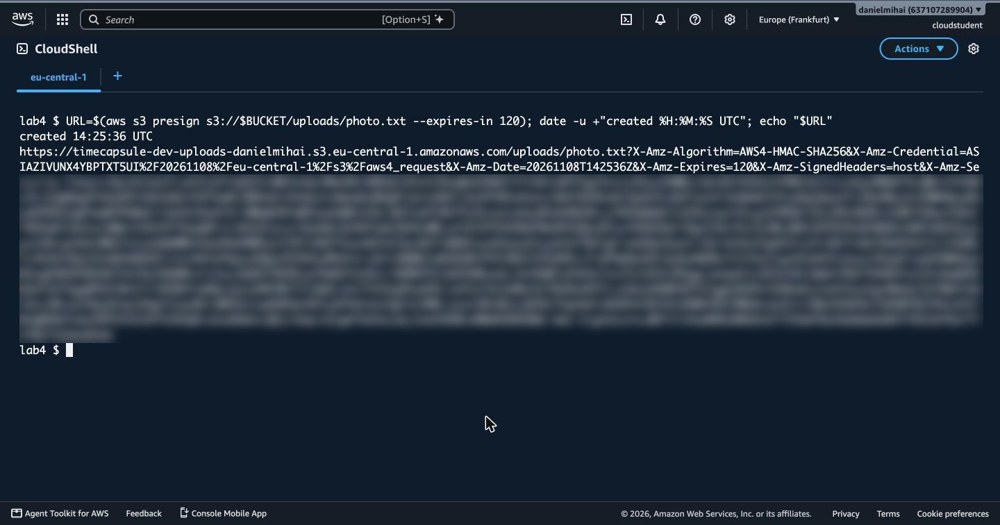
`aws s3 presign ... --expires-in 120`: ссылка создана в 14:25:36 UTC, `X-Amz-Expires=120`. Токен сессии
(`X-Amz-Security-Token`) и подпись размыты.

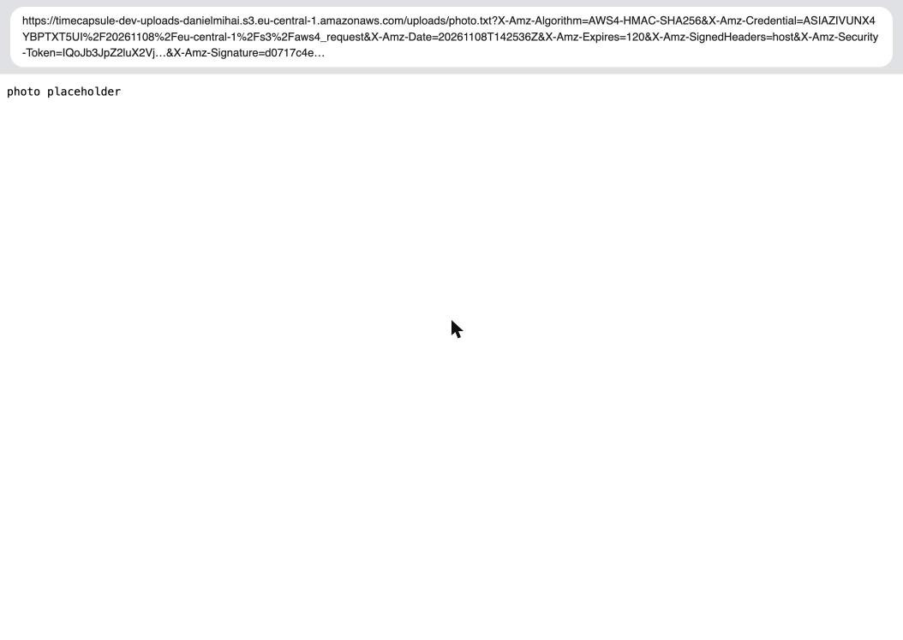
В браузере ссылка отдаёт содержимое `photo.txt` — `photo placeholder` (в строке адреса токен и подпись
сокращены).

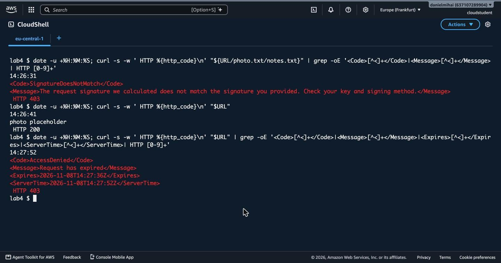
Тот же URL с `notes.txt` вместо `photo.txt` — `SignatureDoesNotMatch` (HTTP 403); исходная ссылка в
14:26:41 ещё работает (HTTP 200), а в 14:27:52 — `AccessDenied: Request has expired`,
`Expires 14:27:36Z` (HTTP 403). В браузере ответы те же.

**Какие ошибки вернул S3 в шагах 3 и 4? Почему нельзя получить другой файл, просто поменяв ключ в ссылке?
Обращалась ли команда `aws s3 presign` к S3, когда создавала ссылку?**
В шаге 3 — `403 SignatureDoesNotMatch` («The request signature we calculated does not match the signature you
provided»), в шаге 4 — `403 AccessDenied` с сообщением `Request has expired` и временем `Expires`/`ServerTime`.
Подпись SigV4 — это HMAC-SHA256 от канонического запроса: метод `GET`, путь с ключом объекта, параметры
`X-Amz-*` (дата, срок, ключ доступа) и подписываемые заголовки. Если поменять ключ, S3 вычислит подпись для
другого канонического запроса, и она не совпадёт; посчитать правильную подпись без секретного ключа нельзя.
По той же причине нельзя продлить ссылку, изменив `X-Amz-Expires`. `aws s3 presign` к S3 не обращается:
подпись вычисляется локально из учётных данных CloudShell, поэтому команда мгновенная и выдаёт ссылку даже на
несуществующий объект. Права и существование объекта S3 проверяет только тогда, когда по ссылке приходит запрос.

После Части 1 временные файлы удалены: `cd ~ && rm -rf lab4`. Бакет оставлен для Части 2.

## Часть 2. Продвинутый уровень

### Задание 7. Политика приложения

```json
{
  "Version": "2012-10-17",
  "Statement": [
    {
      "Sid": "ListOnlyUploadsPrefix",
      "Effect": "Allow",
      "Action": "s3:ListBucket",
      "Resource": "arn:aws:s3:::timecapsule-dev-uploads-danielmihai",
      "Condition": {
        "StringLike": { "s3:prefix": ["uploads/*"] }
      }
    },
    {
      "Sid": "ReadWriteDeleteUploads",
      "Effect": "Allow",
      "Action": ["s3:GetObject", "s3:PutObject", "s3:DeleteObject"],
      "Resource": "arn:aws:s3:::timecapsule-dev-uploads-danielmihai/uploads/*"
    }
  ]
}
```

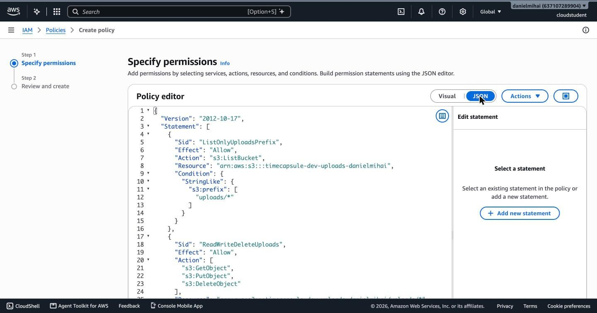
IAM → Policies → Create policy, редактор JSON.

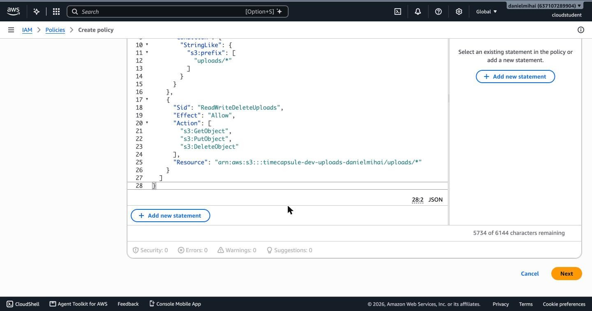
Валидатор политики: Security 0, Errors 0, Warnings 0, Suggestions 0.

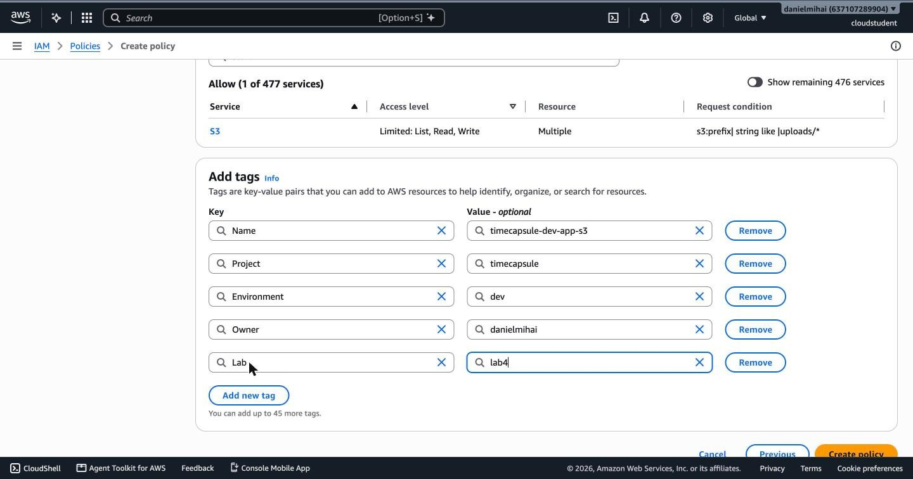
Имя `timecapsule-dev-app-s3`, сводка «S3: Limited: List, Read, Write, условие `s3:prefix` like `uploads/*`»,
обязательные теги.

**Почему `s3:ListBucket` относится к ресурсу "бакет", а `s3:GetObject` к ресурсу "объект"? Что произойдёт,
если перепутать ARN в этих двух правилах?**
Получение списка — операция над бакетом (`GET /?list-type=2` к самому бакету), её ресурс —
`arn:aws:s3:::бакет`, а префикс — лишь параметр запроса, поэтому его ограничивают условием `s3:prefix`.
`GetObject`, `PutObject`, `DeleteObject` работают с конкретным объектом, их ресурс —
`arn:aws:s3:::бакет/ключ`, и `uploads/*` ограничивает ключи. Если перепутать ARN, ни одно правило не
совпадёт ни с одним запросом: `ListBucket` никогда не применяется к ARN объекта, а `GetObject` — к ARN бакета.
Политика сохранится (консоль только предупредит о несовпадении типа ресурса), но приложение получит
`AccessDenied` и на списке, и на чтении — сработает неявный запрет.

### Задание 8. Проверка прав через тестовую роль

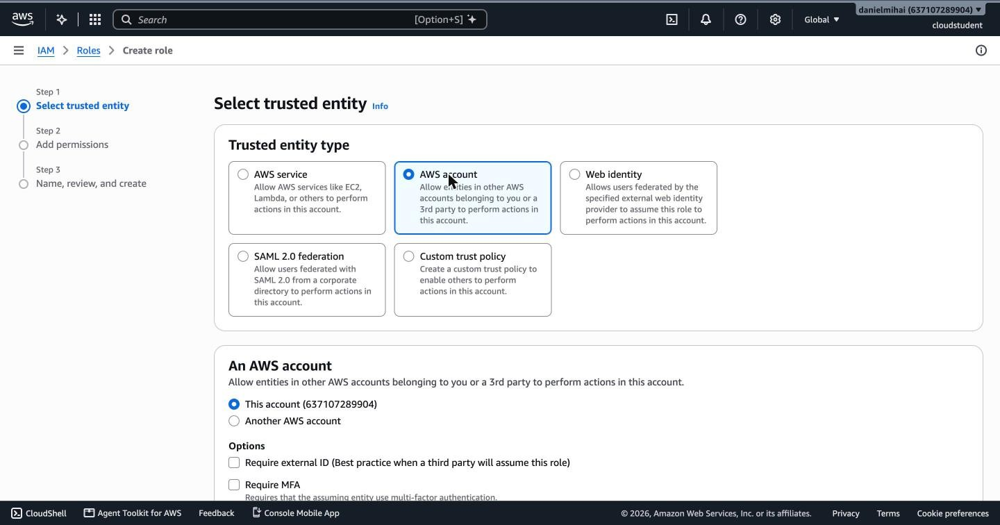
IAM → Roles → Create role: AWS account → This account (637107289904).

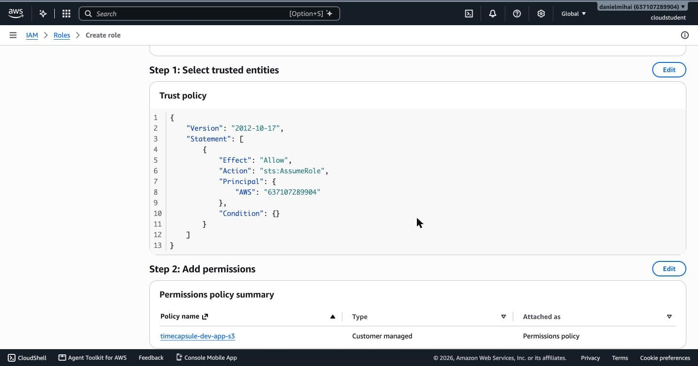
Политика доверия: `sts:AssumeRole` разрешено участнику `"AWS": "637107289904"` (любому пользователю или роли
этого аккаунта, у которого есть право `sts:AssumeRole`). Политика прав — только `timecapsule-dev-app-s3`.

```bash
BUCKET=timecapsule-dev-uploads-danielmihai
ROLE_ARN=arn:aws:iam::$(aws sts get-caller-identity --query Account --output text):role/timecapsule-dev-s3-tester
eval $(aws sts assume-role --role-arn $ROLE_ARN --role-session-name lab4 \
  --query 'Credentials.[AccessKeyId,SecretAccessKey,SessionToken]' --output text \
  | awk '{print "export AWS_ACCESS_KEY_ID="$1" AWS_SECRET_ACCESS_KEY="$2" AWS_SESSION_TOKEN="$3}')
aws sts get-caller-identity
```

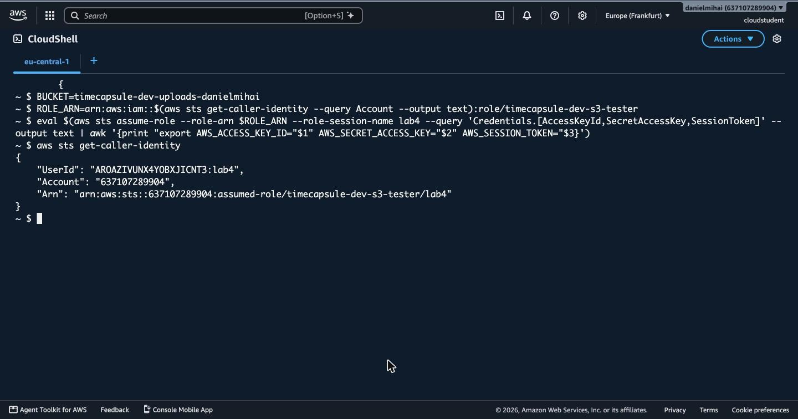
`Arn: arn:aws:sts::637107289904:assumed-role/timecapsule-dev-s3-tester/lab4` — команды дальше выполняются от
имени роли.

Колонка «Ожидаю» заполнена до выполнения команд; идентификатор версии для команды 8 взят из консоли.

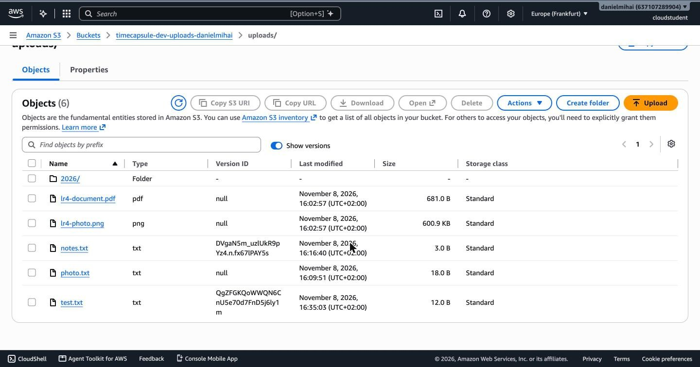
`uploads/test.txt` после команды 1: Version ID `QgZFGKQoWWQN6CnU5e70d7FnD5j6ly1m`.

| № | Команда | Ожидаю | Получил | Какое правило сработало |
|---|---|---|---|---|
| 1 | `aws s3 cp test.txt s3://$BUCKET/uploads/test.txt` | разрешено | разрешено (`upload: ./test.txt to …/uploads/test.txt`) | разрешение в политике приложения (`PutObject` на `uploads/*`) |
| 2 | `aws s3 ls s3://$BUCKET/uploads/` | разрешено | разрешено (список `uploads/`) | разрешение в политике приложения (`ListBucket`, `prefix=uploads/` подходит под `uploads/*`) |
| 3 | `aws s3 ls s3://$BUCKET` | AccessDenied | AccessDenied (`ListObjectsV2 … because no identity-based policy allows the s3:ListBucket action`) | неявный запрет (пустой префикс не подходит под условие) |
| 4 | `aws s3 cp s3://$BUCKET/uploads/photo.txt -` | разрешено | разрешено (`photo placeholder`) | разрешение в политике приложения (`GetObject`) |
| 5 | `aws s3 ls s3://$BUCKET/backups/` | AccessDenied | AccessDenied (`s3:ListBucket`, no identity-based policy allows) | неявный запрет (префикс `backups/`) |
| 6 | `aws s3 cp test.txt s3://$BUCKET/backups/test.txt` | AccessDenied | AccessDenied (`s3:PutObject` на `backups/test.txt`) | неявный запрет |
| 7 | `aws s3api list-object-versions --bucket $BUCKET --prefix uploads/` | AccessDenied | AccessDenied (`s3:ListBucketVersions`) | неявный запрет (действия `ListBucketVersions` в политике нет) |
| 8 | `aws s3api delete-object --bucket $BUCKET --key uploads/test.txt --version-id QgZF…ly1m` | AccessDenied | AccessDenied (`s3:DeleteObjectVersion`) | неявный запрет (удаление версии — отдельное действие) |
| 9 | `aws s3 rm s3://$BUCKET/uploads/test.txt` | разрешено | разрешено (`delete: …/uploads/test.txt`) | разрешение в политике приложения (`DeleteObject`) |
| 10 | `aws s3 ls s3://$BUCKET/uploads/ --endpoint-url http://s3.eu-central-1.amazonaws.com` | AccessDenied | AccessDenied (`with an explicit deny in a resource-based policy`) | явный запрет в политике бакета (не HTTPS) |

Все результаты совпали с ожиданиями. Команды 7 и 8 показывают, что работа с версиями — это отдельные
действия IAM (`s3:ListBucketVersions`, `s3:DeleteObjectVersion`), которые не входят в `ListBucket` и
`DeleteObject`.

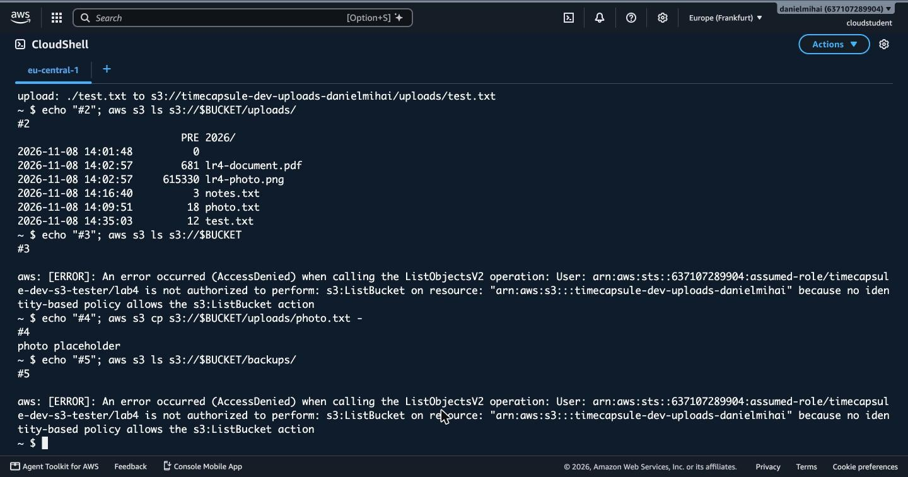
Команды 1–5 (первая строка — вывод команды 1).

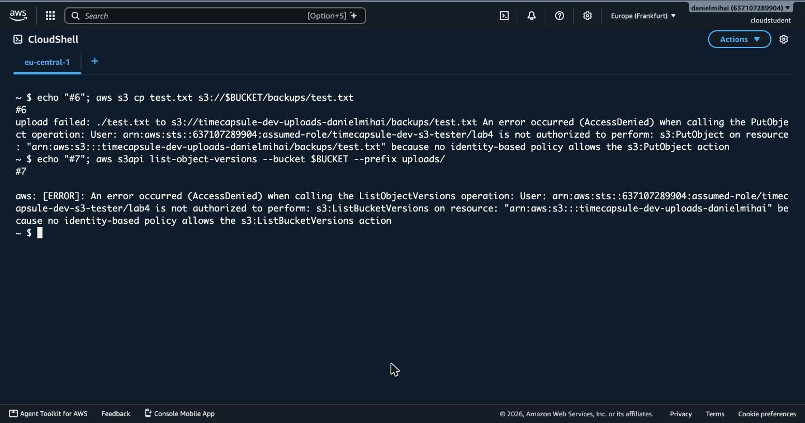
Команды 6 и 7.

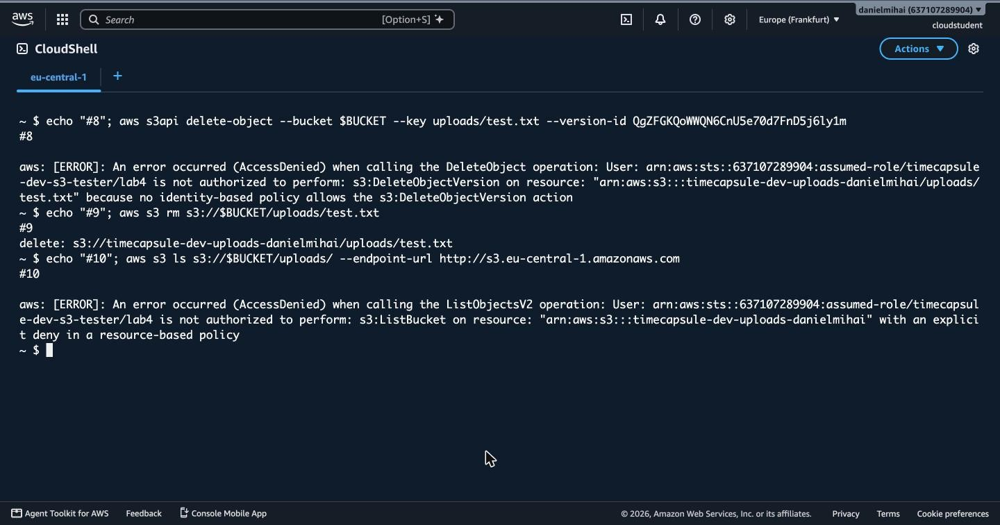
Команды 8–10.

```bash
unset AWS_ACCESS_KEY_ID AWS_SECRET_ACCESS_KEY AWS_SESSION_TOKEN
```

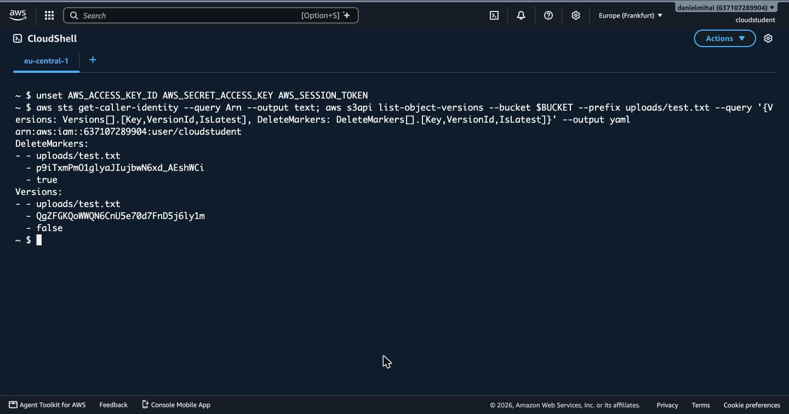
Снова под `cloudstudent`: у `uploads/test.txt` есть маркер удаления (`IsLatest: true`) и сохранившаяся
версия `QgZFGKQo…` из команды 1.

**Чем политика доверия роли отличается от политики прав? Что на самом деле произошло с `test.txt` после
команды 9, и можно ли его восстановить? Сможет ли злоумышленник, получивший учётные данные приложения,
уничтожить файлы пользователей без возможности восстановления? А если бы в политике было `"s3:*"`?**
Политика доверия — это политика ресурса, прикреплённая к самой роли: она говорит, **кто** может взять роль на
себя (`Principal` + `sts:AssumeRole`). Политика прав говорит, **что** можно делать с полученными временными
ключами. У тестовой роли доверие — аккаунт `637107289904`, права — только `timecapsule-dev-app-s3`.
После команды 9 `test.txt` не удалён: `DeleteObject` без версии добавил маркер удаления, а версия
`QgZFGKQo…` осталась (это видно на последнем скриншоте). Восстановить его может администратор, удалив маркер,
как в задании 4; сама роль не может — у неё нет `s3:DeleteObjectVersion`. Злоумышленник с ключами приложения
сможет читать все вложения, перезаписывать их и ставить маркеры удаления, но не уничтожит ни одной версии
сразу: удалять версии, отключать версионирование, менять правило жизненного цикла и политику бакета политика
не разрешает. Есть оговорка: если перезаписать файл трижды, исходная версия перестанет быть одной из двух
самых новых неактуальных и через 90 дней её удалит правило жизненного цикла — подмену нужно заметить раньше.
С `"s3:*"` он смог бы удалить все версии (`DeleteObjectVersion`), приостановить версионирование, удалить
правило, политику бакета и сам бакет, а с `PutBucketPublicAccessBlock` и `PutBucketPolicy` — ещё и открыть
вложения всему интернету.

### Задание 9. Роль сервера

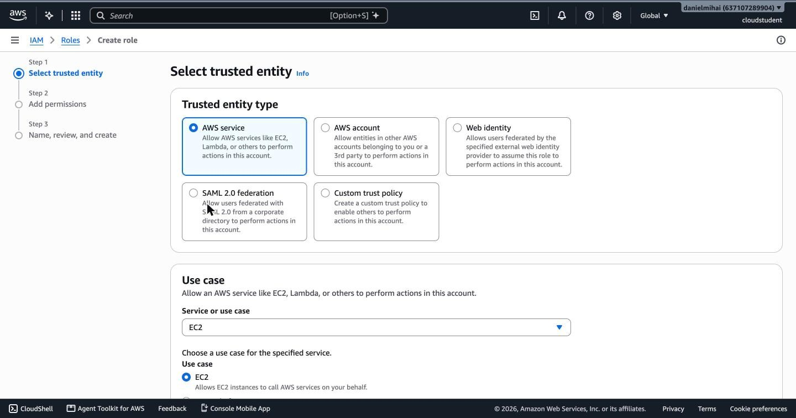
Trusted entity type: AWS service, Use case: EC2.

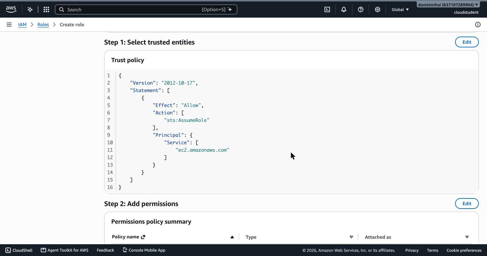
Политика доверия `timecapsule-dev-app-role`: `sts:AssumeRole` разрешено только сервису `ec2.amazonaws.com`.
Политика прав — та же `timecapsule-dev-app-s3`.


Обе роли: `timecapsule-dev-app-role` (AWS Service: ec2) и `timecapsule-dev-s3-tester` (Account: 637107289904).

bastion, `app-server` и `db-server` запущены командой `aws ec2 start-instances`, после чего роль привязана к
`app-server`:


EC2 → Instances → `timecapsule-dev-app` → Actions → Security → Modify IAM role → `timecapsule-dev-app-role`;
сервер не перезапускался.

```bash
ssh app
echo 'export BUCKET=timecapsule-dev-uploads-danielmihai' >> ~/.bashrc && source ~/.bashrc
aws sts get-caller-identity
aws s3 ls s3://$BUCKET/uploads/
aws s3 ls s3://$BUCKET/backups/
```


На `app-server`: `Arn: arn:aws:sts::637107289904:assumed-role/timecapsule-dev-app-role/i-08dd33ebb505096f4`,
список `uploads/` получен, `backups/` — `AccessDenied` (no identity-based policy allows the s3:ListBucket
action).

**Где AWS CLI на сервере взял учётные данные, если вы не выполняли `aws configure` и не вызывали
`assume-role`? Чем политика доверия этой роли отличается от тестовой? Почему такие учётные данные безопаснее
ключа доступа в файле `.env`?**
Из службы метаданных экземпляра (IMDS, `http://169.254.169.254/latest/meta-data/iam/security-credentials/
timecapsule-dev-app-role`). Привязав профиль экземпляра, мы разрешили сервису EC2 самому брать роль на себя и
класть временные ключи в метаданные. AWS CLI и SDK ищут учётные данные по цепочке: переменные окружения,
`~/.aws/credentials` и `config`, контейнер, IMDS — и находят их на последнем шаге. Имя сессии — ID экземпляра.
Тестовой роли доверяет аккаунт: её может взять пользователь или роль этого аккаунта с правом `sts:AssumeRole`.
Роли сервера доверяет только сервис `ec2.amazonaws.com`: человек не может взять её на себя, а может лишь
привязать к экземпляру, если у него есть `iam:PassRole`. Временные ключи живут несколько часов и обновляются
автоматически; их нет в файлах, в репозитории, в резервных копиях и в образе AMI, поэтому их нельзя случайно
закоммитить или унести вместе со снимком диска. Отозвать доступ можно, просто отвязав роль, а ключ из `.env`
действует, пока его не удалят вручную, и после утечки работает откуда угодно.

### Задание 10. Перенос существующих файлов

В этом развёртывании приложение лежит в `/var/www/timecapsule` (без `current/`), а вложения — в
`storage/uploads`: так задано `UPLOAD_DIR=storage/uploads` в `.env` ещё в ЛР2. Папка принадлежит `apache`
(`drwx------`), поэтому от `ec2-user` CLI её не читает, и копирование выполнено через `sudo`: под root CLI
берёт те же временные ключи роли из метаданных экземпляра.

```bash
cd /var/www/timecapsule
sudo ls -l storage/uploads
aws s3 sync storage/uploads s3://$BUCKET/uploads/ --dryrun        # от ec2-user: папка не читается
sudo aws s3 sync storage/uploads s3://$BUCKET/uploads/ --dryrun
sudo aws s3 sync storage/uploads s3://$BUCKET/uploads/
sudo aws s3 sync storage/uploads s3://$BUCKET/uploads/ --dryrun   # повторная проверка
aws s3api head-object --bucket $BUCKET --key uploads/3adc8a3c76dda7173523bddeba575813.png
```


На диске один файл из ЛР2 — `3adc8a3c76dda7173523bddeba575813.png` (163 942 байта). От `ec2-user`:
`warning: Skipping file /var/www/timecapsule/storage/uploads/. File/Directory is not readable.`, через `sudo`:
`(dryrun) upload: storage/uploads/3adc8a3c….png to s3://timecapsule-dev-uploads-danielmihai/uploads/3adc8a3c….png`.


`sync` загрузил файл, повторный `--dryrun` ничего не вывел — все файлы уже в бакете. У перенесённого объекта
`ContentType: image/png`, `ContentLength: 163942`, `ServerSideEncryption: AES256` и свой `VersionId`.

**Хватило ли для `aws s3 sync` прав политики приложения? Какие из разрешённых действий использовала команда?**
Хватило: команда выполнялась от имени `timecapsule-dev-app-role` и не получила ни одного `AccessDenied`. Сначала
`sync` получает список объектов назначения запросом `ListObjectsV2` с `prefix=uploads/` — это `s3:ListBucket`,
и префикс подходит под условие `uploads/*` — и сравнивает имена, размеры и время изменения с локальными
файлами. Затем каждый отсутствующий или изменившийся файл загружает запросом `PutObject` (`s3:PutObject` на
`uploads/*`), а `Content-Type` CLI подбирает по расширению. Режим `--dryrun` использовал только
`s3:ListBucket`; `s3:GetObject` и `s3:DeleteObject` не понадобились (без `--delete` `sync` ничего не удаляет).

### Задание 11. Модуль хранения на S3

Изменения в репозитории:

* [af1a007](https://github.com/danielmihai-cloud/timecapsule/commit/af1a007fd69ffafa64c0a7b689e1c83f3ed5b207) —
  модуль хранения [app/Services/CapsuleStorage.php](../../app/Services/CapsuleStorage.php), диск `s3` в
  [config/filesystems.php](../../config/filesystems.php), подвал страницы и `.env.example`;
* [345446c](https://github.com/danielmihai-cloud/timecapsule/commit/345446c7efb5d4b84dd0096dce77b98967f66f3d) —
  `composer.json` и `composer.lock`.

Composer есть только на сервере, поэтому пакеты добавлены там, во временной копии репозитория:

```bash
cd ~ && git clone -q -b lab4-s3-storage https://github.com/danielmihai-cloud/timecapsule.git tc-composer
cd tc-composer && composer require aws/aws-sdk-php league/flysystem-aws-s3-v3 --no-install --no-scripts
# изменённые composer.json и composer.lock закоммичены, временная копия удалена: rm -rf ~/tc-composer
```


Добавлены `aws/aws-sdk-php` 3.403.1 (`^3.403`) и `league/flysystem-aws-s3-v3` 3.35.3 (`^3.35`), с ними
`aws/aws-crt-php`, `mtdowling/jmespath.php` и `symfony/filesystem`.

Настройки в `.env.example` и в `/var/www/timecapsule/.env` на сервере:

```dotenv
S3_BUCKET=timecapsule-dev-uploads-danielmihai
AWS_REGION=eu-central-1
```


В `.env` на сервере добавлены `S3_BUCKET` и `AWS_REGION`; строк с `AWS_ACCESS_KEY_ID` и
`AWS_SECRET_ACCESS_KEY` нет (`grep -c` → `0`).

Диск `s3` в Laravel по умолчанию читает `AWS_BUCKET` и `AWS_DEFAULT_REGION`, поэтому в
`config/filesystems.php` он настроен на `S3_BUCKET` и `AWS_REGION`, а `key` и `secret` не заданы: SDK ищет
учётные данные по стандартной цепочке и находит временные ключи роли в метаданных экземпляра, как AWS CLI в
задании 9. Модуль берёт у диска готовый `S3Client` (`Storage::disk('s3')->getClient()`): Laravel создаёт
диск один раз и дальше отдаёт тот же объект.

| Метод `CapsuleStorage` | Что делает | Вызов SDK |
|---|---|---|
| `save()` | загружает файл под ключом `uploads/<32 hex-символа>.<расширение>` с `ContentType`, определённым по содержимому файла, и возвращает случайное имя, как раньше | `putObject` с `SourceFile` |
| `delete()` | удаляет объект `uploads/<имя>` | `deleteObject` |
| `stream()` | отвечает 302 на подписанный URL сроком 5 минут; в ссылке `ResponseContentType` и `ResponseContentDisposition`: `inline` для картинок, `attachment` для PDF и при скачивании, с исходным именем файла | `getCommand('GetObject', …)` и `createPresignedRequest(…, '+5 minutes')` |

```php
$command = $this->client()->getCommand('GetObject', [
    'Bucket' => $this->bucket(),
    'Key' => self::PREFIX.$name,                     // uploads/3adc8a3c….png
    'ResponseContentType' => $mime,                  // image/png, application/pdf
    'ResponseContentDisposition' => $disposition,    // inline или attachment; filename="…"
]);
$url = (string) $this->client()->createPresignedRequest($command, self::LINK_LIFETIME)->getUri();

return redirect()->away($url);                       // 302, Location: https://…s3.eu-central-1.amazonaws.com/uploads/…
```

Проверка прав пользователя на капсулу осталась в `CapsuleController::file()` и выполняется до вызова
`stream()`; в контроллере поменялся только тип возвращаемого значения (`StreamedResponse` →
`RedirectResponse`). В подвале страницы вместо `Files: local disk (storage/uploads)` теперь
`Files: S3 timecapsule-dev-uploads-danielmihai/uploads/`. Ключи доступа IAM не создавались: код проверялся на
`app-server` с ролью.

### Задание 12. Деплой и проверка

Ветка `lab4-s3-storage` влита в `main`, и новая версия выпущена тем же способом, что в ЛР3, — скриптом
`~/deploy.sh` на `app-server`: `git pull --ff-only`, `composer install --no-dev --optimize-autoloader`, затем от
`apache` — `php artisan package:discover`, `migrate --force` и `config:cache`, и в конце
`systemctl reload php-fpm`. `config:cache` заново читает `.env` (в том числе новые `S3_BUCKET` и `AWS_REGION`), а
перезагрузка PHP-FPM запускает новые рабочие процессы с новым кодом и кэшем настроек.


Composer установил пять новых пакетов, на сервере коммит `345446c`.

Для проверок в приложении зарегистрирована новая учётная запись (адрес на скриншотах скрыт): пароль от
учётки ЛР2 не сохранился.

**Новые капсулы.** Созданы две капсулы с временем открытия через 3 минуты: с картинкой `storage-lab4.png`
(схема из задания 14, 732 КБ) и с PDF `lr4-document.pdf` (703 байта).


Форма New capsule: время открытия 21:22, вложение `storage-lab4.png`. В подвале — `Files: S3
timecapsule-dev-uploads-danielmihai/uploads/`.


Вторая капсула — с `lr4-document.pdf`.


В `uploads/` появились `3932464cbba1fdfdf82a54b7c15f77e6.png` (731,8 КБ) и
`20d5575f3bfa92aaeccc2158f91dd06d.pdf` (703 Б) — случайные имена, как раньше на диске. Рядом перенесённый
`3adc8a3c….png` из задания 10 и файлы Части 1.


`head-object` на сервере: `ContentType: image/png` и `application/pdf` — тип, который модуль передал в
`PutObject`.

**Подписанный URL.** Капсулы открылись в 21:22.


Обе капсулы — Opened, у каждой `1 file`.


Картинка показывается прямо на странице: ``, приложение отвечает 302, и браузер
загружает её из S3.


Картинка, открытая в новой вкладке. Адрес вкладки выведен поверх страницы скриптом (`location.href`; значения
параметров раскодированы, токен и подпись обрезаны): `https://timecapsule-dev-uploads-danielmihai.s3.eu-central-1.amazonaws.com/uploads/3932464cbba1fdfdf82a54b7c15f77e6.png`
с параметрами `response-content-type=image/png`, `response-content-disposition=inline; filename=storage-lab4.png`,
`X-Amz-Algorithm=AWS4-HMAC-SHA256`, `X-Amz-Credential=ASIA…/20261108/eu-central-1/s3/aws4_request`,
`X-Amz-Security-Token` (временные ключи роли), `X-Amz-Date=20261108T192245Z`, `X-Amz-Expires=300`,
`X-Amz-SignedHeaders=host`, `X-Amz-Signature`.

**PDF.** На странице капсулы кнопка `Download lr4-document.pdf` ведёт на `/capsules/4/file?download=1`.


Капсула с PDF: кнопки Download и Delete.

После нажатия на кнопку браузер начал скачивание. Под каким именем сохранится файл, решает заголовок
`Content-Disposition` в ответе S3, поэтому заголовки проверены на сервере `curl` по такой же ссылке, выданной
модулем хранения (`download=1`):


`HTTP/1.1 200 OK`, `Content-Type: application/pdf`, `Content-Disposition: attachment; filename=lr4-document.pdf`,
`Content-Length: 703`; скачанный файл — `PDF document, version 1.4`. Поэтому браузер сохраняет его под
исходным именем `lr4-document.pdf`, а не `20d5575f….pdf`.

**Старая капсула.** Капсула ЛР2 с вложением (`#1 "Test"`) приватная и принадлежит учётке ЛР2, новая учётка её
не видит, поэтому проверка сделана на сервере тем же модулем, который вызывает `CapsuleController::file()`:


Ссылка на `uploads/3adc8a3c76dda7173523bddeba575813.png` — перенесённый в задании 10 файл: `200 OK`,
`Server: AmazonS3`, `x-amz-version-id: D5CvBhkm…` (версия, загруженная `sync`), `Content-Type: image/png` и
исходное имя `Снимок экрана — 2026-10-05 в 19.47.00.png` в `filename*` (UTF-8) с ASCII-вариантом в
`filename`.

**Срок ссылки.** Адрес картинки из вкладки выше (`X-Amz-Date=20261108T192245Z`) открыт повторно через 5 минут, в
21:27:55. S3 вернул XML:

```xml
<Error>
  <Code>AccessDenied</Code>
  <Message>Request has expired</Message>
  <X-Amz-Expires>300</X-Amz-Expires>
  <Expires>2026-11-08T19:27:45Z</Expires>
  <ServerTime>2026-11-08T19:27:55Z</ServerTime>
  <RequestId>6HZ9KAQZT3WW6ABH</RequestId>
  …
</Error>
```

Страницу браузера с этим XML не удалось сохранить скриншотом, поэтому опыт повторён на сервере: модуль
хранения выдал ссылку на ту же картинку, `curl` сразу получил `HTTP 200 image/png 749333`, а через 5 минут по
той же ссылке:


`now: 20261108T193805Z`, ссылка подписана в `19:32:55Z` с `X-Amz-Expires=300` → `HTTP 403`, `AccessDenied`,
`Request has expired`, `Expires 19:37:55Z`, `ServerTime 19:38:05Z`. Файл со ссылкой после проверки удалён.

**Удаление.** Капсула с PDF удалена формой Delete на её странице (`POST /capsules/4/delete` →
`CapsuleStorage::delete()` → `DeleteObject`).


`Capsule deleted.` — осталась капсула с картинкой.


`uploads/` с включённым Show versions: у `20d5575f3bfa92aaeccc2158f91dd06d.pdf` сверху маркер удаления
(`Delete marker`, 0 Б, 21:24:49), под ним прежняя версия PDF `HRoIcie78r4bGLJ5K1.SD7p3eAd72q8r` (703 Б).

**Почему ссылку, которую пользователь переслал другу, не нужно специально отзывать? Что осталось в бакете
после удаления капсулы и когда это исчезнет окончательно?**
Ссылка сама перестаёт работать через 5 минут: `X-Amz-Expires=300` отсчитывается от подписанного `X-Amz-Date`,
и S3 отвечает `Request has expired`, а срок нельзя продлить, не испортив подпись. Кроме того, она не переживёт
временные ключи роли, которыми подписана, и права проверяются при каждом запросе. Пока ссылка действует, по ней
можно только скачать один этот объект, а после удаления капсулы она не работает и в эти 5 минут: текущая
версия ключа — маркер удаления. В бакете остались маркер удаления и прежняя версия PDF. Сама она не исчезнет:
правило `timecapsule-dev-noncurrent` удаляет неактуальную версию через 90 дней, только если у ключа есть ещё две
более новые неактуальные версии, а здесь она одна; в Standard-IA она тоже не перейдёт (меньше 128 КБ).
Окончательно файл удалит администратор с правом `s3:DeleteObjectVersion` (у приложения его нет) или второе
правило жизненного цикла без `NewerNoncurrentVersions` — как и записано в ADR-0003.

### Задание 13. Сервер без состояния

**Локальные файлы убраны.**

```bash
sudo mv /var/www/timecapsule/storage/uploads ~/uploads-backup
```


В `~/uploads-backup` старая картинка ЛР2, в `/var/www/timecapsule/storage/` остались только `app`,
`framework` и `logs`.


Капсула «LR4: картинка в S3», созданная до переноса, открывается с вложением.


Вложение капсулы ЛР2 по ссылке модуля хранения — `200 OK` от `AmazonS3`, `image/png`, 163 942 байта, хотя
локальной копии больше нет.


Создана ещё одна капсула с вложением — «LR4: сервер без состояния» (`lr4-stateless.png`).


Папка `uploads` не появилась снова, а в бакете новый объект `9d27ce4db1e44b574f7e1a4f0c06375b.png`
(595 899 байт).


Капсула открылась в 21:36, картинка загружается из S3.

Всё работает, поэтому копия удалена:

```bash
sudo rm -rf ~/uploads-backup
```


`~/uploads-backup` больше нет (`link.txt` — временный файл со ссылкой для проверки срока из задания 12,
удалён следом).

**Права уменьшены.** Новая версия политики `timecapsule-dev-app-s3` без правила `ListOnlyUploadsPrefix`:

```bash
POLICY_ARN=arn:aws:iam::637107289904:policy/timecapsule-dev-app-s3
aws iam create-policy-version --policy-arn $POLICY_ARN --policy-document file://policy-v2.json --set-as-default
aws iam list-policy-versions --policy-arn $POLICY_ARN --output table
aws iam get-policy-version --policy-arn $POLICY_ARN --version-id v2 --query PolicyVersion.Document
```


`v2` — версия по умолчанию (`IsDefaultVersion: True`), `v1` сохранена; в `v2` одно правило
`ReadWriteDeleteUploads`: `s3:GetObject`, `s3:PutObject`, `s3:DeleteObject` на `uploads/*`.

Приложение работает и с новой политикой: картинка капсулы «LR4: сервер без состояния» загружается, а капсула
«LR4: проверка политики v2» создана с вложением и сразу удалена.


`Capsule deleted.` после проверки; остались две капсулы ЛР4.


В бакете (под `cloudstudent`): `09a6b6c7….png` загружен в 19:39:58 и получил маркер удаления в 19:40:14 — уже
после создания `v2` в 19:38:21, то есть `PutObject` и `DeleteObject` по-прежнему разрешены.

**Запрос несуществующего объекта.**

```bash
aws s3 ls s3://$BUCKET/uploads/                       # на сервере
aws s3 cp s3://$BUCKET/uploads/no-such-file.txt -     # на сервере и в CloudShell
```


На `app-server` (роль `timecapsule-dev-app-role`): `ListObjectsV2` → `AccessDenied` (no identity-based policy
allows the s3:ListBucket action), а запрос `no-such-file.txt` → `(403) when calling the HeadObject operation:
Forbidden`.


В CloudShell (`user/cloudstudent`, администратор): тот же запрос → `(404) when calling the HeadObject operation:
Not Found`.

**Почему S3 ответил вам и серверу по-разному, хотя объекта нет в обоих случаях? Зачем S3 так поступает? Что
теперь нужно сделать, чтобы заменить `app-server` новым сервером без потери данных?**
Для отсутствующего ключа S3 отвечает `404 NoSuchKey` только тому, у кого есть `s3:ListBucket` на бакет; без
этого права ответ — `403 AccessDenied`. У `cloudstudent` `ListBucket` есть, а у роли сервера после `v2` его
нет. Так S3 не раскрывает, какие ключи существуют: иначе, перебирая имена и сравнивая 403 и 404, можно было бы
узнать содержимое бакета без права его листать. Данных на `app-server` больше нет: вложения в S3, база на
`db-server`, код в GitHub. Чтобы заменить сервер, нужно запустить новый экземпляр в `public-a` с
`web-sg` и профилем экземпляра `timecapsule-dev-app-role`, развернуть код (`git clone`, `composer install`)
и перенести `.env` с тем же `APP_KEY`, паролем базы, `S3_BUCKET` и `AWS_REGION`, а затем перевесить Elastic IP
`3.64.208.134`. Потеряются только сессии в `storage/framework/sessions` (пользователи войдут заново) и
локальные логи.

## Архитектура и ADR


Схема ЛР3 дополнена (исходник — [storage-lab4.svg](../architecture/storage-lab4.svg), значки — AWS
Architecture Icons):

* бакет `timecapsule-dev-uploads-danielmihai` с префиксом `uploads/` — внутри региона `eu-central-1`, но вне
  VPC: S3 — региональный сервис, к нему обращаются по HTTPS через его публичный адрес;
* роль `timecapsule-dev-app-role` с политикой `timecapsule-dev-app-s3`, связанная с `app-server` через
  профиль экземпляра (пунктир);
* две стрелки: запросы приложения к S3 (`PutObject`, `DeleteObject` по HTTPS через Internet Gateway) и
  скачивание вложения браузером напрямую из S3 по подписанному URL сроком 5 минут. Через `app-server` проходит
  только запрос к приложению и его ответ 302.

Решение записано в [ADR-0003. Где хранить вложения пользователей](../adr/0003-attachment-storage.md):
сравнены диск EBS сервера приложения, общая файловая система Amazon EFS и бакет Amazon S3; выбран S3. Диск EBS
привязан к одному серверу и одной зоне доступности, EFS решает это, но дороже в несколько раз и по-прежнему
отдаёт файлы через PHP. S3 не зависит от сервера, хранит данные минимум в трёх зонах, оплачивается по
фактическому объёму, а версионирование, жизненный цикл, IAM и подписанные URL закрывают требования к доступу и
защите от удаления.

## Итог

После работы из `bastion-sg` удалено временное правило SSH для CloudShell (осталось только правило с моего
IP), `bastion`, `app-server` и `db-server` остановлены, временные файлы `~/test.txt` и `~/policy-v2.json` в
CloudShell удалены.


Временное правило `TEMP-CloudShell-LR4` отозвано, в `bastion-sg` осталось `Admin SSH from My IP`.


В домашней папке CloudShell нет `test.txt`; `timecapsule-dev-bastion`, `timecapsule-dev-app` и
`timecapsule-dev-db` в состоянии stopped, Elastic IP `3.64.208.134` остался за `app-server`.

Бакет `timecapsule-dev-uploads-danielmihai` (вложения приложения под `uploads/` и файлы Части 1), политика
`timecapsule-dev-app-s3` (версия `v2` по умолчанию), роли `timecapsule-dev-app-role` и
`timecapsule-dev-s3-tester` оставлены для следующих работ. На `app-server` нет ни папки с вложениями, ни ключей
доступа: его можно заменить новым экземпляром без потери данных.

## Контрольные вопросы

Письменные ответы на вопросы заданий — в конце каждого задания. Ниже — ответы на дополнительные вопросы
продвинутого уровня, подготовленные к защите.

**1. Как проходит запрос на скачивание вложения: от нажатия ссылки в браузере до получения файла? Где на этом
пути проверяются права пользователя приложения, а где права роли?**
Браузер отправляет `GET /capsules/{id}/file` с cookie сессии на `3.64.208.134`; nginx передаёт его PHP-FPM, и
Laravel проверяет права пользователя приложения: капсулу видит только владелец (публичную после открытия — все),
иначе 404, а у запечатанной капсулы файл не отдаётся (403). Если проверка пройдена, модуль хранения подписывает
`GetObject` для `uploads/<имя>` временными ключами роли (локально, без обращения к S3) и отвечает 302 с
`Location` на подписанный URL. Браузер сам идёт в S3 по HTTPS, и уже S3 проверяет подпись и срок, политику бакета
(только HTTPS) и права роли `timecapsule-dev-app-role` (`s3:GetObject` на `uploads/*`) — и отдаёт файл с
`Content-Type` и `Content-Disposition` из параметров ссылки.

**2. Какие настройки бакета и какие свойства подписанного URL не дают постороннему открыть вложение по прямому
адресу объекта?**
Бакет: включён Block all public access, ACL выключены (Bucket owner enforced), а ни политика бакета, ни политики
IAM ничего не разрешают анонимному участнику, поэтому запрос без подписи получает `403 AccessDenied` (задание 1);
вдобавок политика бакета запрещает запросы не по HTTPS. Подписанный URL действует только для одного метода
(`GET`), одного ключа и указанных параметров `response-*`: любое изменение даёт `SignatureDoesNotMatch`.
Срок ограничен `X-Amz-Expires=300` и временем жизни временных ключей роли, а права проверяются в момент запроса —
если у роли забрать `s3:GetObject`, перестанут работать и уже выданные ссылки.

**3. Почему приложение отдаёт файлы через подписанный URL, а не открывает бакет для чтения всем?**
Публичный бакет отдавал бы каждый файл любому, кто узнал адрес, навсегда и мимо правил приложения: файл
запечатанной или чужой капсулы скачивался бы по ссылке, и отозвать доступ было бы нельзя. К тому же для этого
пришлось бы выключить Block Public Access. Подписанный URL выдаётся только после проверки прав пользователя, работает
5 минут и только для одного объекта. При этом файл, как и при публичном бакете, идёт браузеру напрямую из S3 и
не нагружает сервер — в отличие от старой отдачи через PHP.

**4. Как изменится схема, если вложения должны пережить отказ всего региона `eu-central-1`?**
S3 Standard переживает отказ зоны доступности, но не региона. Понадобится второй бакет в другом регионе
(например, `eu-west-1`) и правило репликации между регионами (Cross-Region Replication, требует версионирования
в обоих бакетах и роли для репликации, по желанию с Replication Time Control). Копия асинхронная, поэтому файлы
последних минут до отказа могут потеряться. Кроме бакета во втором регионе нужно поднять и всё остальное: сервер
приложения из AMI, реплику базы, а переключение пользователей настроить в Route 53 (failover по проверкам
доступности); приложению при этом нужно сменить `S3_BUCKET` и `AWS_REGION` или работать через S3 Multi-Region
Access Point.

## Вывод

В регионе `eu-central-1` создан закрытый бакет S3 для вложений TimeCapsule: Block Public Access, без ACL,
шифрование SSE-S3, политика бакета с запретом запросов не по HTTPS, версионирование и правило жизненного цикла
для старых версий и незавершённых загрузок. На практике проверено, что в S3 нет папок, а есть ключи с
префиксами, что `DeleteObject` при версионировании только ставит маркер удаления, а подписанный URL нельзя
изменить или продлить. Для приложения написана политика IAM только на префикс `uploads/`; её действие проверено
через тестовую роль, а затем она выдана `app-server` через профиль экземпляра — без ключей доступа в `.env`.
Модуль хранения переписан на AWS SDK for PHP: файлы загружаются в S3, а браузер получает их напрямую по
пятиминутным подписанным ссылкам после проверки прав в приложении. Старые файлы перенесены `aws s3 sync`,
локальная папка удалена, право `s3:ListBucket` убрано из политики, и сервер приложения больше не хранит
данных пользователей. Решение и его последствия записаны в ADR-0003 и показаны на схеме.

## Источники

1. Лекция 6 «Облачные хранилища. Amazon S3, EBS и EFS», Hands-on 6.1–6.3.
2. Условие лабораторной работы №4: [MSU-Courses/cloud-computing, Lab/04_Cloud_Storage](https://github.com/MSU-Courses/cloud-computing/tree/main/Lab/04_Cloud_Storage).
3. Amazon S3 User Guide: Blocking public access, Controlling ownership of objects (Object Ownership), Bucket policies, Using versioning, Managing the lifecycle of objects, Sharing objects with presigned URLs, Replicating objects.
4. AWS Identity and Access Management User Guide: Policy evaluation logic, IAM roles, Using an IAM role to grant permissions to applications running on Amazon EC2 instances.
5. AWS CLI Command Reference: `aws s3 sync`, `aws s3 presign`, `aws s3api head-object`, `aws sts assume-role`.
6. AWS SDK for PHP Developer Guide: Amazon S3 pre-signed URLs; Laravel 12 Documentation: File Storage (Amazon S3 driver).
7. Amazon S3 pricing, Amazon EBS pricing, Amazon EFS pricing.
8. AWS Architecture Icons.
