# Лабораторная работа №5. Облачные базы данных. Amazon RDS

| | |
|---|---|
| **Студент** | Daniel Mihai |
| **Группа** | `I2402` |
| **Специальность** | Informatică |
| **Уровень** | продвинутый (Часть 1 и Часть 2, задания 1–12) |
| **Приложение** | TimeCapsule из ЛР2–ЛР4 (Laravel 12, PHP 8.4) |
| **Регион** | `eu-central-1` (Frankfurt) |
| **Репозиторий** | https://github.com/danielmihai-cloud/timecapsule |
| **Схема** | [docs/architecture/database-lab5.png](../architecture/database-lab5.png) (исходник [database-lab5.svg](../architecture/database-lab5.svg)) |
| **ADR** | [docs/adr/0004-database-hosting.md](../adr/0004-database-hosting.md) |

Отчёты прошлых работ: ЛР2 — [README.md](../../README.md), ЛР3 — [docs/lab3/README.md](../lab3/README.md),
ЛР4 — [docs/lab4/README.md](../lab4/README.md).

> **Как выполнялась работа.** Работа сделана под IAM-пользователем `cloudstudent` (группа `Admins`). Команды AWS
> CLI выполнялись в AWS CloudShell `eu-central-1`, но к базам CloudShell не подключался: `psql` запускался только
> на `app-server`, куда CloudShell заходил по SSH через bastion, как в ЛР3 и ЛР4. `web-server` из Части 1 ЛР3
> был удалён в ЛР3, поэтому, как разрешает условие, в Части 1 с базой работает `app-server`.
> Пароли нигде не вводились вручную и не попали на экран: пароль `dbadmin` сгенерирован командой
> `openssl rand` прямо на `app-server` и записан в `~/.pgpass` (права 600), откуда его берёт `psql`; в
> `aws rds create-db-instance` он передавался через переменную оболочки. Номер аккаунта на скриншотах скрыт, в
> тексте вместо него `<account-id>`.

> **Ограничение бесплатного плана.** Аккаунт на бесплатном плане AWS (Free plan). RDS на нём не разрешает
> хранить автоматические резервные копии дольше 1 дня: запрос с `--backup-retention-period 7` вернул
> `FreeTierRestrictionError: The specified backup retention period exceeds the maximum available to free tier
> customers`. Поэтому у обеих баз срок хранения 1 день. На восстановление на момент времени (задание 5) это не
> влияет: оно работает в пределах срока хранения.

## Содержание

- [Часть 1. Базовый уровень](#часть-1-базовый-уровень)
- [Часть 2. Продвинутый уровень](#часть-2-продвинутый-уровень)
- [Архитектура и ADR](#архитектура-и-adr)
- [Итог](#итог)
- [Контрольные вопросы](#контрольные-вопросы)
- [Вывод](#вывод)
- [Источники](#источники)

---

## Часть 1. Базовый уровень

Учебные ресурсы названы с префиксом `lab5-` и помечены тегом `Lab=lab5`.

### Задание 1. Размещение и доступ к базе

```bash
VPC=vpc-03a7bddba207a62c8
PA=subnet-0005fe1f99ce5ebad   # timecapsule-dev-private-a, eu-central-1a, 10.7.10.0/24
PB=subnet-0aa5e7b48eb3b3796   # timecapsule-dev-private-b, eu-central-1b, 10.7.11.0/24
aws rds create-db-subnet-group --db-subnet-group-name lab5-db-subnets \
  --db-subnet-group-description "LR5 training DB: private-a and private-b" --subnet-ids $PA $PB \
  --tags Key=Name,Value=lab5-db-subnets Key=Lab,Value=lab5
WEBSG5=$(aws ec2 create-security-group --group-name lab5-web-sg \
  --description "LR5 web server that connects to lab5-db" --vpc-id $VPC \
  --tag-specifications 'ResourceType=security-group,Tags=[{Key=Name,Value=lab5-web-sg},{Key=Lab,Value=lab5}]' \
  --query GroupId --output text)
RDSSG5=$(aws ec2 create-security-group --group-name lab5-rds-sg \
  --description "LR5 lab5-db: PostgreSQL 5432 only from lab5-web-sg" --vpc-id $VPC \
  --tag-specifications 'ResourceType=security-group,Tags=[{Key=Name,Value=lab5-rds-sg},{Key=Lab,Value=lab5}]' \
  --query GroupId --output text)
aws ec2 authorize-security-group-ingress --group-id $RDSSG5 --ip-permissions \
  "IpProtocol=tcp,FromPort=5432,ToPort=5432,UserIdGroupPairs=[{GroupId=$WEBSG5,Description=PostgreSQL from lab5-web-sg}]"
# группа веб-сервера добавлена app-server в дополнение к timecapsule-dev-web-sg
aws ec2 modify-instance-attribute --instance-id i-08dd33ebb505096f4 --groups sg-006025d3f22a219dc $WEBSG5
```

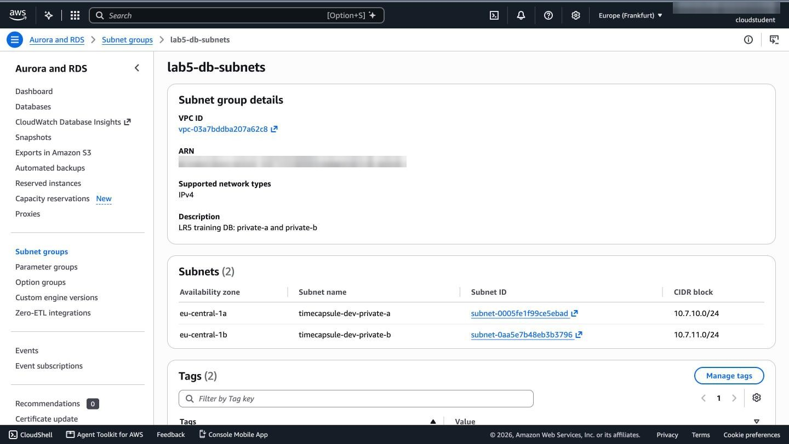
`lab5-db-subnets`: приватные подсети `timecapsule-dev-private-a` (`eu-central-1a`, `10.7.10.0/24`) и
`timecapsule-dev-private-b` (`eu-central-1b`, `10.7.11.0/24`) из `timecapsule-dev-vpc`.

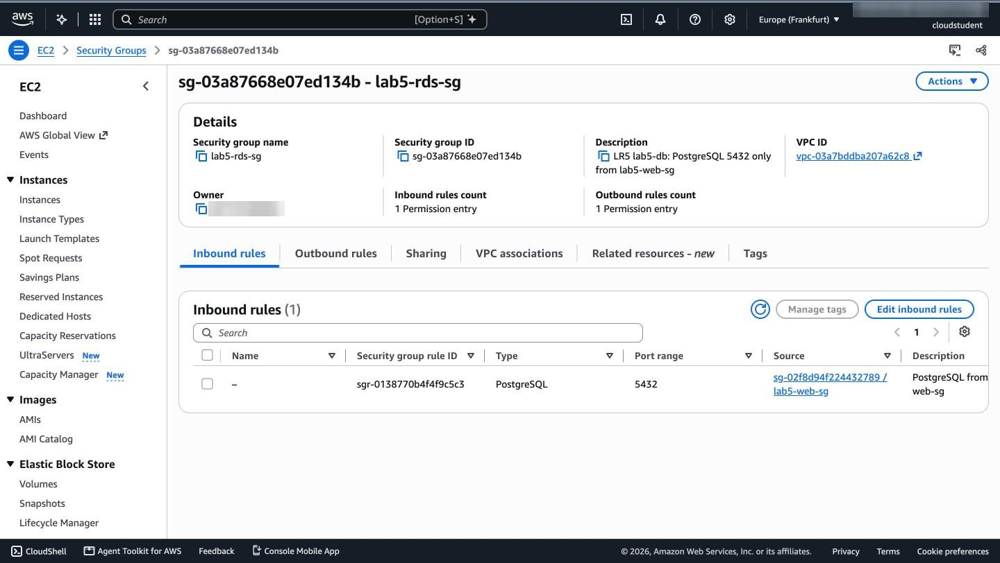
`lab5-rds-sg` (`sg-03a87668e07ed134b`): единственное входящее правило — PostgreSQL 5432 от группы
`lab5-web-sg` (`sg-02f8d94f224432789`). Сама `lab5-web-sg` входящих правил не имеет: это метка «веб-сервер,
которому можно к базе», её получил `app-server` (теперь у него `lab5-web-sg` и `timecapsule-dev-web-sg`).

**Почему для ограничения доступа удобнее использовать Security Group источника, а не его IP-адрес? Зачем
указывать две подсети, если учебная база будет работать в одной зоне?**
Правило с группой-источником пускает любой сетевой интерфейс, у которого есть эта группа, каким бы ни был его
адрес: сервер можно пересоздать, добавить второй или получить новый приватный IP — правило базы менять не
нужно. Оно описывает роль («веб-серверы»), а не адреса, и не пускает соседей по подсети, у которых этой группы
нет. Две подсети нужны, потому что группа подсетей RDS должна покрывать минимум две зоны доступности: в
`private-b` RDS сможет поставить реплику (задание 4), резервный экземпляр Multi-AZ или восстановленную копию,
если зона `eu-central-1a` откажет, — без изменения сетевых настроек.

### Задание 2. База RDS

База создана из AWS CLI, а не мастером в консоли: так пароль не нужно вводить в форму. Шаблон Sandbox —
это набор значений по умолчанию консоли, в CLI шаблонов нет, поэтому те же параметры (Single-AZ,
burstable-класс, без Multi-AZ) заданы явно. Последняя версия PostgreSQL в RDS сейчас 18.3 (версия по
умолчанию `describe-db-engine-versions --default-only`).

```bash
# пароль генерируется на app-server, сразу записывается в ~/.pgpass и попадает в переменную, не на экран
PW5=$(ssh app 'umask 077; p=$(openssl rand -base64 48 | tr -dc A-Za-z0-9 | head -c 24);
  printf "%s\n" "*:5432:lab5:dbadmin:$p" >> ~/.pgpass; chmod 600 ~/.pgpass; printf %s "$p"')
aws rds create-db-instance --db-instance-identifier lab5-db \
  --engine postgres --engine-version 18.3 --db-instance-class db.t4g.micro \
  --storage-type gp3 --allocated-storage 20 \
  --master-username dbadmin --master-user-password "$PW5" \
  --db-subnet-group-name lab5-db-subnets --availability-zone eu-central-1a --no-publicly-accessible \
  --vpc-security-group-ids $RDSSG5 --db-name lab5 \
  --backup-retention-period 1 --storage-encrypted --deletion-protection --no-multi-az \
  --copy-tags-to-snapshot --tags Key=Name,Value=lab5-db Key=Lab,Value=lab5
unset PW5
```

Без `--max-allocated-storage` автоматическое увеличение хранилища выключено. Первая попытка с
`--backup-retention-period 7` была отклонена ограничением бесплатного плана:

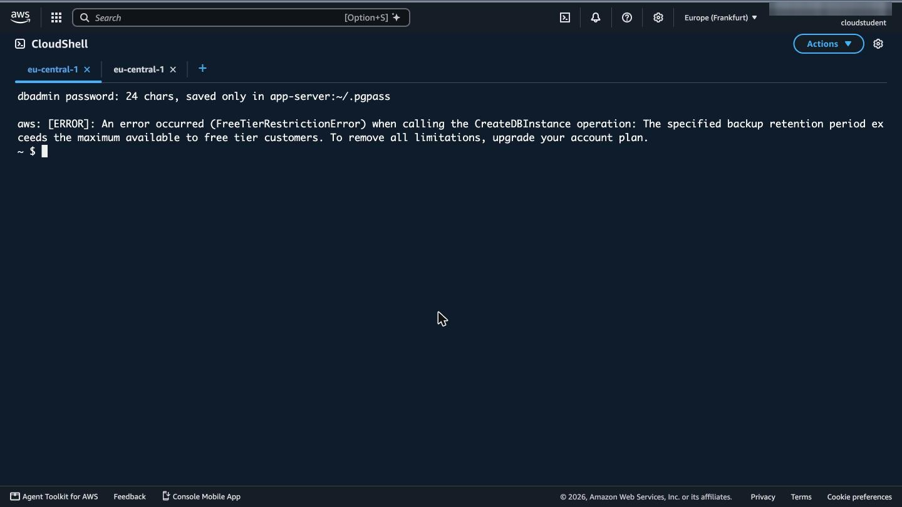
`FreeTierRestrictionError` на срок хранения 7 дней; пароль (24 символа) уже лежал только в `~/.pgpass` на
`app-server`, вторая попытка взяла его оттуда же.

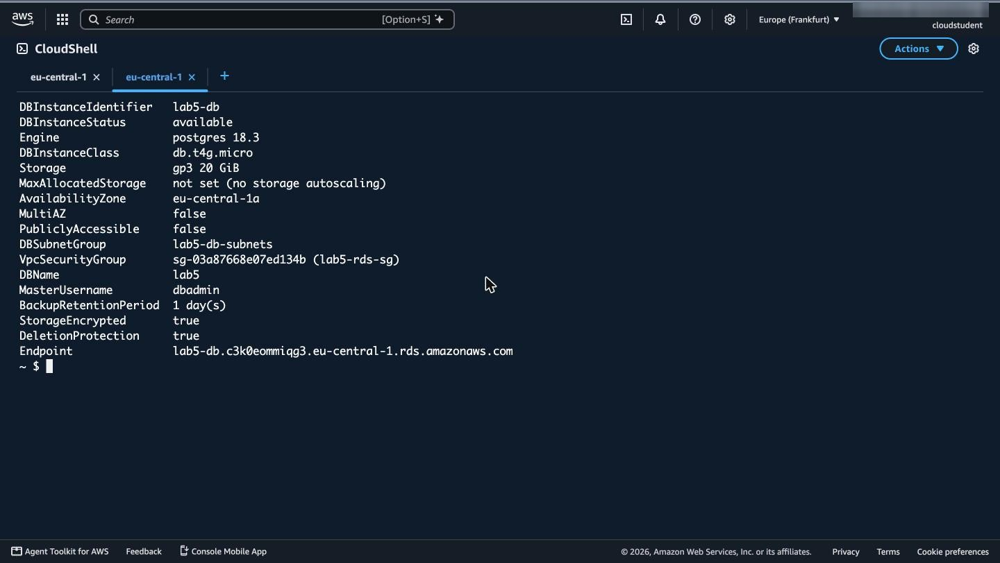
`lab5-db` в состоянии `available`: PostgreSQL 18.3, `db.t4g.micro`, `gp3` 20 ГиБ без автоматического
увеличения (`MaxAllocatedStorage` не задан), зона `eu-central-1a`, без Multi-AZ и публичного доступа, группа
подсетей `lab5-db-subnets`, Security Group `lab5-rds-sg`, база данных `lab5`, пользователь `dbadmin`, копии
хранятся 1 день, шифрование и защита от удаления включены.

**Как убедиться, что база принимает подключения только с нужного сервера? Почему для неё выбрана зона
`eu-central-1a`? От чего защищает `deletion protection`, а от чего нет?**
Посмотреть правила: у базы `Publicly accessible: No`, а в `lab5-rds-sg` один источник — `lab5-web-sg` — и
проверить на деле (задание 3): с `app-server`, у которого есть `lab5-web-sg`, порт 5432 открыт и `psql`
подключается, с `bastion` в той же VPC соединение не устанавливается, а снаружи имя базы разрешается в приватный
адрес `10.7.10.49`, который из интернета недостижим. Зона `eu-central-1a` — та же, что у `app-server`
(`public-a`): запросы не ходят между зонами, задержка меньше, и нет платы за межзонный трафик. Защита от удаления
не даёт удалить экземпляр (`DeleteDBInstance` отклоняется, пока её не выключить через Modify) — от случайного
удаления в консоли, CLI или скриптом. От потери данных внутри базы она не защищает (`DELETE`, `DROP TABLE`,
ошибочный `UPDATE`, администратор, который сначала выключит защиту) — от этого спасают резервные копии и
восстановление на момент времени.

### Задание 3. Подключение к базе

На `app-server` (`ssh app`):

```bash
DB5=lab5-db.c3k0eommiqg3.eu-central-1.rds.amazonaws.com
psql -h $DB5 -U dbadmin -d lab5          # пароль psql берёт из ~/.pgpass
```

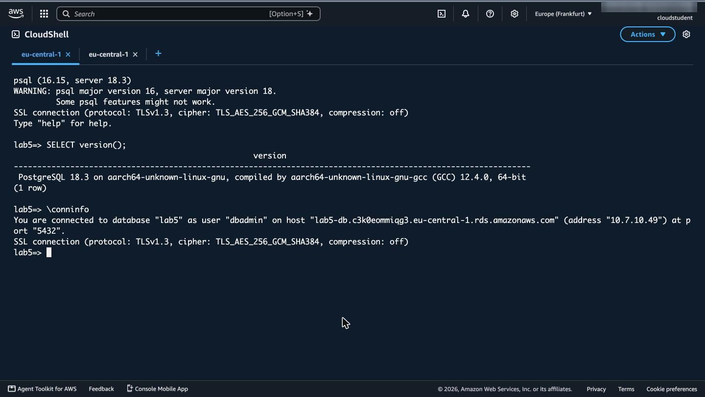
`psql` 16.15 подключился к серверу 18.3 (предупреждение о разных мажорных версиях не мешает) по TLS 1.3;
`PostgreSQL 18.3 on aarch64` — экземпляр `db.t4g` на Graviton. `\conninfo`: база `lab5`, пользователь
`dbadmin`, хост — endpoint `lab5-db`, адрес `10.7.10.49`, порт 5432.

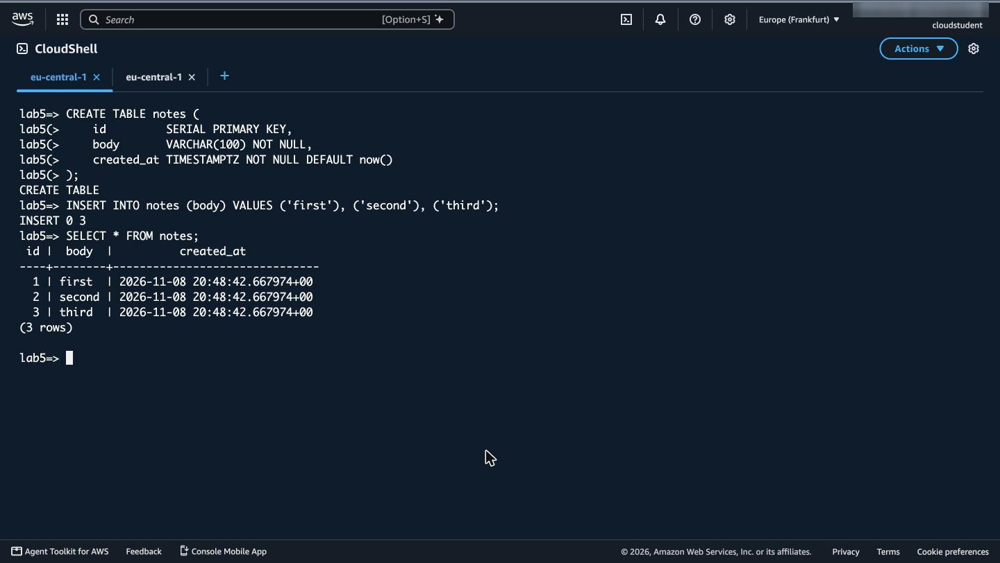
Таблица `notes` создана, в ней `first`, `second`, `third`.

```bash
dig +noall +answer +stats $DB5 | grep -E 'IN|SERVER'                       # на app-server
timeout 3 bash -c "</dev/tcp/$DB5/5432" && echo "5432 open" || echo "5432 closed/filtered"
```

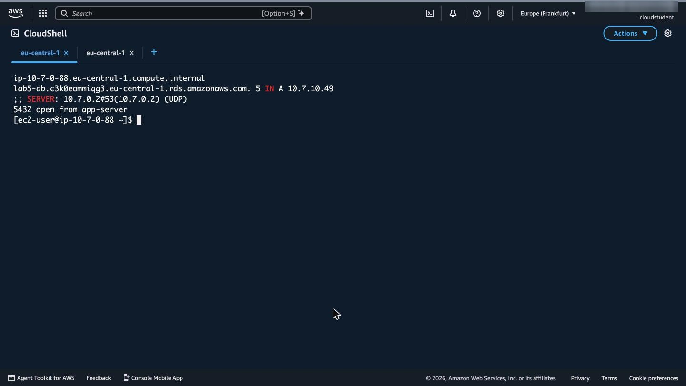
На `app-server`: endpoint — запись A на `10.7.10.49` (TTL 5 с), отвечает DNS-сервер VPC `10.7.0.2`; порт 5432
открыт.

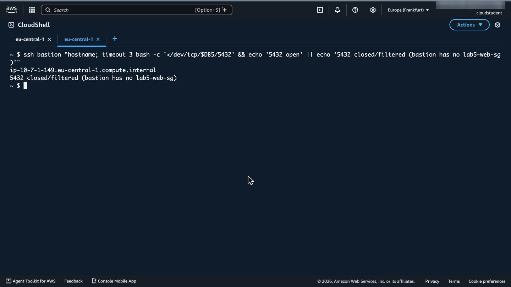
С `bastion` (в той же VPC, но без `lab5-web-sg`) соединение с 5432 не устанавливается — его отбрасывает
`lab5-rds-sg`.

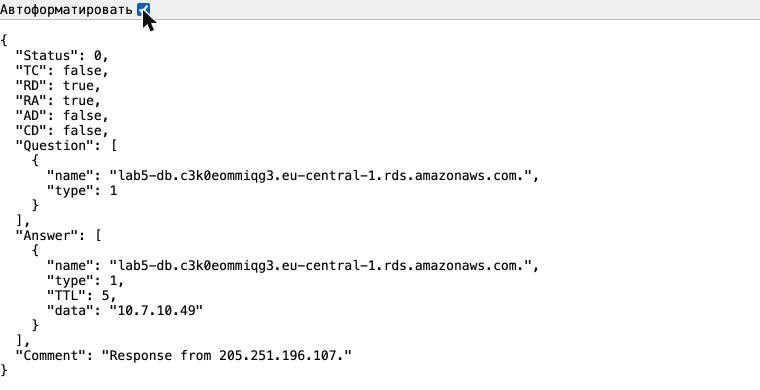
С моего компьютера (публичный резолвер Google, `https://dns.google/resolve?name=<endpoint>&type=A`) имя
разрешается в тот же приватный адрес `10.7.10.49`: RDS публикует endpoint в публичном DNS, но адрес из
диапазона VPC, и из интернета к нему не подключиться.

### Задание 4. Реплика для чтения

```bash
aws rds create-db-instance-read-replica --db-instance-identifier lab5-db-replica \
  --source-db-instance-identifier lab5-db --db-instance-class db.t4g.micro \
  --availability-zone eu-central-1b --no-publicly-accessible --vpc-security-group-ids $RDSSG5 \
  --tags Key=Name,Value=lab5-db-replica Key=Lab,Value=lab5
```

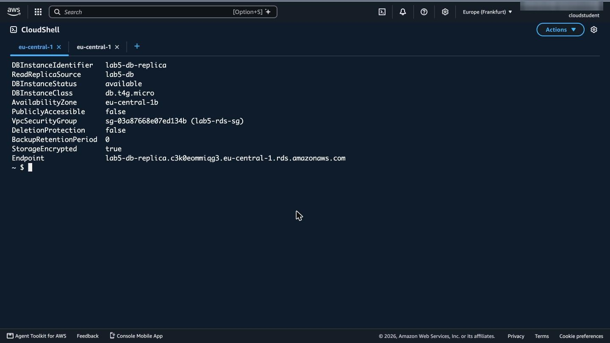
`lab5-db-replica`: источник `lab5-db`, `db.t4g.micro`, зона `eu-central-1b`, без публичного доступа, та же
`lab5-rds-sg`, защита от удаления выключена. Подсеть реплика взяла из группы подсетей источника
`lab5-db-subnets` — здесь и пригодилась вторая подсеть `private-b`. Срок хранения копий у реплики 0: резервные
копии делает основная база.

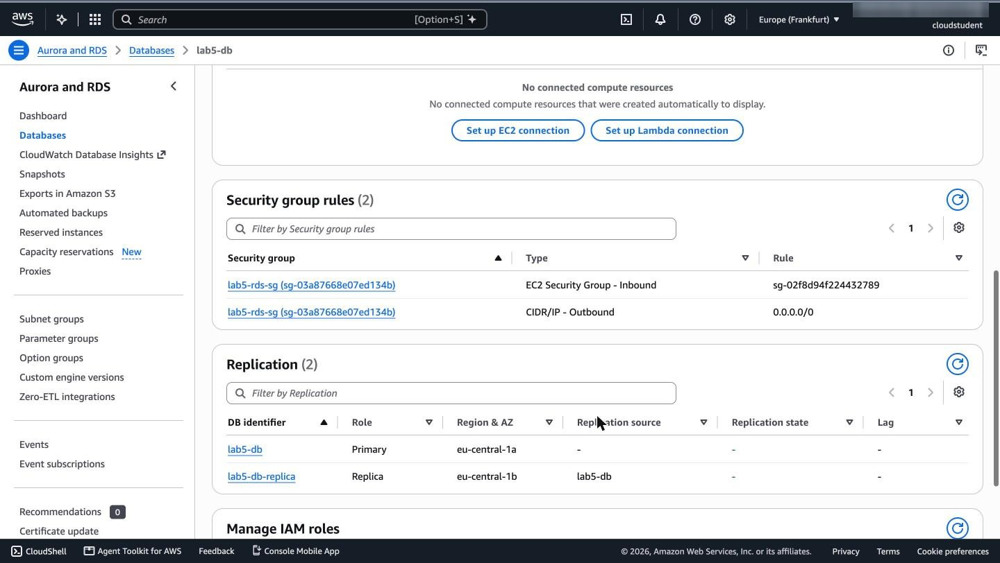
Карточка `lab5-db` в консоли: в `Security group rules` — единственное входящее правило от `lab5-web-sg`
(`sg-02f8d94f224432789`), в `Replication` — основная база `lab5-db` в `eu-central-1a` и реплика
`lab5-db-replica` в `eu-central-1b` с источником `lab5-db`.

На `app-server` (строка `*:5432:lab5:dbadmin` в `~/.pgpass` подходит и для реплики: пароль у неё тот же, что у
источника):

```bash
REP=lab5-db-replica.c3k0eommiqg3.eu-central-1.rds.amazonaws.com
psql -h $REP -U dbadmin -d lab5 -e -c 'SELECT inet_server_addr();' -c 'SELECT pg_is_in_recovery();' \
  -c 'SELECT * FROM notes;' -c "INSERT INTO notes (body) VALUES ('from replica');"
psql -h $DB5 -U dbadmin -d lab5 -e -c 'SELECT inet_server_addr();' -c 'SELECT pg_is_in_recovery();' \
  -c "INSERT INTO notes (body) VALUES ('fourth');"
psql -h $REP -U dbadmin -d lab5 -e -c 'SELECT * FROM notes;'
```

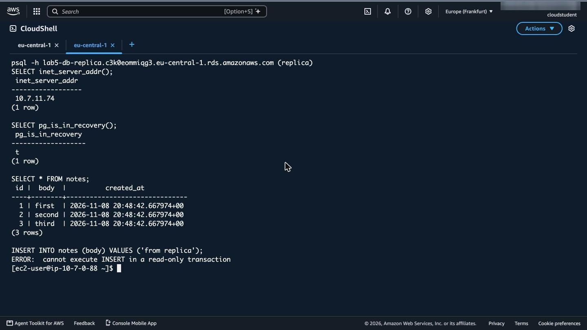
Реплика отвечает с адреса `10.7.11.74` (подсеть `private-b`), `pg_is_in_recovery()` = `t`: сервер работает в
режиме восстановления и только применяет журнал изменений (WAL), который присылает основная база. Строки
`first`–`third` на месте, а `INSERT` отклонён: `cannot execute INSERT in a read-only transaction`.

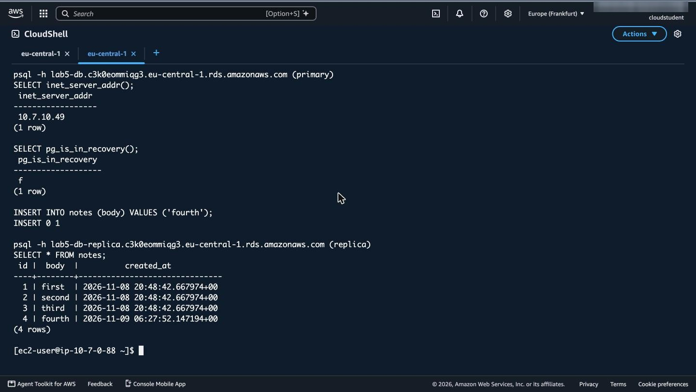
На основной базе (`10.7.10.49`, `private-a`) `pg_is_in_recovery()` = `f`. Строка `fourth`, добавленная на
основной базе, видна на реплике уже при следующем запуске `psql`, меньше чем через секунду.

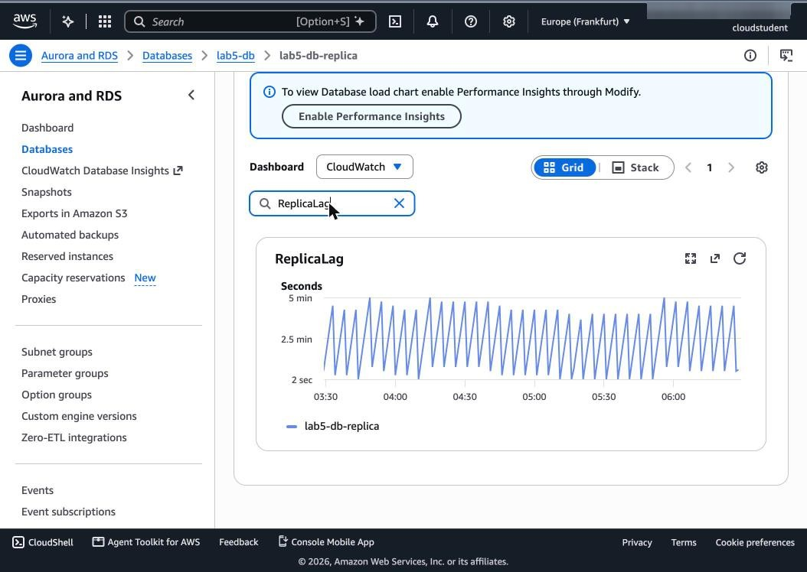
`ReplicaLag` реплики за 3 часа с периодом 1 минута — «пила» от 2 секунд до 5 минут. Так метрика ведёт себя,
когда в базу никто не пишет: для PostgreSQL RDS считает отставание как «текущее время минус время последней
применённой транзакции», поэтому без записей значение растёт. Раз в 5 минут RDS переключает сегмент журнала,
на реплику приходит новая запись, и отставание падает.

```bash
aws cloudwatch get-metric-statistics --namespace AWS/RDS --metric-name ReplicaLag \
  --dimensions Name=DBInstanceIdentifier,Value=lab5-db-replica \
  --start-time $(date -u -d '-25 min' +%FT%TZ) --end-time $(date -u +%FT%TZ) \
  --period 60 --statistics Maximum --query 'sort_by(Datapoints,&Timestamp)[].[Timestamp,Maximum]' --output text
```

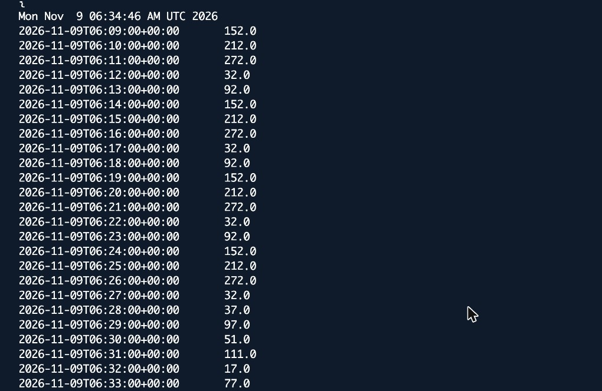
Те же значения из CloudWatch: каждую минуту метрика растёт на 60 с (32 → 92 → … → 272) и сбрасывается при
переключении журнала. В 06:28 цикл сбился: в 06:27:52 на основной базе добавлена `fourth`, в 06:29:38
выполнен `DELETE` (задание 5) — после каждой записи значение падает до времени, прошедшего с неё. Реальная
задержка доставки изменений — меньше секунды, что и показала строка `fourth`.

**Почему `INSERT` на реплике не выполнился? Чем реплика для чтения отличается от резервного экземпляра
Multi-AZ?**
Реплика — физическая копия: PostgreSQL на ней работает в режиме восстановления (`pg_is_in_recovery() = t`) и
только применяет журнал изменений основной базы, поэтому любая транзакция на ней только для чтения. Писать можно
лишь в основную базу. Реплика для чтения — отдельный экземпляр со своим endpoint: к ней подключаются, чтобы
разгрузить основную базу чтением, но копия асинхронная и немного отстаёт, а при отказе основной базы сама не
переключается — её можно только вручную повысить (promote) до самостоятельной базы. Резервный экземпляр
Multi-AZ получает изменения синхронно (транзакция подтверждается, когда записана в обеих зонах), своего
endpoint у него нет и подключиться к нему нельзя: он нужен только на случай отказа, и тогда RDS сам переключает
endpoint основной базы на него за 1–2 минуты без потери подтверждённых данных.

### Задание 5. Восстановление после ошибки

На `app-server`:

```bash
psql -h $DB5 -U dbadmin -d lab5 -e -c "SELECT now() AT TIME ZONE 'UTC';" -c 'SELECT * FROM notes;'
# через минуту
psql -h $DB5 -U dbadmin -d lab5 -e -c "SELECT now() AT TIME ZONE 'UTC';" -c 'DELETE FROM notes;'
psql -h $REP -U dbadmin -d lab5 -e -c 'SELECT * FROM notes;'
```

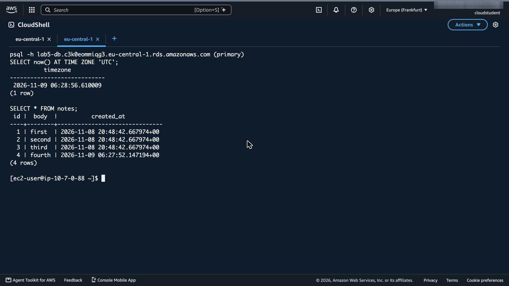
Момент до ошибки — `2026-11-09 06:28:56` UTC (08:28:56 по Кишинёву), в таблице четыре строки.

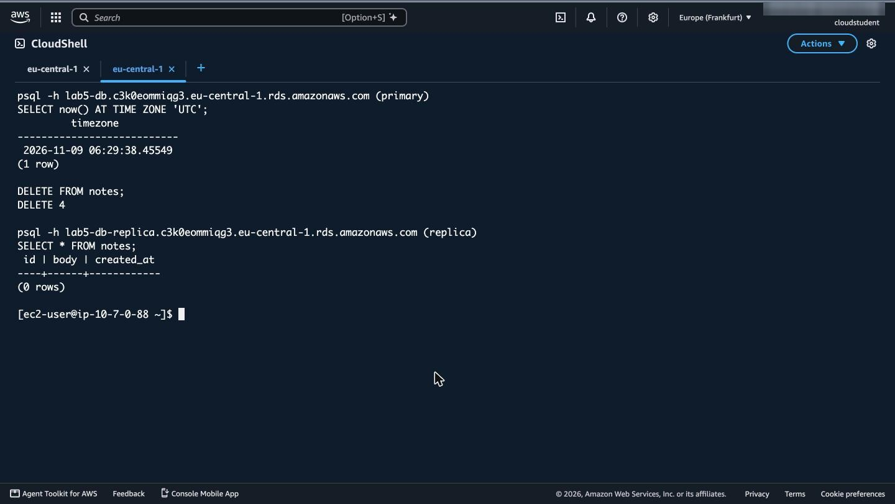
В 06:29:38 UTC удалены все 4 строки. На реплике таблица сразу пустая: `DELETE` дошёл до неё так же быстро,
как перед этим `fourth`.

Реплика больше не нужна (CloudShell):

```bash
aws rds delete-db-instance --db-instance-identifier lab5-db-replica --skip-final-snapshot
```

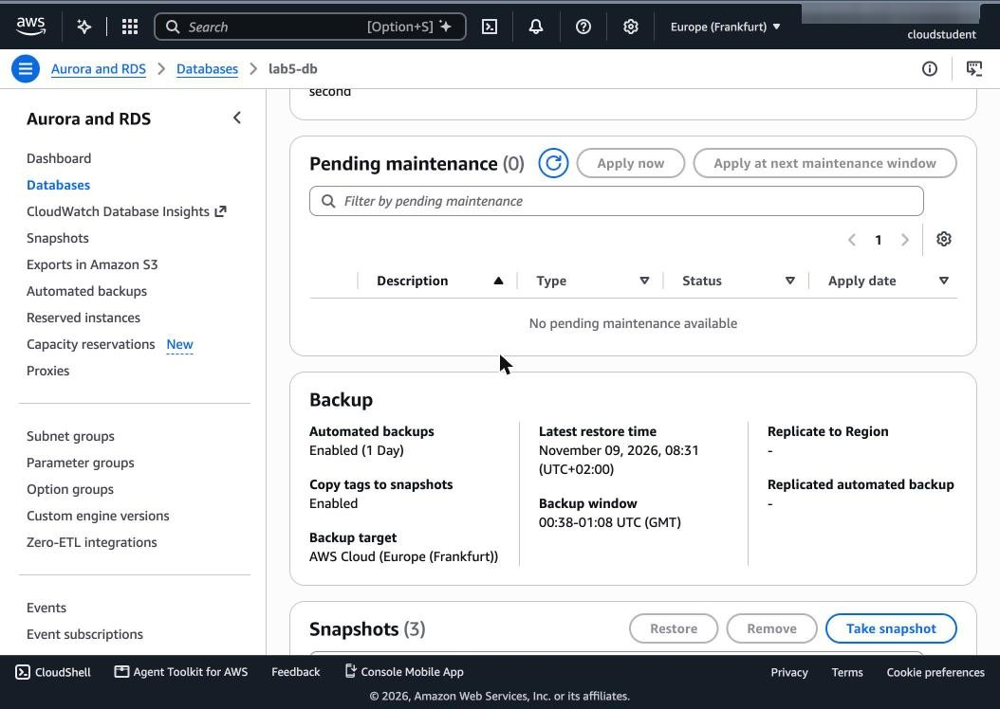
`Maintenance & backups` основной базы: автоматические копии включены (1 день), `Latest restore time` —
08:31 (UTC+02:00), то есть позже нужного момента 08:28:56. Двумя минутами раньше `LatestRestorableTime` в
`describe-db-instances` был 06:26:54 UTC — раньше нужного момента, поэтому пришлось подождать, пока RDS
сохранит очередной кусок журнала. Снимков у базы три, все автоматические: при создании базы, при создании
реплики и ночной в окне резервного копирования (`00:38–01:08` UTC).

Восстановление сделано в консоли: `lab5-db` → `Actions` → `Restore to point in time`.

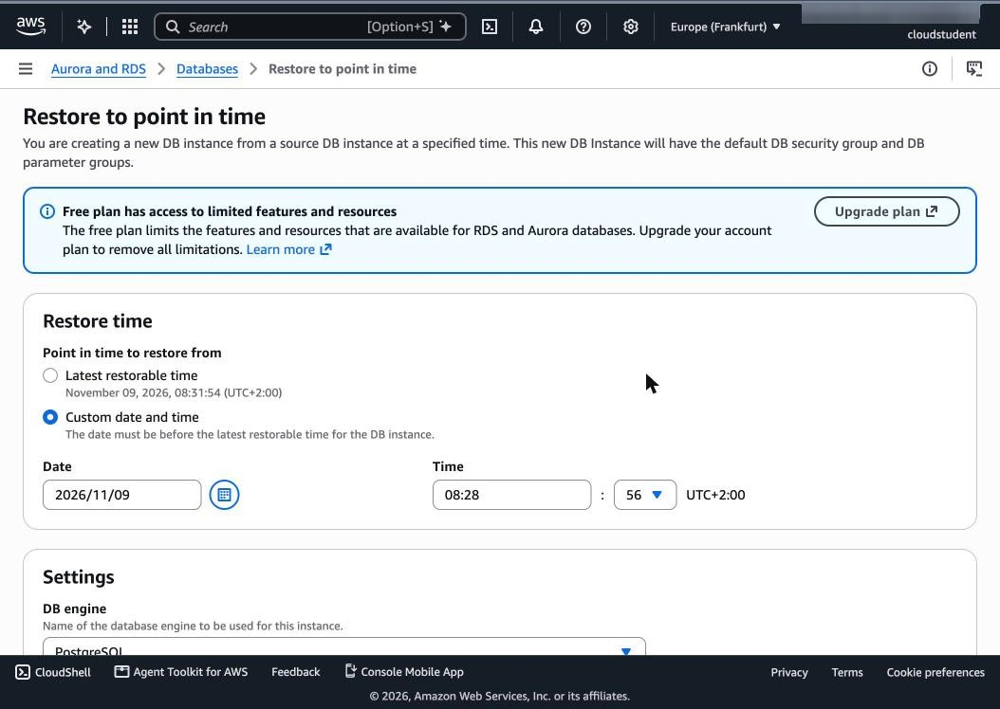
`Custom date and time`: 2026/11/09 08:28:56. Рядом с полем указан пояс `UTC+2:00` (пояс браузера), поэтому
время из шага 1 (06:28:56 UTC) введено как 08:28:56.

Остальные параметры копии: имя `lab5-db-restore`, класс `db.t4g.micro`, `Single-AZ DB instance deployment`
(варианты Multi-AZ на Free plan недоступны), `gp3` 20 ГиБ. Флажок `Enable storage autoscaling` в форме
восстановления по умолчанию включён (до 1000 ГиБ) — я его снял, как у исходной базы. Теги `Name=lab5-db-restore`
и `Lab=lab5`.

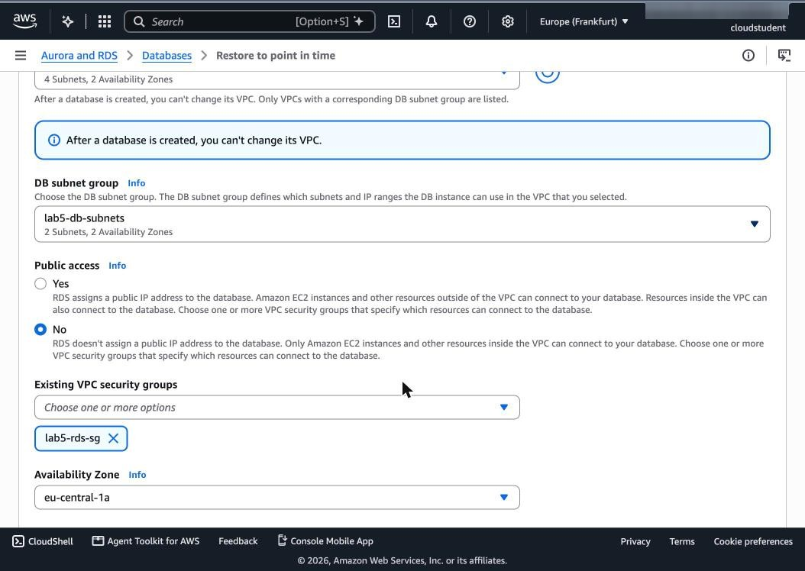
Сеть: `timecapsule-dev-vpc`, группа подсетей `lab5-db-subnets`, `Public access: No`, Security Group
`lab5-rds-sg`, зона `eu-central-1a`. Ниже в форме `Enable deletion protection` не отмечен.

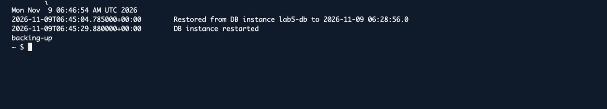
Событие копии `Restored from DB instance lab5-db to 2026-11-09 06:28:56.0`: копия создана на нужный момент,
после этого RDS перезапустил её и сделал первый снимок (состояние `backing-up`, затем `available`).

```bash
RST=lab5-db-restore.c3k0eommiqg3.eu-central-1.rds.amazonaws.com    # на app-server
psql -h $RST -U dbadmin -d lab5 -e -c 'SELECT inet_server_addr();' -c 'SELECT * FROM notes;'
psql -h $DB5 -U dbadmin -d lab5 -e -c 'SELECT count(*) FROM notes;'
```

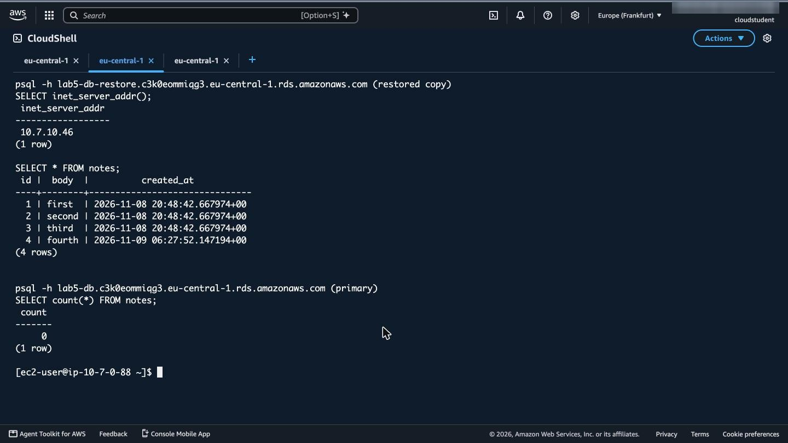
В копии (`10.7.10.46`, новый адрес и новый endpoint) все четыре строки, включая `fourth`, а в основной базе
по-прежнему 0 строк. Пароль `dbadmin` у копии тот же, что у источника, поэтому `psql` снова взял его из
`~/.pgpass`. Копия проверена и удалена без финального снимка и без сохранения резервных копий (команда — в
«Завершении Части 1»).

**Почему реплика не спасла данные? Почему восстановление создаёт новую базу, а не откатывает старую?**
Реплика повторяет все изменения основной базы, в том числе ошибочные: `DELETE` дошёл до неё меньше чем за
секунду, как и любая другая транзакция. Реплика защищает от потери сервера или зоны и разгружает чтение, но не
от ошибок в самих данных. Восстановление берёт последний автоматический снимок до нужного момента и применяет
к нему сохранённый журнал изменений до указанного времени — журнал можно «проиграть» только вперёд от снимка,
поэтому результат получается на новом хранилище, то есть в новой базе с новым endpoint. Исходная база остаётся
нетронутой: в ней могут быть данные, записанные уже после ошибки, копию можно сначала проверить и только потом
переключить на неё приложение, а если момент выбран неудачно — восстановить ещё раз.

### Завершение Части 1

```bash
aws rds modify-db-instance --db-instance-identifier lab5-db --no-deletion-protection --apply-immediately
aws rds delete-db-instance --db-instance-identifier lab5-db --skip-final-snapshot --delete-automated-backups
aws ec2 modify-instance-attribute --instance-id i-08dd33ebb505096f4 --groups sg-006025d3f22a219dc
aws rds delete-db-instance --db-instance-identifier lab5-db-restore --skip-final-snapshot --delete-automated-backups
aws rds wait db-instance-deleted --db-instance-identifier lab5-db-restore
aws rds delete-db-subnet-group --db-subnet-group-name lab5-db-subnets
aws ec2 delete-security-group --group-id $RDSSG5                                  # lab5-rds-sg
aws ec2 delete-security-group --group-id $WEBSG5                                  # lab5-web-sg
```

Защиту от удаления пришлось сначала выключить: с ней `Delete` в меню `Actions` недоступен. База в этот момент
работала, поэтому запускать её перед `modify-db-instance` не понадобилось.

`lab5-web-sg` сначала снята с `app-server`, потом удалена; у сервера снова одна группа
`timecapsule-dev-web-sg`.

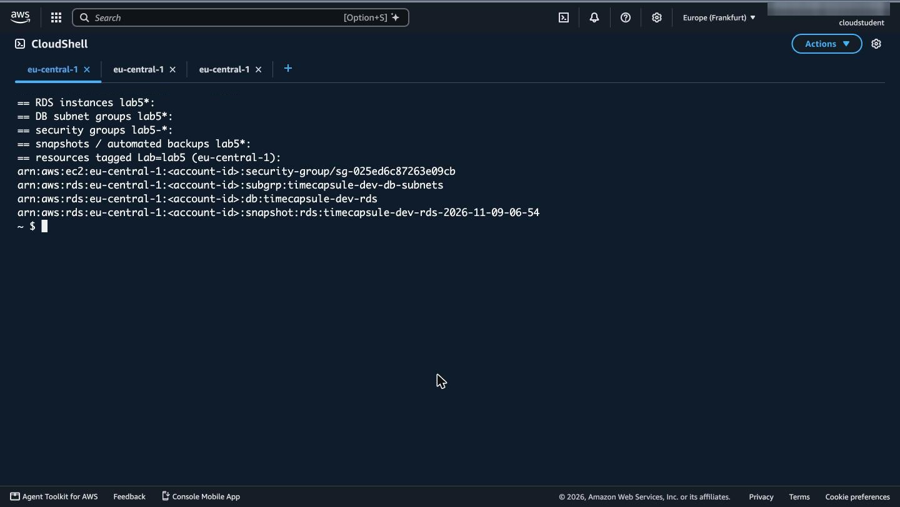
Проверка: экземпляров, групп подсетей, Security Groups, снимков и автоматических копий с префиксом `lab5` нет — ни
реплики, ни копии. С тегом `Lab=lab5` остались только ресурсы Части 2 (`timecapsule-dev-…`) и автоматический
снимок базы приложения.

---

## Часть 2. Продвинутый уровень

Ресурсы Части 2 остаются до конца курса и названы по соглашению из ЛР3; теги `Project=timecapsule`,
`Environment=dev`, `Owner=danielmihai`, `Lab=lab5`.

### Задание 6. База приложения

```bash
aws rds create-db-subnet-group --db-subnet-group-name timecapsule-dev-db-subnets \
  --db-subnet-group-description "TimeCapsule dev RDS: private-a and private-b" --subnet-ids $PA $PB \
  --tags Key=Name,Value=timecapsule-dev-db-subnets Key=Project,Value=timecapsule Key=Environment,Value=dev \
         Key=Owner,Value=danielmihai Key=Lab,Value=lab5
RDSSG=$(aws ec2 create-security-group --group-name timecapsule-dev-rds-sg \
  --description "TimeCapsule dev RDS: PostgreSQL 5432 only from web-sg" --vpc-id $VPC \
  --tag-specifications 'ResourceType=security-group,Tags=[{Key=Name,Value=timecapsule-dev-rds-sg},{Key=Project,Value=timecapsule},{Key=Environment,Value=dev},{Key=Owner,Value=danielmihai},{Key=Lab,Value=lab5}]' \
  --query GroupId --output text)                                  # sg-025ed6c87263e09cb
aws ec2 authorize-security-group-ingress --group-id $RDSSG --ip-permissions \
  "IpProtocol=tcp,FromPort=5432,ToPort=5432,UserIdGroupPairs=[{GroupId=sg-006025d3f22a219dc,Description=PostgreSQL from web-sg (app-server)}]"

# пароль dbadmin генерируется на app-server и сразу попадает в ~/.pgpass (строка только для этого хоста)
PW=$(ssh app 'umask 077; p=$(openssl rand -base64 48 | tr -dc A-Za-z0-9 | head -c 24);
  printf "%s\n" "timecapsule-dev-rds.c3k0eommiqg3.eu-central-1.rds.amazonaws.com:5432:*:dbadmin:$p" >> ~/.pgpass;
  printf %s "$p"')
aws rds create-db-instance --db-instance-identifier timecapsule-dev-rds \
  --engine postgres --engine-version 16.15 --db-instance-class db.t4g.micro \
  --storage-type gp3 --allocated-storage 20 \
  --master-username dbadmin --master-user-password "$PW" \
  --db-subnet-group-name timecapsule-dev-db-subnets --availability-zone eu-central-1a \
  --no-publicly-accessible --vpc-security-group-ids $RDSSG \
  --backup-retention-period 1 --storage-encrypted --deletion-protection --no-multi-az --copy-tags-to-snapshot \
  --tags Key=Name,Value=timecapsule-dev-rds Key=Project,Value=timecapsule Key=Environment,Value=dev \
         Key=Owner,Value=danielmihai Key=Lab,Value=lab5
unset PW
```

Версия 16.15 — последняя в ветке 16: на ней работал `db-server`, и такие же `psql`/`pg_dump` 16.15 стоят на
`app-server`, поэтому `pg_dump` не упрётся в несовпадение версий. `--db-name` не указан: базу данных
`timecapsule` я создаю сам в задании 8. Первая попытка создать базу, пока существовали `lab5-db` и
`lab5-db-replica`, вернула `InstanceQuotaExceeded: You reached the maximum number of instances available with
free plan accounts` — третий экземпляр RDS бесплатный план не разрешает, поэтому база приложения создана, когда
реплика и `lab5-db` уже были удалены.

Примерно через 8 минут после команды база перешла в `available` (событие `DB instance created` — 08:53, первый
снимок закончился в 08:57 по Кишинёву).

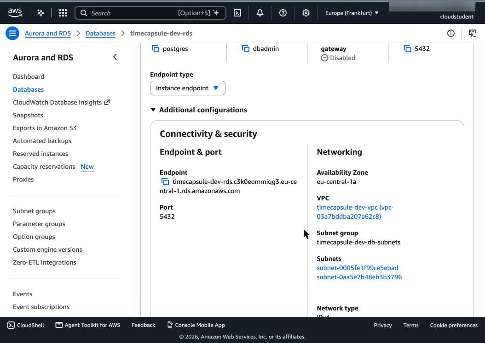
`Connectivity & security` → `Endpoints`: endpoint `timecapsule-dev-rds.c3k0eommiqg3.eu-central-1.rds.amazonaws.com`,
порт 5432, зона `eu-central-1a`, VPC `timecapsule-dev-vpc`, группа подсетей `timecapsule-dev-db-subnets` с
подсетями `private-a` и `private-b`. Выше на той же вкладке: `Internet access gateway: Disabled`, база данных по
умолчанию `postgres`, пользователь `dbadmin`.

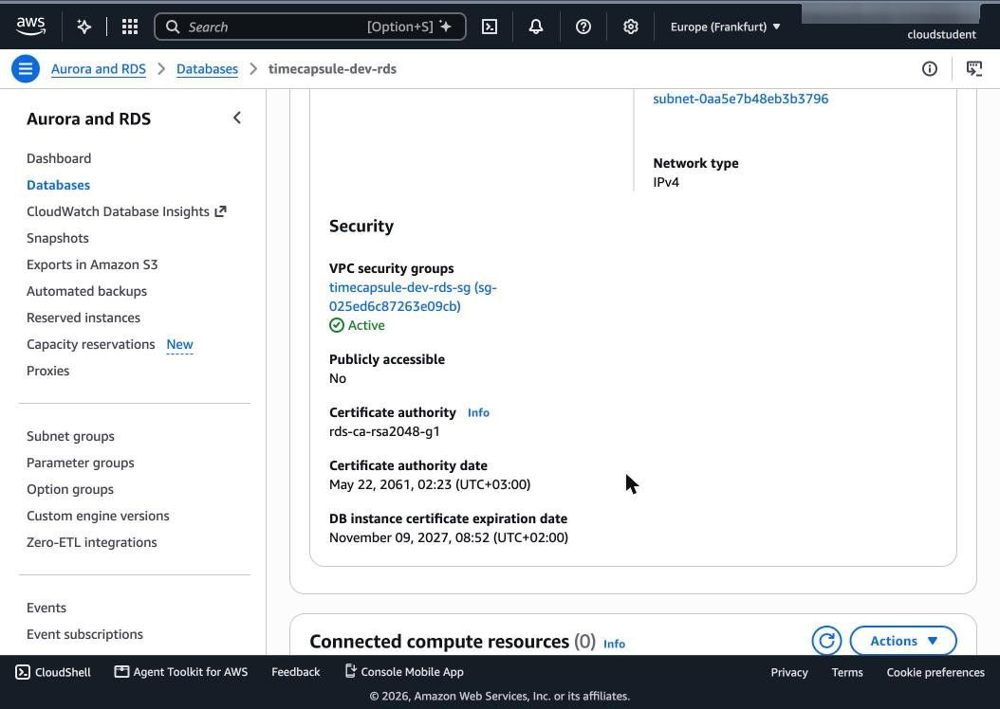
`Security`: группа `timecapsule-dev-rds-sg` активна, `Publicly accessible: No`, сертификат сервера выдан
центром `rds-ca-rsa2048-g1` и действует до ноября 2027 года.

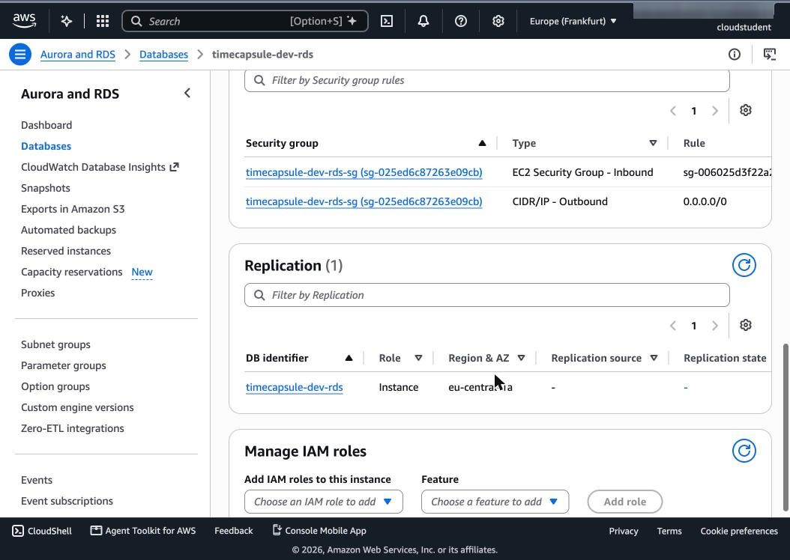
`Security group rules`: входящее правило только от группы `sg-006025d3f22a…` (`timecapsule-dev-web-sg`, её
носит `app-server`), исходящее — по умолчанию.

**Какие параметры базы приложения вы выбрали бы иначе для рабочей системы с реальными пользователями?
Почему?**
Multi-AZ (резервный экземпляр в `eu-central-1b` с автоматическим переключением) и срок хранения копий 7–35
дней на платном плане: простой и потеря данных там уже недопустимы. Класс не burstable `db.t4g.micro`, у
которого кончаются кредиты CPU, а `db.m7g`/`db.r7g` по нагрузке, автоувеличение хранилища с верхним пределом,
Performance Insights, сигналы CloudWatch (CPU, `FreeStorageSpace`, соединения) и журналы PostgreSQL в
CloudWatch Logs. Пароли — в AWS Secrets Manager с ротацией (`--manage-master-user-password`), клиенты проверяют
сертификат сервера (`sslmode=verify-full`). Ночной остановки не было бы: база работает круглосуточно, а
расходы снижают зарезервированные экземпляры.

### Задание 7. Ночная остановка базы

Политика и роль созданы из CloudShell (`<account-id>` — номер аккаунта):

```json
{
  "Version": "2012-10-17",
  "Statement": [
    {
      "Sid": "StopOnlyAppDatabase",
      "Effect": "Allow",
      "Action": "rds:StopDBInstance",
      "Resource": "arn:aws:rds:eu-central-1:<account-id>:db:timecapsule-dev-rds"
    }
  ]
}
```

```json
{
  "Version": "2012-10-17",
  "Statement": [
    {
      "Effect": "Allow",
      "Principal": { "Service": "scheduler.amazonaws.com" },
      "Action": "sts:AssumeRole",
      "Condition": { "StringEquals": { "aws:SourceAccount": "<account-id>" } }
    }
  ]
}
```

```bash
TAGS='Key=Project,Value=timecapsule Key=Environment,Value=dev Key=Owner,Value=danielmihai Key=Lab,Value=lab5'
aws iam create-policy --policy-name timecapsule-dev-rds-stop \
  --description "EventBridge Scheduler stops only the timecapsule-dev-rds DB instance, LR5" \
  --policy-document file://~/lab5/rds-stop-policy.json --tags $TAGS
aws iam create-role --role-name timecapsule-dev-scheduler-role \
  --description "EventBridge Scheduler role for the nightly stop of timecapsule-dev-rds, LR5" \
  --assume-role-policy-document file://~/lab5/scheduler-trust.json --tags $TAGS
aws iam attach-role-policy --role-name timecapsule-dev-scheduler-role \
  --policy-arn arn:aws:iam::<account-id>:policy/timecapsule-dev-rds-stop
```

Условие `aws:SourceAccount` в доверии роли не даёт взять её расписанию из чужого аккаунта (защита от «confused
deputy»): Scheduler может взять роль, только если расписание принадлежит этому аккаунту.

Расписание создано в консоли: `Amazon EventBridge` → `Scheduler` → `Schedules` → `Create schedule`.

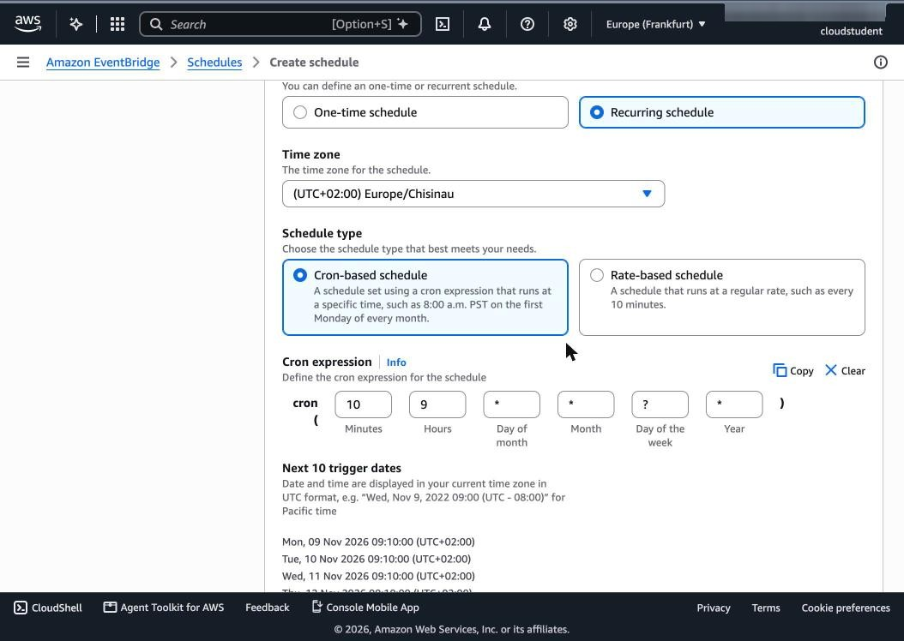
`Recurring schedule`, часовой пояс `Europe/Chisinau`, `Cron-based schedule`. Для проверки — `cron(10 9 * * ? *)`,
то есть 09:10 по Кишинёву, через 8 минут после создания; ниже консоль показывает следующие срабатывания.
`Flexible time window` — `Off`.

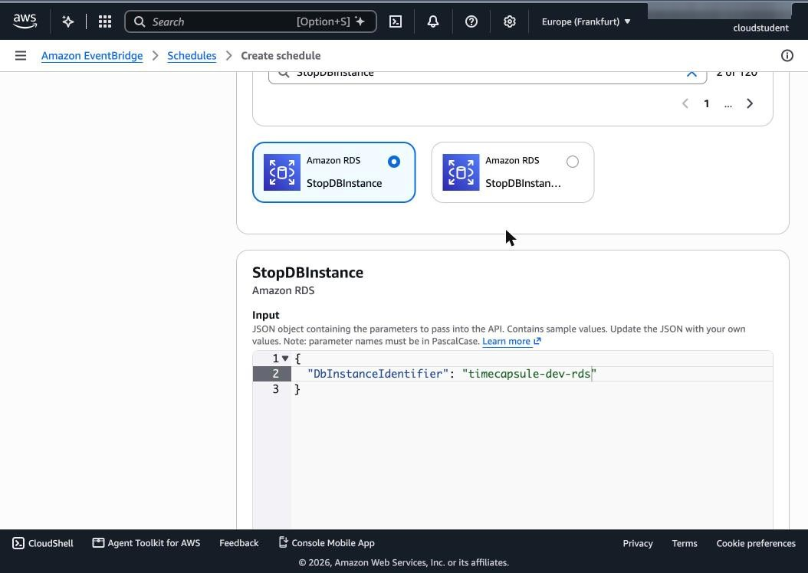
`Target API` → `All APIs` → `Amazon RDS` → `StopDBInstance`, входные данные
`{"DbInstanceIdentifier": "timecapsule-dev-rds"}`.

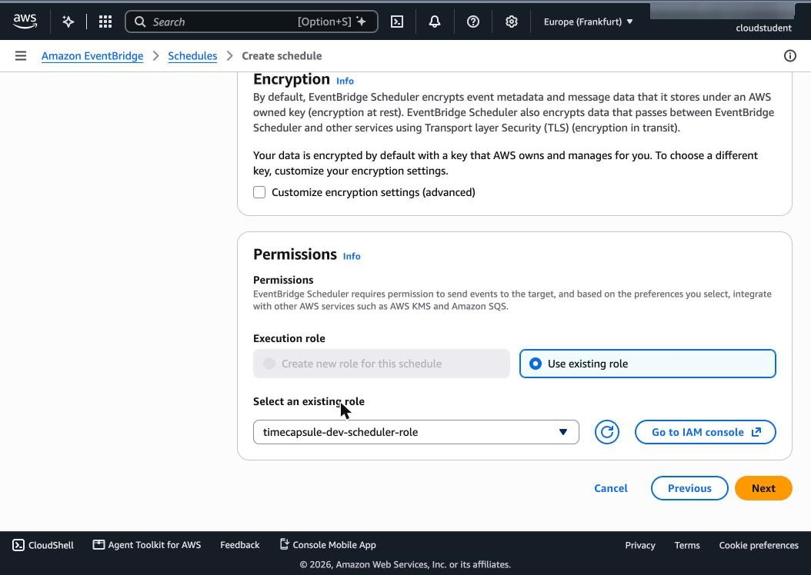
`Settings` → `Permissions` → `Use existing role` → `timecapsule-dev-scheduler-role`. Остальное по умолчанию:
расписание включено, после выполнения не удаляется (`NONE`), повторы выключены.

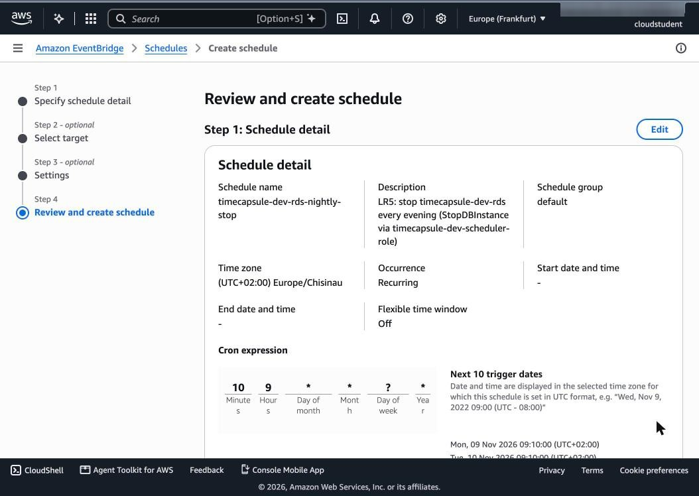
Страница `Review and create schedule` перед созданием.

```bash
aws scheduler get-schedule --name timecapsule-dev-rds-nightly-stop \
  --query '{Expr:ScheduleExpression,TZ:ScheduleExpressionTimezone,State:State,Window:FlexibleTimeWindow,TargetArn:Target.Arn,Input:Target.Input,Retry:Target.RetryPolicy}'
```

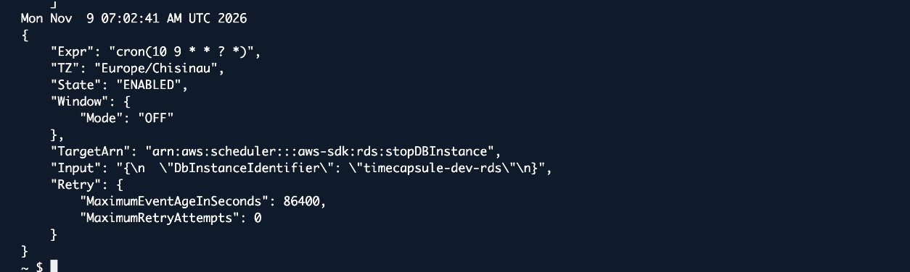
Созданное расписание: цель — универсальная цель `arn:aws:scheduler:::aws-sdk:rds:stopDBInstance`, то есть
Scheduler сам вызывает API RDS; `MaximumRetryAttempts: 0` — при ошибке вызов не повторяется.

Проверка — состояние базы каждые 20 секунд:

```bash
while true; do s=$(aws rds describe-db-instances --db-instance-identifier timecapsule-dev-rds \
    --query 'DBInstances[0].DBInstanceStatus' --output text)
  echo "$(date -u +%T) UTC  $(TZ=Europe/Chisinau date +%T) Chisinau  $s"; [ "$s" = stopped ] && break; sleep 20; done
```

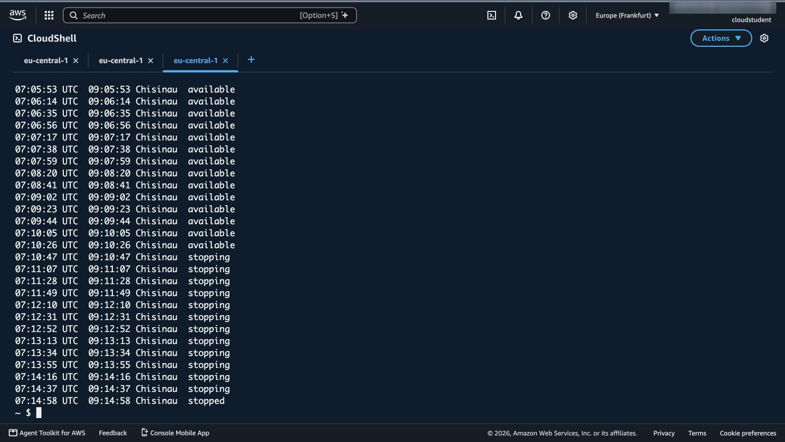
В 09:10 по Кишинёву (07:10 UTC) расписание сработало: база перешла в `stopping`, а в 09:14:58 — в `stopped`.

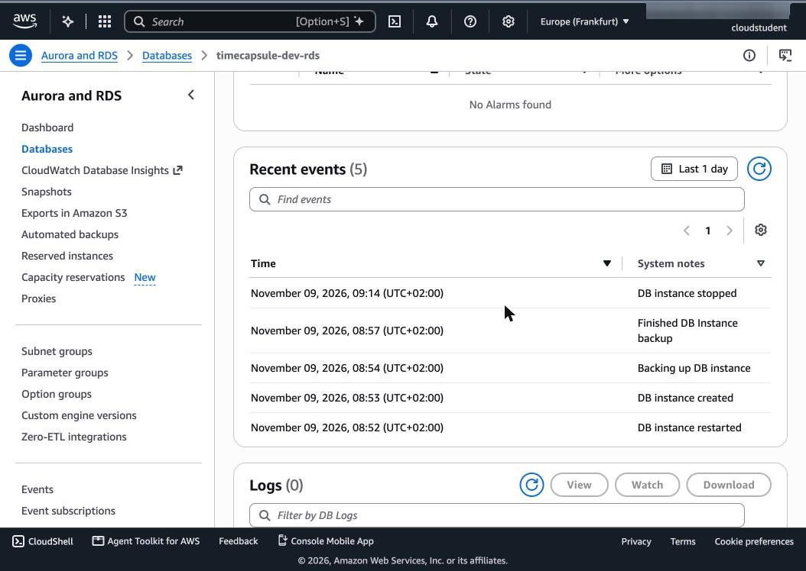
`Logs & events` базы: событие `DB instance stopped` в 09:14. Кто именно вызвал `StopDBInstance`, видно в CloudTrail
(задание 11).

После проверки расписание переведено на вечер: `Edit` → `cron(0 23 * * ? *)` → `Skip to Review and save
schedule` → `Save schedule`.

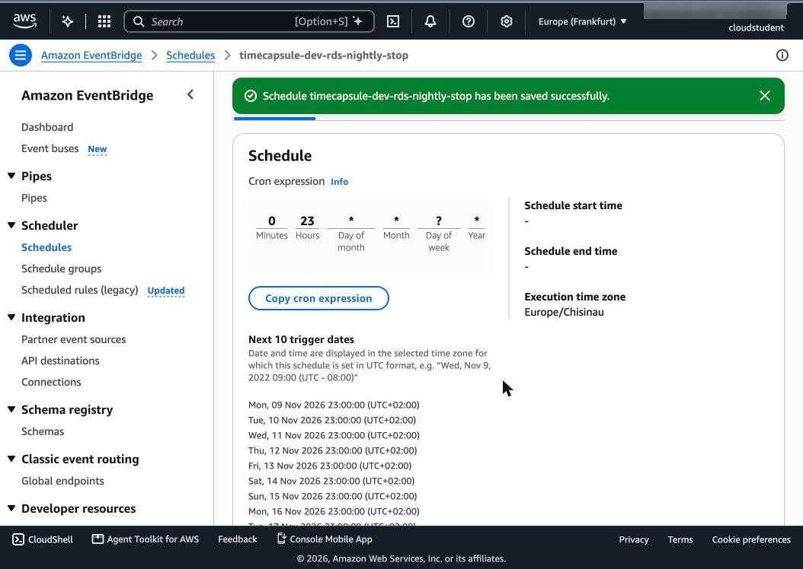
Расписание сохранено: каждый день в 23:00 `Europe/Chisinau`, ближайшее срабатывание — сегодня, 9 ноября, в 23:00.

```bash
aws rds start-db-instance --db-instance-identifier timecapsule-dev-rds    # база снова нужна для заданий 9–11
```

**Зачем расписанию своя роль, если вы и сами можете остановить базу? Почему роль может остановить только одну
базу?**
В 23:00 меня может не быть за компьютером, а моих учётных данных у EventBridge Scheduler нет и быть не должно.
Поэтому Scheduler берёт на себя роль и получает временные учётные данные STS только на время вызова, а
доверие роли разрешает это только сервису `scheduler.amazonaws.com` из моего аккаунта. Права роли — наименьшие
нужные: только `rds:StopDBInstance` и только для ARN `timecapsule-dev-rds`. Если в расписании ошибутся с
`DbInstanceIdentifier` или роль используют не по назначению, она не сможет остановить, изменить или удалить
другие базы и ресурсы.

### Задание 8. Пользователь и база данных

На `app-server`, под `dbadmin` к служебной базе данных `postgres` (пароль `psql` берёт из строки `~/.pgpass`
для хоста `timecapsule-dev-rds`):

```bash
EP=timecapsule-dev-rds.c3k0eommiqg3.eu-central-1.rds.amazonaws.com
psql -h $EP -U dbadmin -d postgres -c '\conninfo' -c 'SELECT version();' -c 'SHOW password_encryption;' -c '\l'
```

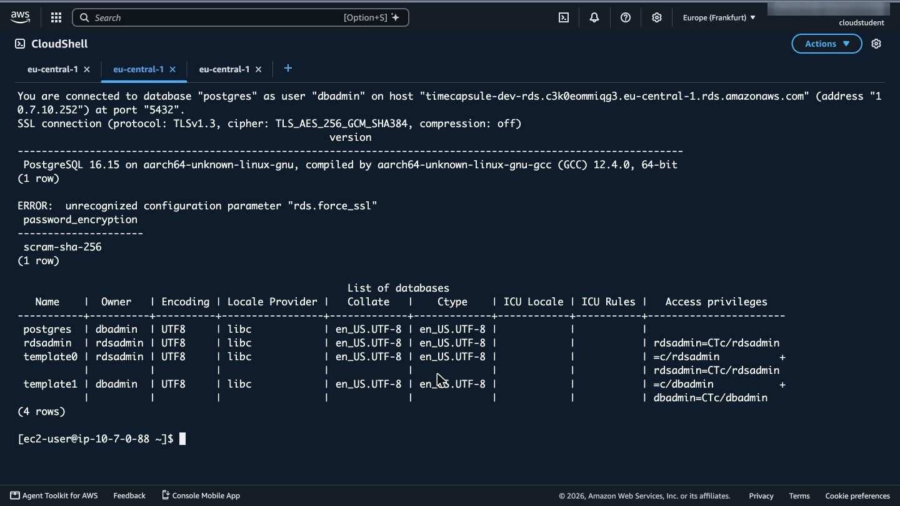
Соединение по TLS 1.3, сервер PostgreSQL 16.15 на `aarch64` (Graviton). В экземпляре есть только служебные
базы данных `postgres`, `rdsadmin`, `template0/1`. Пароли хранятся как SCRAM-SHA-256.

`\password` спрашивает пароль с клавиатуры, а пароль приложения я не набираю и не вывожу на экран. Поэтому тот
же результат получен по-другому: строка `\set pw …` с паролем из `DB_PASSWORD` в `.env` и команды SQL
передаются в `psql` через конвейер. `psql` читает их не с терминала, поэтому в историю они не попадают, а
`:'pw'` подставляет значение переменной как строковый литерал. Пароль идёт на сервер по TLS-соединению, а
сервер сохраняет только его хеш SCRAM.

```bash
{ printf '\\set pw %s\n' "$(sudo sed -n 's/^DB_PASSWORD=//p' /var/www/timecapsule/.env)"
  printf '%s\n' 'CREATE USER timecapsule;' "ALTER ROLE timecapsule PASSWORD :'pw';" \
                'GRANT timecapsule TO dbadmin;' 'CREATE DATABASE timecapsule OWNER timecapsule;'
} | psql -h $EP -U dbadmin -d postgres -v ON_ERROR_STOP=1
```

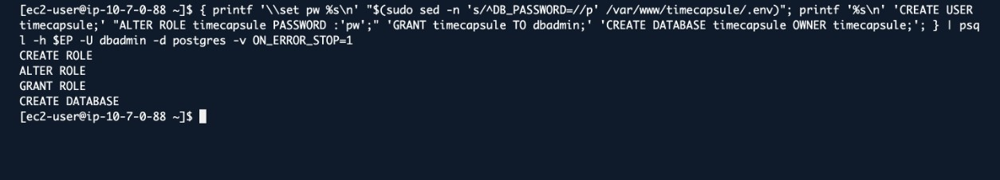
`CREATE ROLE`, `ALTER ROLE`, `GRANT ROLE`, `CREATE DATABASE` — все четыре команды выполнены.

Чтобы `pg_dump` и `psql` в задании 9 работали без ввода пароля, в `~/.pgpass` на `app-server` добавлена строка
`*:5432:timecapsule:timecapsule:<пароль из .env>` — так же, без вывода на экран:

```bash
sudo sed -n 's/^DB_PASSWORD=//p' /var/www/timecapsule/.env | tr -d '\n' |
  { read -r p; printf '%s\n' "*:5432:timecapsule:timecapsule:$p" >> ~/.pgpass; }
psql -h $EP -U dbadmin -d postgres -c '\drg dbadmin' -c '\l timecapsule'
psql -h $EP -U timecapsule -d timecapsule -c '\conninfo'
```

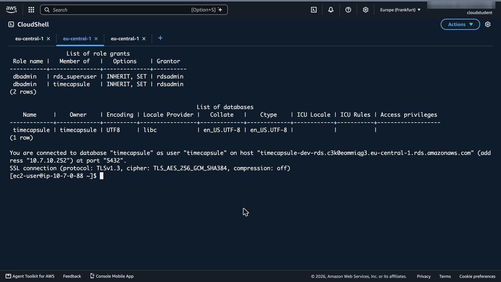
`dbadmin` входит в роль `timecapsule` (и в `rds_superuser`), база данных `timecapsule` принадлежит
`timecapsule`, и `timecapsule` подключается к ней по TLS.

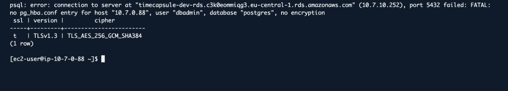
Без шифрования (`sslmode=disable`) RDS отказывает: `no pg_hba.conf entry for host "10.7.0.88", user "dbadmin",
database "postgres", no encryption`. С `sslmode=require` соединение идёт по TLS 1.3.

```bash
aws rds describe-db-parameters --db-parameter-group-name default.postgres16 \
  --query "Parameters[?ParameterName=='rds.force_ssl'].[ParameterName,ParameterValue,Source,ApplyType]" --output text
```

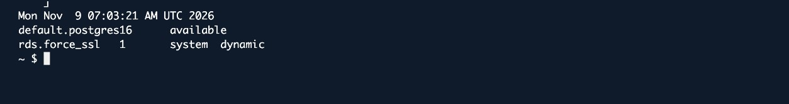
Причина — параметр `rds.force_ssl = 1` в группе параметров по умолчанию `default.postgres16`, которую
использует база (значение задано самой системой, `Source: system`).

**Почему приложению нужен отдельный пользователь, а не `dbadmin`?**
Принцип наименьших привилегий: `timecapsule` владеет только своей базой данных и не может создавать роли и
базы, читать чужие данные или менять настройки, как `dbadmin` с ролью `rds_superuser`. Если пароль из `.env`
утечёт или в приложении найдётся SQL-инъекция, ущерб ограничен одной базой данных. Кроме того, пароль
приложения можно сменить, не трогая учётную запись администратора, а в журналах и `pg_stat_activity` сразу
видно, какие запросы шлёт приложение.

### Задание 9. Перенос данных

С начала выгрузки и до переключения в задании 10 приложение не открывали. На `app-server` нет ни cron, ни
таймеров приложения, так что без HTTP-запросов приложение в старую базу ничего не пишет.

На `app-server` (пароль `timecapsule` для обеих баз — из строки `*:5432:timecapsule:timecapsule` в `~/.pgpass`):

```bash
pg_dump -h db.timecapsule.internal -U timecapsule -d timecapsule --no-owner --no-privileges -f timecapsule.sql
psql -h $EP -U timecapsule -d timecapsule -v ON_ERROR_STOP=1 -f timecapsule.sql 2>&1 | sort | uniq -c | sort -rn
for h in db.timecapsule.internal $EP; do
  psql -h $h -U timecapsule -d timecapsule -At -F ' | ' \
    -c "SELECT '$h', inet_server_addr(), (SELECT count(*) FROM users) AS users, (SELECT count(*) FROM capsules) AS capsules"
done
```

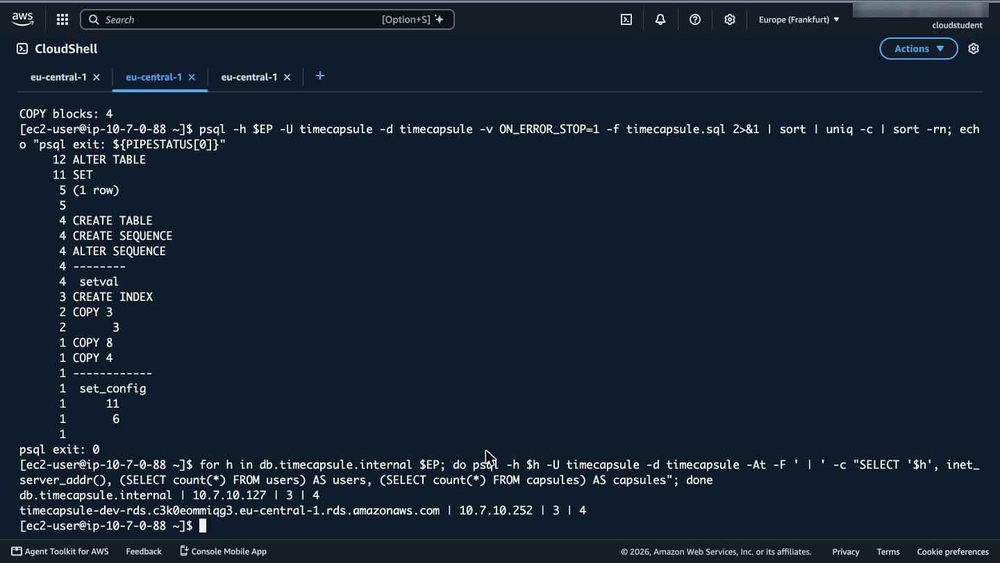
Выгрузка — 10 КБ, четыре блока `COPY` (четыре таблицы). Загрузка в RDS прошла без ошибок (`psql exit: 0`; вывод
`psql` свёрнут через `uniq -c`): 4 таблицы, 4 последовательности, 3 индекса, 12 `ALTER TABLE` (ключи и
значения по умолчанию), 4 `setval` и строки `COPY 3`, `COPY 3`, `COPY 8`, `COPY 4`. Итог одинаковый в обеих
базах: `db-server` (`10.7.10.127`) и RDS (`10.7.10.252`) — 3 пользователя и 4 капсулы.

```bash
shred -u timecapsule.sql      # в выгрузке хеши паролей пользователей
```

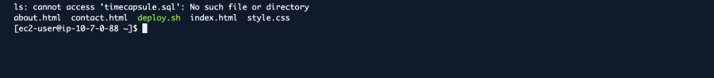
Файл выгрузки затёрт и удалён.

### Задание 10. Переключение приложения

Удаление записи A и создание CNAME сделаны одним пакетом изменений Route 53: пакет применяется атомарно, так
что промежутка, когда имени нет, не бывает вовсе, и ответ «такого имени нет» никто не закэширует (Route 53 по
умолчанию даёт записи SOA зоны TTL 900 с — отсюда 15 минут из условия). Для `DELETE` нужно указать запись точно
как она есть: A, TTL 60, `10.7.10.127`.

```bash
ZID=Z03960203IZOV9GNSV06I        # приватная зона timecapsule.internal
cat > ~/lab5/db-cname.json <<EOF
{"Comment": "LR5: db.timecapsule.internal -> RDS",
 "Changes": [
  {"Action": "DELETE", "ResourceRecordSet": {"Name": "db.timecapsule.internal.", "Type": "A", "TTL": 60,
    "ResourceRecords": [{"Value": "10.7.10.127"}]}},
  {"Action": "CREATE", "ResourceRecordSet": {"Name": "db.timecapsule.internal.", "Type": "CNAME", "TTL": 60,
    "ResourceRecords": [{"Value": "$EP"}]}}]}
EOF
CID=$(aws route53 change-resource-record-sets --hosted-zone-id $ZID --change-batch file://~/lab5/db-cname.json \
  --query ChangeInfo.Id --output text)
aws route53 wait resource-record-sets-changed --id $CID
aws route53 get-change --id $CID --query 'ChangeInfo.[Status,SubmittedAt]' --output text
aws route53 list-resource-record-sets --hosted-zone-id $ZID \
  --query "ResourceRecordSets[?Name=='db.timecapsule.internal.'].[Name,Type,TTL,ResourceRecords[0].Value]" --output text
```

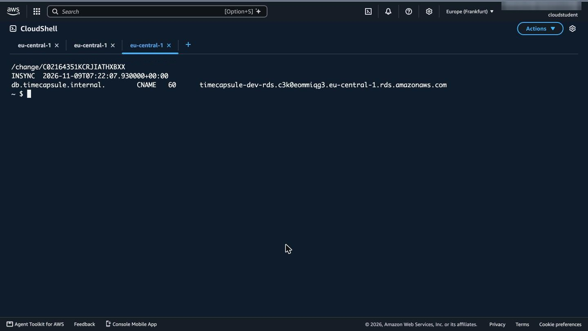
Изменение применено (`INSYNC`, 07:22:07 UTC): `db.timecapsule.internal` — CNAME на endpoint
`timecapsule-dev-rds`, TTL 60.

Шифрование включать не пришлось: Laravel передаёт `pdo_pgsql` параметр `sslmode=prefer` (`'sslmode' =>
env('DB_SSLMODE', 'prefer')` в `config/database.php`), и libpq сам предлагает серверу TLS. Так как RDS отклоняет
соединения без шифрования (задание 8), раз приложение работает — оно работает по TLS. `.env` не менялся.

На `app-server`:

```bash
dig db.timecapsule.internal
curl -s -w '\nHTTP %{http_code}\n' http://127.0.0.1/health
```

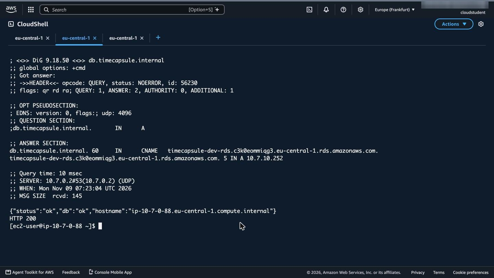
DNS-сервер VPC (`10.7.0.2`) отвечает цепочкой: `db.timecapsule.internal` → CNAME (TTL 60) → endpoint RDS → A
`10.7.10.252` (TTL 5). `/health` — `{"status":"ok","db":"ok"}`, HTTP 200.

Затем в приложении создана капсула «LR5: capsule after the move to Amazon RDS» с датой открытия 20 ноября.

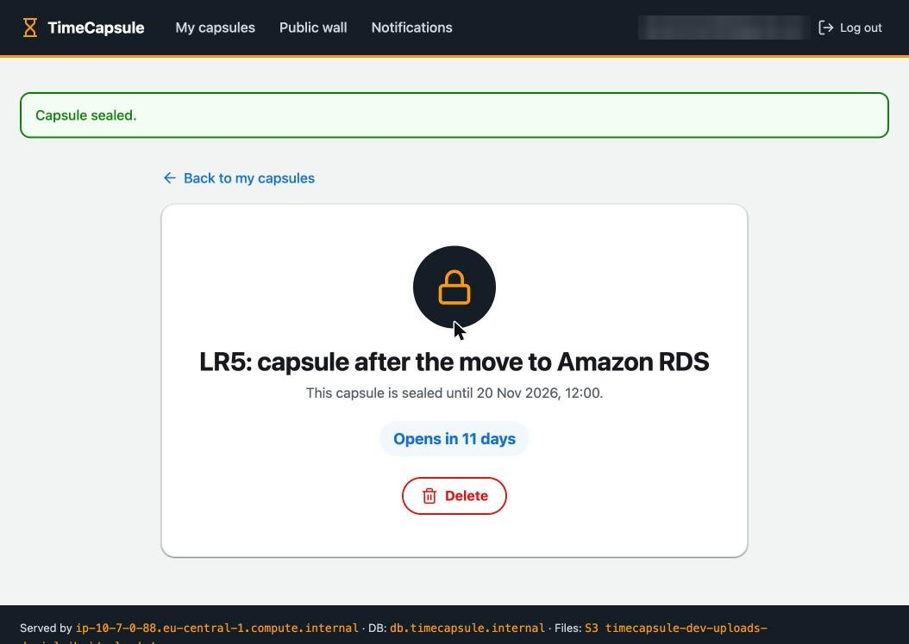
Капсула запечатана.

```bash
psql -h $EP -U timecapsule -d timecapsule \
  -c 'SELECT id, user_id, title, open_at, created_at FROM capsules ORDER BY id DESC LIMIT 3;'
psql -h 10.7.10.127 -U timecapsule -d timecapsule -At -c 'SELECT count(*) AS capsules, max(id) AS max_id FROM capsules;'
```

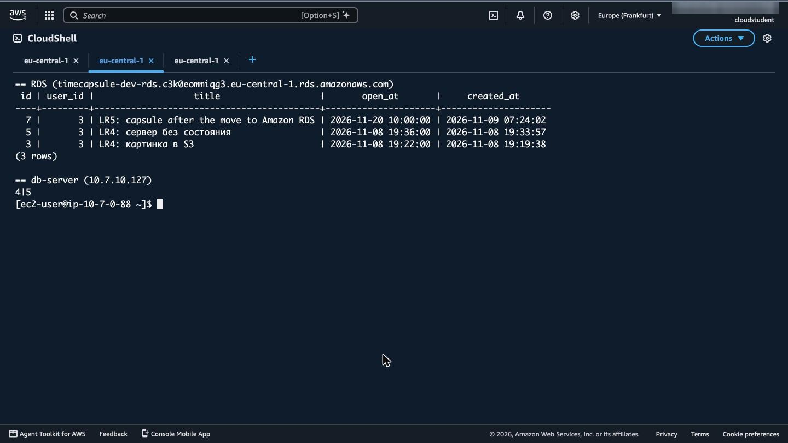
Новая капсула (`id = 7`, создана в 07:24:02 UTC) есть в RDS, а на `db-server` по-прежнему 4 капсулы с
максимальным `id = 5`: приложение пишет уже только в RDS. Номер 7, а не 6, потому что `pg_dump` перенёс и
текущее значение последовательности (`setval`): номер 6 был израсходован ещё на `db-server`, а последовательность
не выдаёт номера повторно, даже если строку удалили или вставка не удалась.

```bash
aws ec2 stop-instances --instance-ids i-0b517bf66674ee99c          # timecapsule-dev-db
aws ec2 wait instance-stopped --instance-ids i-0b517bf66674ee99c
```

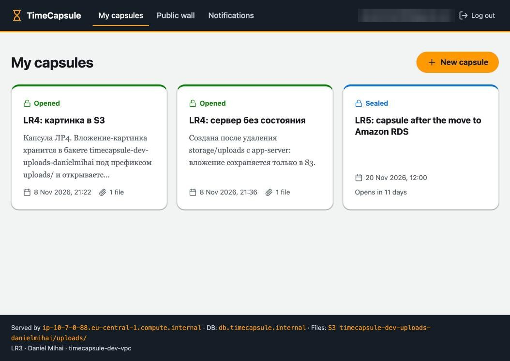
`db-server` остановлен (07:24:58 UTC), а приложение работает: список капсул открывается, в подвале
`DB: db.timecapsule.internal`, `/health` отвечает 200. Корневой диск сервера помечен `DeleteOnTermination: True`,
поэтому удаляется вместе с ним.

```bash
aws ec2 terminate-instances --instance-ids i-0b517bf66674ee99c
aws ec2 wait instance-terminated --instance-ids i-0b517bf66674ee99c
aws ec2 describe-instances --filters Name=tag:Project,Values=timecapsule \
  Name=instance-state-name,Values=pending,running,stopping,stopped \
  --query 'Reservations[].Instances[].[Tags[?Key==`Name`]|[0].Value,InstanceId,State.Name,PrivateIpAddress]' --output table
```

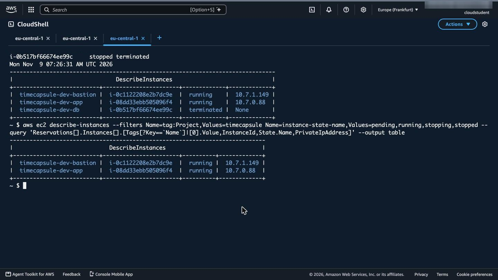
`timecapsule-dev-db` — `terminated`; среди работающих и остановленных серверов проекта остались `bastion` и
`app-server`.

**Почему не пришлось менять `DB_HOST`? Какие обязанности из ЛР3 перешли к AWS, а какие остались за вами?**
Приложение знает базу только по имени `db.timecapsule.internal`, а куда оно ведёт, решает запись в приватной
зоне Route 53: достаточно было заменить A на CNAME, и тот же `DB_HOST` теперь приводит к endpoint RDS. К AWS
перешли установка и обновления PostgreSQL и ОС (в окно обслуживания), автоматические копии и журнал для
восстановления на момент времени, замена отказавшего оборудования, шифрование диска, метрики и события. За мной
остались схема и данные, пользователи и права в базе, сетевой доступ (Security Groups, подсети), выбор класса и
параметров, расписание остановки, проверка восстановления и сами решения, когда восстанавливать и переключать.

### Задание 11. Обслуживание базы

На `app-server` запущен опрос `/health` каждые 2 секунды, а из CloudShell — перезагрузка базы:

```bash
for i in $(seq 1 100); do printf '%s ' "$(date -u +%T)"
  curl -s -m 5 -w ' HTTP %{http_code}\n' http://127.0.0.1/health | sed -E 's/,"hostname":"[^"]*"//'; sleep 2; done
aws rds reboot-db-instance --db-instance-identifier timecapsule-dev-rds      # в CloudShell, 07:27:20 UTC
```

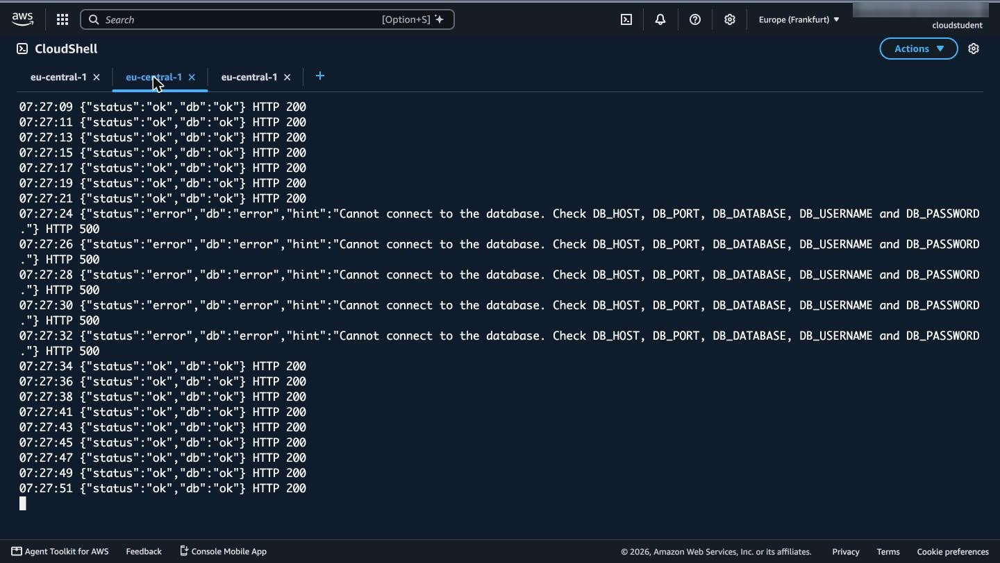
С 07:27:24 до 07:27:32 UTC `/health` отвечал HTTP 500 с подсказкой `Cannot connect to the database...`, с
07:27:34 — снова 200. Перезагрузка экземпляра `db.t4g.micro` заняла около 10 секунд.

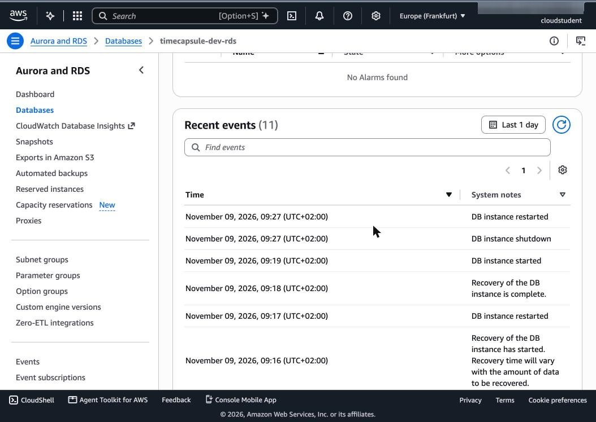
`Logs & events`: перезагрузка — это `DB instance shutdown` и `DB instance restarted` в 09:27. Ниже — запуск
после проверки расписания: `Recovery of the DB instance has started` (09:16), `DB instance restarted`,
`Recovery ... is complete`, `DB instance started` (09:19).

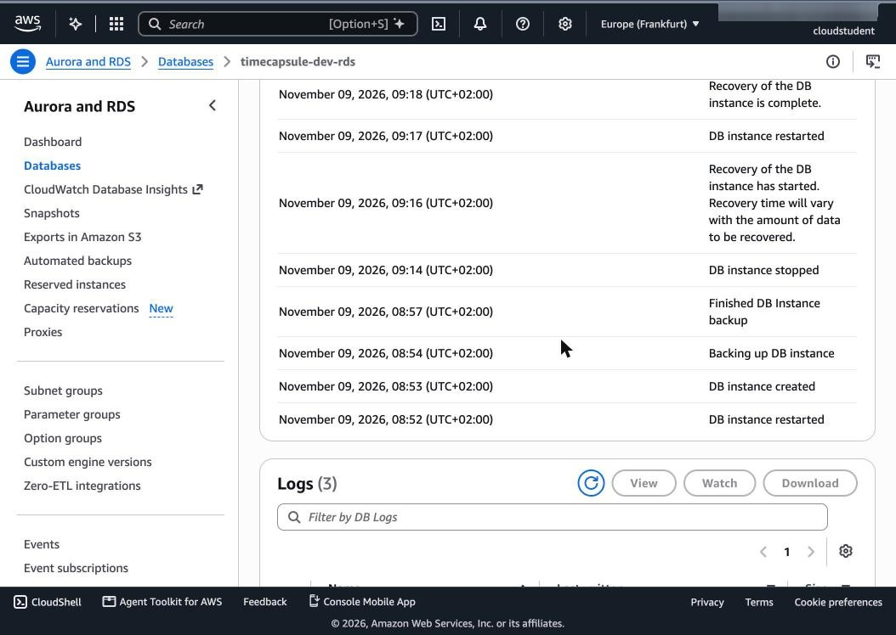
Ещё ниже — `DB instance stopped` (09:14, остановка расписанием) и события создания: `DB instance created`,
первый снимок `Backing up DB instance` / `Finished DB Instance backup`. По событиям видно, когда база была
недоступна и почему.

```bash
aws rds stop-db-instance --db-instance-identifier timecapsule-dev-rds         # 07:28:47 UTC
```


Пока база останавливается и стоит, приложение отвечает страницей 500 «Cannot connect to the database». Сам
`app-server` при этом работает — отказ только в базе.

Чтобы увидеть, что получает расписание, когда база уже остановлена, я дождался состояния `stopped`, попробовал
остановить базу ещё раз сам и создал разовое расписание с той же целью и той же ролью (без повторов, после
срабатывания оно удаляется само):

```bash
aws rds stop-db-instance --db-instance-identifier timecapsule-dev-rds          # база уже stopped
cat ~/lab5/stop-test-target.json
# {"Arn":"arn:aws:scheduler:::aws-sdk:rds:stopDBInstance",
#  "RoleArn":"arn:aws:iam::<account-id>:role/timecapsule-dev-scheduler-role",
#  "Input":"{\"DbInstanceIdentifier\":\"timecapsule-dev-rds\"}","RetryPolicy":{"MaximumRetryAttempts":0}}
aws scheduler create-schedule --name timecapsule-dev-rds-stop-test \
  --description 'LR5: one-time StopDBInstance while the DB is already stopped' \
  --schedule-expression 'at(2026-11-09T09:36:00)' --schedule-expression-timezone Europe/Chisinau \
  --flexible-time-window Mode=OFF --action-after-completion DELETE --target file://~/lab5/stop-test-target.json
```


`InvalidDBInstanceState ... Instance timecapsule-dev-rds is not in available state.` Разовое расписание
создано; в 09:36 оно сработало и удалилось.

```bash
aws rds start-db-instance --db-instance-identifier timecapsule-dev-rds      # 07:37:29 UTC
dig +noall +answer db.timecapsule.internal; curl -s -w ' HTTP %{http_code}\n' http://127.0.0.1/health
```


В 07:40:43 UTC база снова `available`, endpoint тот же, CNAME ведёт на него, а он — на тот же адрес
`10.7.10.252`; `/health` — 200, приложение работает, и пользователь остался залогиненным.


CloudTrail → `Event history` с фильтром `Event name = StopDBInstance`: четыре вызова. У двух `User name` —
это имя сессии роли, которую взял на себя Scheduler, у двух — `cloudstudent`.

```bash
aws cloudtrail lookup-events --lookup-attributes AttributeKey=EventName,AttributeValue=StopDBInstance --output json |
  jq -r '.Events[] | .CloudTrailEvent | fromjson | "\(.eventTime)  \(.userIdentity.type)  \(.userIdentity.sessionContext.sessionIssuer.userName // .userIdentity.userName)  \(.userAgent|split(" ")[0])  \(.errorCode // "OK")  \(.errorMessage // "")"'
```


Подробности тех же событий:

* 07:10:33 — `AssumedRole` `timecapsule-dev-scheduler-role`, агент `AmazonEventBridgeScheduler`, успешно:
  остановка из задания 7, через 33 секунды после 09:10:00;
* 07:28:48 — `cloudstudent` из `aws-cli`, успешно: остановка вручную;
* 07:33:58 — `cloudstudent`, повторная остановка остановленной базы — `InvalidDBInstanceStateFault`;
* 07:36:22 — снова роль расписания, `InvalidDBInstanceStateFault`, `Instance timecapsule-dev-rds is not in
  available state.` Запись одна: расписание не повторяет вызов, а состояние базы не меняется.

**Что показывал `/health` во время перезагрузки? Изменился ли endpoint после остановки и запуска? Какую
ошибку получает расписание, если база уже остановлена?**
Во время перезагрузки `/health` около 10 секунд (07:27:24–07:27:32 UTC) отвечал HTTP 500
`{"status":"error","db":"error"}` с подсказкой `Cannot connect to the database`, а потом снова 200: PHP открывает
соединение с базой заново на каждый запрос, так что приложение восстановилось само. Endpoint после двух
остановок и запусков остался прежним (и даже адрес `10.7.10.252` не изменился), поэтому CNAME трогать не нужно:
имя постоянное, а если адрес за ним сменится, RDS сам обновит запись A с TTL 5 секунд. Расписание получает
`InvalidDBInstanceStateFault` («Instance timecapsule-dev-rds is not in available state»): вызов ничего не
меняет, в событиях RDS его нет, а в CloudTrail он виден с кодом ошибки.

### Задание 12. Архитектура и решение

Схема обновлена, решение записано в ADR-0004 — см. раздел [«Архитектура и ADR»](#архитектура-и-adr).

---

## Архитектура и ADR


Схема ЛР4 дополнена по образцу рисунка 5.1 (исходник — [database-lab5.svg](../architecture/database-lab5.svg),
значки — AWS Architecture Icons):

* `db-server` убран: база приложения — экземпляр RDS `timecapsule-dev-rds` в `private-a` под группой
  `timecapsule-dev-rds-sg` (5432 только от `web-sg`);
* группа подсетей `timecapsule-dev-db-subnets` охватывает `private-a` и `private-b`; во второй зоне —
  пунктирный резерв: туда RDS поставит копию или резервный экземпляр Multi-AZ, там же жила реплика задания 4;
* Route 53: приватная зона `timecapsule.internal`, запись `db` — CNAME на endpoint, TTL 60;
* EventBridge Scheduler `timecapsule-dev-rds-nightly-stop` с ролью `timecapsule-dev-scheduler-role` и розовая
  стрелка `StopDBInstance` к базе каждый день в 23:00;
* приложение подключается к базе по TLS (тёмная стрелка `PostgreSQL 5432 (TLS), db.timecapsule.internal`), S3
  и IAM-роль сервера остались как в ЛР4.

Решение записано в [ADR-0004. Где размещать базу приложения](../adr/0004-database-hosting.md): сравнены
PostgreSQL на EC2, RDS в одной зоне, RDS Multi-AZ и Amazon Aurora; выбран RDS Single-AZ. В разделе
«Последствия» — частота резервных копий и возможная потеря данных (журнал раз в ~5 минут, срок хранения 1 день
на Free plan), стоимость (≈ $13–14 за три месяца) и ограничение расходов ночным расписанием, поведение после 7
дней остановки, поиск базы через CNAME и план на случай отказа `eu-central-1a`.

## Итог

После работы база приложения и серверы остановлены, из `bastion-sg` удалено временное правило SSH для
CloudShell, папка `~/lab5` (JSON с номером аккаунта) в CloudShell удалена. На `app-server` в `~/.pgpass`
осталась только строка `dbadmin` для `timecapsule-dev-rds`: строки `lab5` и пароля приложения удалены.

```bash
sed -i '/^\*:5432:lab5:dbadmin:/d; /^\*:5432:timecapsule:timecapsule:/d' ~/.pgpass    # на app-server
aws rds stop-db-instance --db-instance-identifier timecapsule-dev-rds
aws ec2 stop-instances --instance-ids i-08dd33ebb505096f4 i-0c1122208e2b7dc9e      # app-server, bastion
aws ec2 revoke-security-group-ingress --group-id sg-0f12344a15628a3d1 --security-group-rule-ids sgr-0c62d3a1a3ce0ed50
rm -f ~/lab5/*.json && rmdir ~/lab5
```


В `bastion-sg` осталось только постоянное правило SSH с моего IP (адрес скрыт), папки `~/lab5` в CloudShell
нет, `bastion` и `app-server` — `stopped`, `timecapsule-dev-rds` — `stopped`, расписание
`timecapsule-dev-rds-nightly-stop` включено.

Ресурсов Части 1 (`lab5-*`) не осталось. Ресурсы Части 2 оставлены для следующих работ: база
`timecapsule-dev-rds` (остановлена), группа подсетей `timecapsule-dev-db-subnets`, группа доступа
`timecapsule-dev-rds-sg`, политика `timecapsule-dev-rds-stop`, роль `timecapsule-dev-scheduler-role`,
расписание `timecapsule-dev-rds-nightly-stop`, запись CNAME `db.timecapsule.internal`. `db-server` удалён;
его Security Group `timecapsule-dev-db-sg` больше ни к чему не привязана. В начале следующего занятия первой
запускается база, потом серверы.

## Контрольные вопросы

Письменные ответы на вопросы заданий — в конце каждого задания. Ниже — ответы на дополнительные вопросы
продвинутого уровня, подготовленные к защите.

**1. Как проходит запрос от браузера до базы? Какие проверки проходит соединение на каждом шаге?**
Браузер идёт по HTTP на Elastic IP `3.64.208.134`: через Internet Gateway и маршрут `public-rt` запрос попадает
на `app-server`, если его пропускает `timecapsule-dev-web-sg` (порт 80), а nginx передаёт его PHP-FPM, где
Laravel проверяет сессию и права пользователя. Чтобы прочитать данные, PHP разрешает имя
`db.timecapsule.internal` через DNS-сервер VPC (`10.7.0.2`): приватная зона Route 53 отвечает CNAME на endpoint
RDS, тот — адресом `10.7.10.252` в `private-a`, и соединение на 5432 идёт по маршруту `local` внутри VPC. На
входе в базу `timecapsule-dev-rds-sg` пускает только группу `web-sg`, PostgreSQL требует TLS (`rds.force_ssl =
1`) и проверяет пароль `timecapsule` по SCRAM-SHA-256, а затем права роли на базу данных `timecapsule` — ответ
возвращается тем же путём (группы безопасности stateful).

**2. Чем репликация отличается от резервного копирования?**
Репликация непрерывно поддерживает копию текущего состояния на другом экземпляре: реплика отстаёт на секунды и
нужна для доступности и чтения, но повторяет и ошибки — `DELETE` в задании 5 дошёл до неё сразу. Резервное
копирование хранит прошлые состояния: ежедневные снимки и журнал изменений за срок хранения позволяют вернуть
базу на любой момент до ошибки. Восстановление дольше (минуты) и создаёт новую базу, зато спасает от удаления и
порчи данных. Поэтому одно не заменяет другого: реплика — от отказа сервера, копии — от ошибки в данных.

**3. Как пережить отказ зоны `eu-central-1a` и сколько это будет стоить?**
Сейчас база и `app-server` в одной зоне, и без доплаты возможен только ручной план: восстановить базу из копий
на последний момент (`Latest restore time`, потеря до ~5 минут) в `eu-central-1b` — группа подсетей это
позволяет, — запустить сервер приложения в `public-b` из образа и перевести на них CNAME и Elastic IP; это
десятки минут простоя и ни доллара заранее. Автоматически переживает отказ RDS Multi-AZ: резервный экземпляр в
`eu-central-1b` подхватывает endpoint за 1–2 минуты без потери данных, но база стоит примерно вдвое дороже (≈
$0,038 в час и ≈ $5,2 в месяц за хранилище, то есть около $26 за три месяца вместо $13–14) и на Free plan
недоступна. Для приложения нужен ещё второй сервер в `public-b` и балансировщик нагрузки (ЛР6).

**4. Как вы решили проблему автоматического запуска базы через 7 дней?**
Расписание EventBridge Scheduler `timecapsule-dev-rds-nightly-stop` каждый день в 23:00 по Кишинёву вызывает
`StopDBInstance` от имени роли `timecapsule-dev-scheduler-role`. Если AWS запустит базу сам после 7 дней
остановки, ближайший вечерний запуск её остановит — лишним окажется максимум день работы (≈ $0,46). Если база
уже остановлена, вызов просто завершается ошибкой `InvalidDBInstanceStateFault` и ничего не меняет. Заодно
расписание страхует от забытой остановки после занятия.

## Вывод

В `eu-central-1` развёрнута учебная база RDS for PostgreSQL в приватных подсетях: доступ к порту 5432 открыт
только группе веб-сервера, а с bastion и из интернета база недостижима. На практике проверены реплика для
чтения во второй зоне (только чтение, отставание и метрика `ReplicaLag`) и восстановление на момент до
ошибочного `DELETE`, которое вернуло все строки в новую базу; учебные ресурсы удалены. База приложения
TimeCapsule перенесена с `db-server` в RDS `timecapsule-dev-rds`: отдельный пользователь `timecapsule`, перенос
`pg_dump`/`psql` со сверкой числа строк, переключение заменой записи A на CNAME одним пакетом Route 53 без
правки `.env`, соединения только по TLS, после чего `db-server` удалён. Расходы ограничены ночной остановкой
через EventBridge Scheduler с ролью, которой разрешено только остановить эту базу; её срабатывание и ошибка
на уже остановленной базе видны в CloudTrail. Перезагрузка базы стоит приложению около 10 секунд ошибок 500, а
endpoint после остановки и запуска не меняется. Решение и его последствия записаны в ADR-0004 и показаны на
схеме.

## Источники

1. Лекция 7 «Облачные базы данных и согласованность данных. Amazon RDS, DynamoDB», Hands-on 7.1 «Первая база данных в RDS».
2. Условие лабораторной работы №5: [MSU-Courses/cloud-computing, Lab/05_Cloud_Database](https://github.com/MSU-Courses/cloud-computing/tree/main/Lab/05_Cloud_Database).
3. Amazon RDS User Guide: Working with a DB instance in a VPC (DB subnet groups), Controlling access with security groups, Working with DB instance read replicas, Backing up, restoring and exporting data (point-in-time recovery), Stopping an Amazon RDS DB instance temporarily, Rebooting a DB instance, Using SSL/TLS with RDS for PostgreSQL (`rds.force_ssl`), Multi-AZ deployments, Amazon RDS event categories and event messages.
4. [Working with PostgreSQL read replicas in Amazon RDS](https://docs.aws.amazon.com/AmazonRDS/latest/UserGuide/USER_PostgreSQL.Replication.ReadReplicas.html) — как считается отставание реплики и почему без записей оно доходит до 5 минут.
5. Amazon EventBridge Scheduler User Guide: Using universal targets, Setting up the execution role, Schedule types (cron, at), Configuring a retry policy.
6. AWS CloudTrail User Guide: Working with CloudTrail Event history.
7. Amazon Route 53 Developer Guide: Working with private hosted zones, ChangeResourceRecordSets, Negative caching (SOA).
8. PostgreSQL 16 Documentation: pg_dump, psql, Hot Standby.
9. Amazon RDS for PostgreSQL pricing, Amazon Aurora pricing.
10. AWS Architecture Icons.
