# Лабораторная работа №6. Масштабирование и балансировка нагрузки. Elastic Load Balancing, Amazon EC2 Auto Scaling

| | |
|---|---|
| **Студент** | Daniel Mihai |
| **Группа** | `I2402` |
| **Специальность** | Informatică |
| **Уровень** | продвинутый (Часть 1 и Часть 2, задания 1–7) |
| **Приложение** | TimeCapsule из ЛР2–ЛР5 (Laravel 12, PHP 8.4) |
| **Регион** | `eu-central-1` (Frankfurt) |
| **Репозиторий** | https://github.com/danielmihai-cloud/timecapsule |
| **Схема** | [docs/architecture/scaling-lab6.png](../architecture/scaling-lab6.png) (исходник [scaling-lab6.svg](../architecture/scaling-lab6.svg)) |
| **ADR** | [docs/adr/0005-session-storage.md](../adr/0005-session-storage.md) |

Отчёты прошлых работ: ЛР2 — [README.md](../../README.md), ЛР3 — [docs/lab3/README.md](../lab3/README.md),
ЛР4 — [docs/lab4/README.md](../lab4/README.md), ЛР5 — [docs/lab5/README.md](../lab5/README.md).

> **Как выполнялась работа.** Работа сделана под IAM-пользователем `cloudstudent` (группа `Admins`) в консоли
> AWS; CloudShell, как требует условие, не использовался. Нагрузка в заданиях 3 и 6 шла с моего компьютера: вместо
> `curl` в Git Bash тот же цикл запросов выполнял браузер (скрипт `fetch`, приведён в задании 3) — условие разрешает
> нагрузку «со своего компьютера». К серверам по SSH я ходил только через `bastion`: в `bastion-sg` на время
> работы было добавлено правило SSH из диапазона EC2 Instance Connect (терминал консоли AWS), а с `bastion` на
> сервер приложения — по ключу, который `bastion` на 60 секунд кладёт на сервер через EC2 Instance Connect.
> Номер аккаунта и мой IP на скриншотах скрыты, в тексте вместо номера — `<account-id>`.

## Содержание

- [Часть 1. Базовый уровень](#часть-1-базовый-уровень)
- [Часть 2. Продвинутый уровень](#часть-2-продвинутый-уровень)
- [Архитектура и ADR](#архитектура-и-adr)
- [Итог](#итог)
- [Контрольные вопросы](#контрольные-вопросы)
- [Вывод](#вывод)
- [Источники](#источники)

---

## Часть 1. Базовый уровень

Учебные ресурсы названы с префиксом `lab6-` и помечены тегом `Lab=lab6`. Всё создано в VPC из ЛР3
`timecapsule-dev-vpc` (`vpc-03a7bddba207a62c8`) в публичных подсетях `timecapsule-dev-public-a`
(`subnet-0595c1c8b4f76ee32`, `eu-central-1a`, `10.7.0.0/24`) и `timecapsule-dev-public-b`
(`subnet-0bdd73dfad65f7b20`, `eu-central-1b`, `10.7.1.0/24`).

### Задание 1. Балансировщик

Сначала — две группы безопасности, чтобы серверы принимали HTTP только от балансировщика:

| Группа | ID | Входящие правила |
|---|---|---|
| `lab6-alb-sg` | `sg-067725d2c4b521292` | HTTP 80 из `0.0.0.0/0` |
| `lab6-web-sg` | `sg-0ab770c087a76c743` | HTTP 80 от `lab6-alb-sg`, SSH 22 от `timecapsule-dev-bastion-sg` |

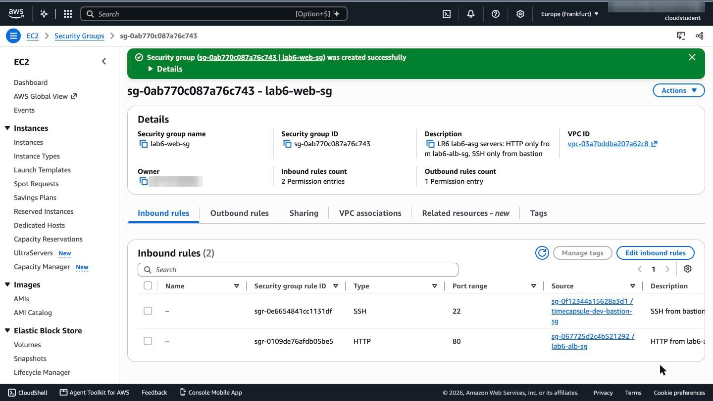
`lab6-web-sg`: источники правил — не адреса, а группы: HTTP 80 только от группы балансировщика, SSH 22 только
от группы `bastion`.

Целевая группа `lab6-tg`: тип целей `Instances`, HTTP 80, VPC `timecapsule-dev-vpc`, проверка `GET /health`
каждые 10 секунд (таймаут 5 секунд, 2 успешных ответа — `healthy`, 2 неудачных — `unhealthy`, ожидается код
`200`). Задержку отмены регистрации я уменьшил с 300 до 30 секунд: страница nginx отдаётся за миллисекунды, и
при сокращении группы ждать пять минут незачем.

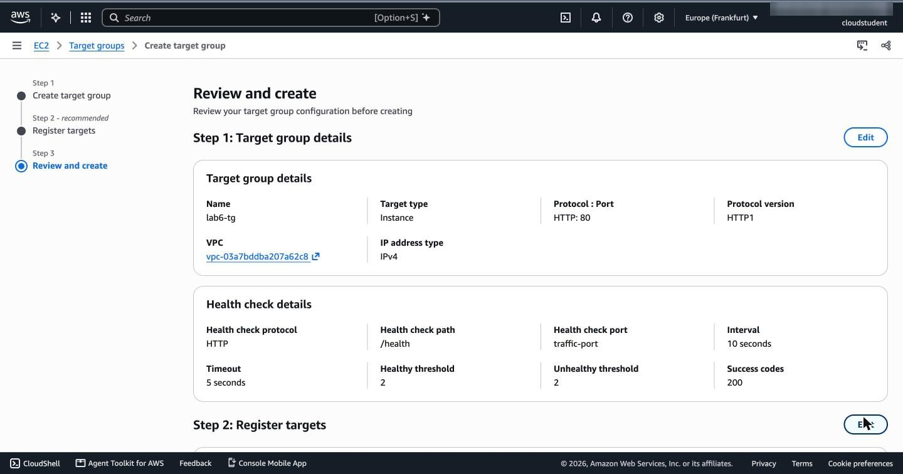
Проверка работоспособности `lab6-tg`: протокол HTTP, путь `/health`, интервал 10 секунд.

Балансировщик `lab6-alb`: Application Load Balancer, схема `Internet-facing`, IPv4, подсети `public-a` и
`public-b`, группа безопасности только `lab6-alb-sg` (группа `default` убрана), listener HTTP 80 с действием
по умолчанию «передать в `lab6-tg`».

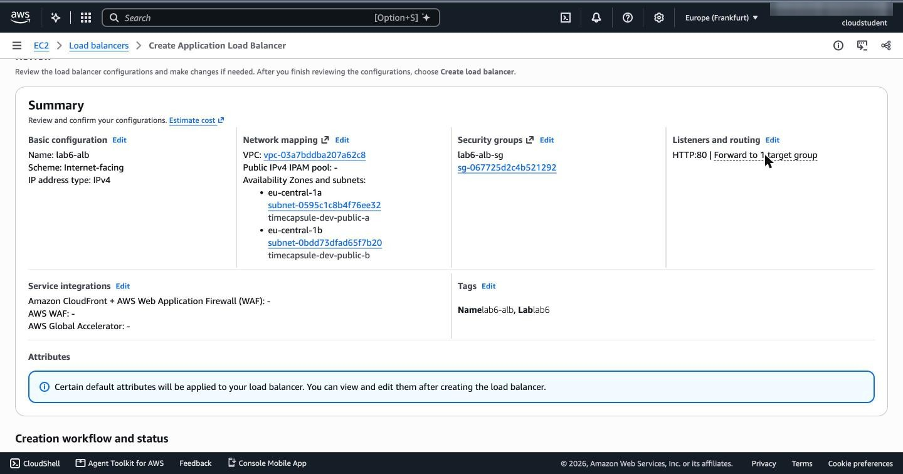
Сводка перед созданием: схема `Internet-facing`, две зоны и две публичные подсети, `lab6-alb-sg`, listener
`HTTP:80` → одна целевая группа, теги `Name` и `Lab`.

DNS-имя балансировщика — `lab6-alb-857291361.eu-central-1.elb.amazonaws.com`. Когда он перешёл в `Active`,
в целевой группе ещё не было ни одной цели:


`http://lab6-alb-857291361.eu-central-1.elb.amazonaws.com/` — `503 Service Temporarily Unavailable`, заголовок
`Server: awselb/2.0` (ответ сформировал сам балансировщик, а не nginx).

**Какой ответ вернул балансировщик и почему? Зачем ему подсети в двух зонах?**
Балансировщик ответил `503 Service Temporarily Unavailable`. Listener принял запрос и по правилу передал его в
`lab6-tg`, но в целевой группе нет ни одной исправной цели — серверов ещё нет, — поэтому ответ формирует сам ALB
(`Server: awselb/2.0`). Подсети в двух зонах нужны потому, что ALB ставит свой узел в каждую выбранную зону, а
DNS-имя возвращает адреса всех узлов: если одна зона откажет, запросы будет принимать узел в другой. ALB и не
создаётся меньше чем с двумя зонами, а цели принимает только в тех зонах, где у него есть узлы, поэтому серверы
группы тоже можно разнести по двум зонам.

### Задание 2. Группа Auto Scaling

Шаблон запуска `lab6-lt` (`lt-03e5c73f8a77483f1`), версия 1, с включённой подсказкой «Auto Scaling guidance»:

| Параметр | Значение |
|---|---|
| AMI | Amazon Linux 2023 `ami-0e75af8cec6f28266` (2023.12.20261109.0, kernel 6.18, x86_64) |
| Тип | `t3.micro` |
| Ключ | `danielmihai-keypair` |
| Подсеть | не указана (поле помечено «Not applicable for EC2 Auto Scaling») |
| Сеть | один сетевой интерфейс: группа `lab6-web-sg`, публичный IP — включён, удаление вместе с экземпляром |
| Теги экземпляра и диска | `Name=lab6-web`, `Lab=lab6` |
| User data | скрипт из условия: nginx, страница с именем сервера и зоной, `/health` → `OK` |

Публичный IP включён явно: в публичных подсетях нет NAT, и без адреса сервер не скачает nginx через Internet
Gateway. Входящий HTTP при этом всё равно разрешён только от `lab6-alb-sg`.

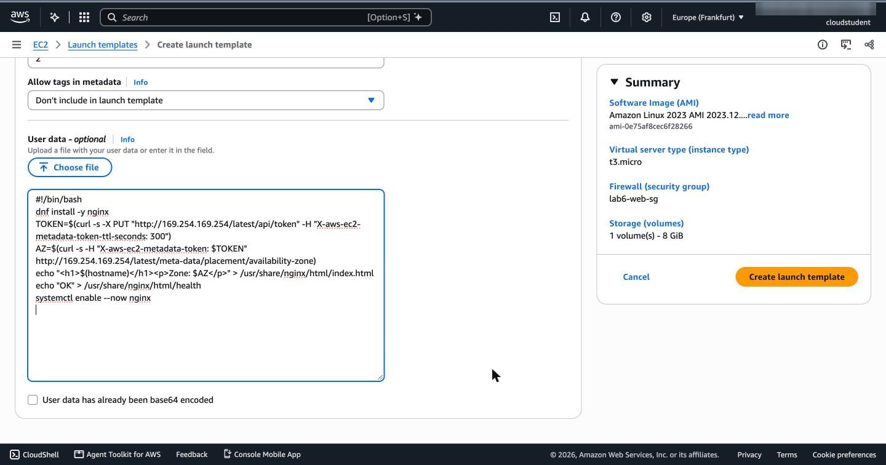
Поле `User data` шаблона `lab6-lt` — скрипт из условия без изменений.

Группа `lab6-asg`: шаблон `lab6-lt` (версия `Default`), подсети `public-a` и `public-b` (распределение
`Balanced best effort`), подключение к `lab6-tg`, проверки EC2 + ELB с отсрочкой 300 секунд, размер 2/2/4,
сбор метрик группы в CloudWatch. Политика target tracking `lab6-requests-per-target`: метрика `Application Load
Balancer request count per target` для `lab6-tg`, цель 50, прогрев экземпляра 60 секунд.

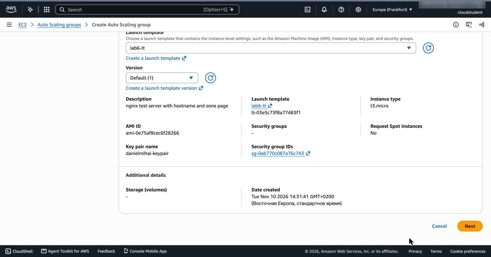
Первый шаг мастера: `lab6-lt` — `t3.micro`, `ami-0e75af8cec6f28266`, ключ `danielmihai-keypair`, группа
`sg-0ab770c087a76c743` (`lab6-web-sg`).

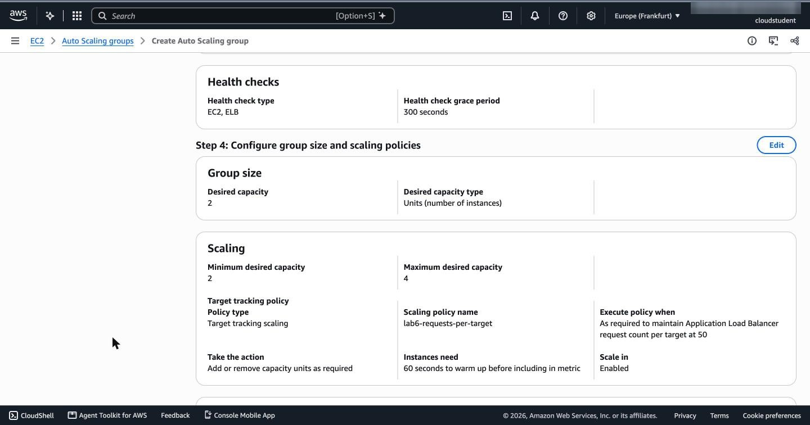
Проверка перед созданием: проверки `EC2, ELB`, отсрочка 300 секунд, желаемое 2, минимум 2, максимум 4, политика
target tracking держит `Application Load Balancer request count per target` на уровне 50, новым серверам нужно 60
секунд прогрева.

Группа создалась, а политика — нет:

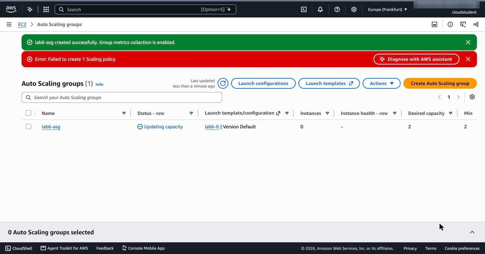
`lab6-asg created successfully`, но `Failed to create 1 Scaling policy`.

Это случай из таблицы «Частые проблемы»: `lab6-asg` — первая группа Auto Scaling в аккаунте, и служебная роль
`AWSServiceRoleForAutoScaling` была создана в ту же минуту, что и группа (14:37), — к моменту создания политики
она ещё не была готова. По той же причине группа запустила первые серверы не сразу, а через 3 минуты (12:40:47
UTC, см. задание 3). Через пару минут я добавил ту же политику на вкладке `Automatic scaling`:

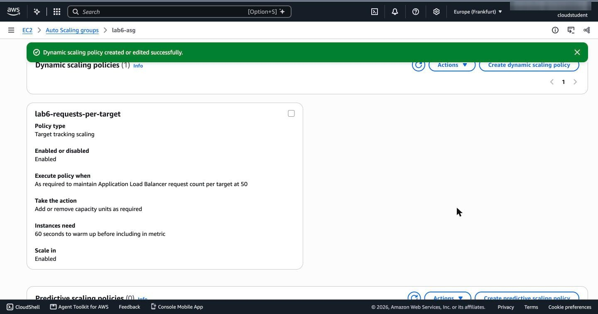
`lab6-requests-per-target`: target tracking, держит `Application Load Balancer request count per target` на 50,
прогрев 60 секунд, уменьшение группы разрешено.

Через несколько минут после запуска обе цели прошли проверки:

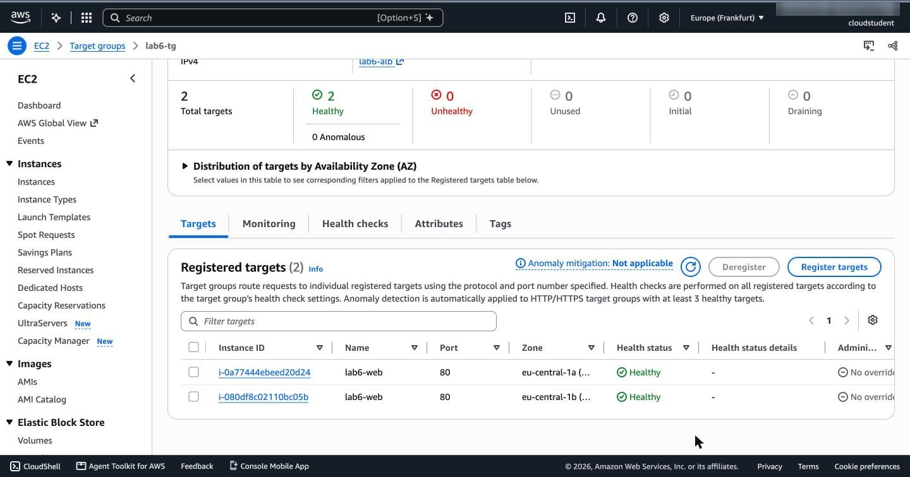
`lab6-tg`: 2 цели, обе `Healthy` — `i-0a77444ebeed20d24` в `eu-central-1a` и `i-080df8c02110bc05b` в
`eu-central-1b`, обе с тегом `Name=lab6-web` из шаблона.

Страница балансировщика, обновлённая несколько раз, показывает два разных сервера:

|  |  |
|---|---|
| `ip-10-7-0-25.eu-central-1.compute.internal`, `eu-central-1a` | `ip-10-7-1-69.eu-central-1.compute.internal`, `eu-central-1b` |

Восемь запросов подряд (`fetch` с `cache: 'no-store'`) чередовались строго по кругу: `0-25, 1-69, 0-25, 1-69,
…` — целевая группа использует round robin. Интересно, что при обычном обновлении страницы браузер долго
показывал один и тот же сервер: на каждую загрузку он отправляет два запроса — страницу и `/favicon.ico`, — и
при строгом чередовании страница всегда попадала на один сервер, а значок на другой. Один лишний запрос между
загрузками сдвинул очередь, и страница пришла со второго сервера.

**Чем группа Auto Scaling отличается от целевой группы? Почему в шаблоне нет подсети?**
Группа Auto Scaling отвечает за _количество_ серверов: по шаблону запускает их, заменяет неисправные и держит
желаемое число между минимумом и максимумом. Целевая группа — это список целей для балансировщика с настройками
проверки `/health` и выбора цели: решает, _куда_ отправить запрос, но серверов не запускает. Связаны они так:
группа сама регистрирует новые серверы в `lab6-tg` и снимает с регистрации удаляемые, а результат проверок
целевой группы (проверки ELB) использует, чтобы заменить сервер, который не отвечает. Подсети в шаблоне нет,
потому что шаблон описывает, _какой_ сервер запустить, а _где_ — решает группа: в ней две подсети в разных
зонах, и она выбирает подсеть при каждом запуске, чтобы серверов в зонах было поровну. Подсеть в шаблоне
привязала бы все серверы к одной зоне.

### Задание 3. Нагрузка

Нагрузка шла с моего компьютера: в браузере на странице балансировщика выполнялся тот же цикл, что и в условии,
— запросы один за другим в течение 10 минут (с 13:43:37 до 13:53:37 UTC). Заодно скрипт считал, какой сервер
ответил, по минутам:

```js
// то же, что end=$((SECONDS+600)); while [ $SECONDS -lt $end ]; do curl -s -o /dev/null http://$ALB/; done
const L = window.__load = {start: Date.now(), count: 0, errors: 0, perMin: {}, done: null};
const end = L.start + 10 * 60 * 1000;
(async () => {
  while (Date.now() < end) {
    try {
      const r = await fetch('/?load=' + Date.now(), {cache: 'no-store'});
      const t = await r.text();
      const m = t.match(/<h1>(.*?)<\/h1>/);
      const host = m ? m[1].split('.')[0] : ('status-' + r.status);
      const minute = new Date().toISOString().slice(11, 16);
      const b = L.perMin[minute] || (L.perMin[minute] = {});
      b[host] = (b[host] || 0) + 1;
      L.count++;
    } catch (e) {
      L.errors++;
      await new Promise(res => setTimeout(res, 200));
    }
  }
  L.done = Date.now();
})();
```

| Минута (UTC) | `ip-10-7-0-25` (1a) | `ip-10-7-1-69` (1b) | `ip-10-7-0-60` (1a) | `ip-10-7-1-156` (1b) | Всего |
|---|---|---|---|---|---|
| 13:44 | 702 | 702 | — | — | 1404 |
| 13:45 | 679 | 679 | — | — | 1358 |
| 13:46 | 661 | 661 | — | — | 1322 |
| 13:47 | 665 | 666 | — | — | 1331 |
| 13:48 | 672 | 672 | — | — | 1344 |
| 13:49 | 420 | 419 | 278 | 279 | 1396 |
| 13:50 | 346 | 347 | 347 | 347 | 1387 |

Около 1 350 запросов в минуту, то есть примерно 670 на сервер при цели 50. Ошибок не было ни одной.

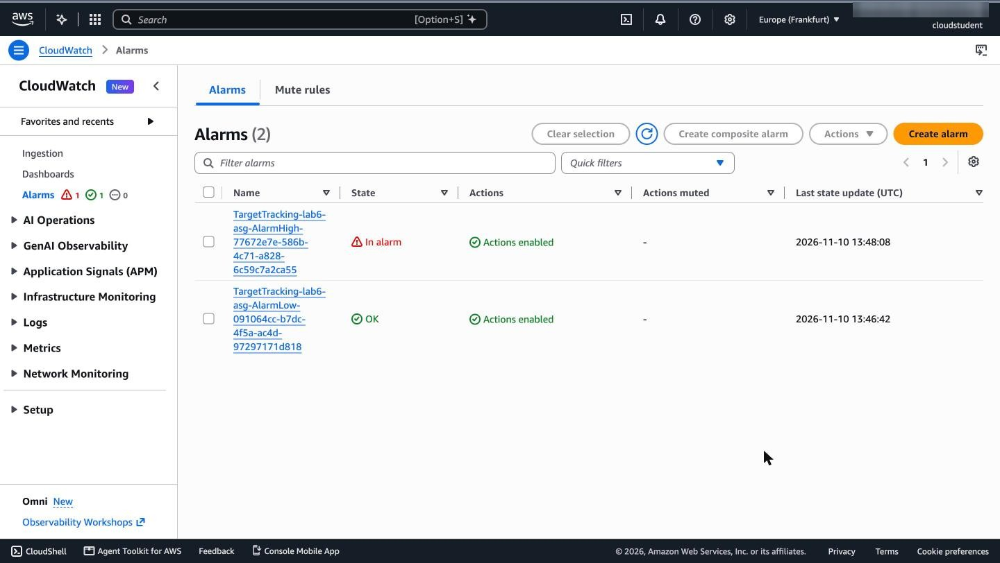
Политика создала две тревоги: `TargetTracking-lab6-asg-AlarmHigh-…` перешла в `In alarm` в 13:48:08 UTC, а
`AlarmLow-…`, которая была в `ALARM`, пока трафика не было, вернулась в `OK` в 13:46:42.

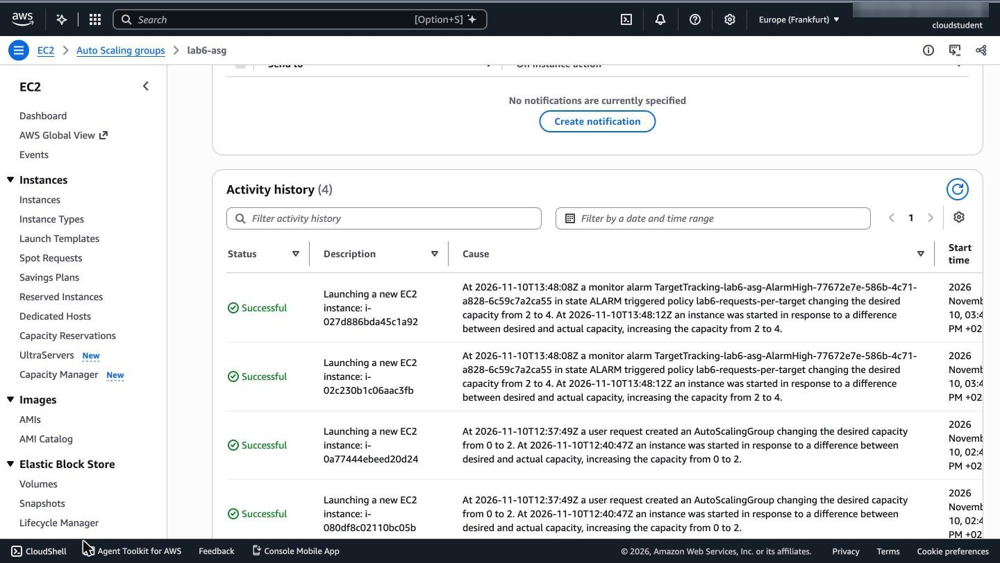
Вкладка `Activity`: в 13:48:08 UTC тревога `AlarmHigh` запустила политику `lab6-requests-per-target`, и та
изменила желаемое число с 2 до 4; в 13:48:12 запущены `i-02c230b1c06aac3fb` и `i-027d886bda45c1a92`. Ниже —
запуск первых двух серверов при создании группы (12:40:47).

С 13:49 запросы получают четыре сервера: новые `ip-10-7-0-60` и `ip-10-7-1-156` прошли две проверки `/health`
(интервал 10 секунд) примерно через минуту после запуска, и нагрузка на сервер упала вдвое.
