# Лабораторная работа №6. Масштабирование и балансировка нагрузки. Elastic Load Balancing, Amazon EC2 Auto Scaling

| | |
|---|---|
| **Студент** | Daniel Mihai |
| **Группа** | `I2402` |
| **Специальность** | Informatică |
| **Уровень** | продвинутый (Часть 1 и Часть 2, задания 1–7) |
| **Приложение** | TimeCapsule из ЛР2–ЛР5 (Laravel 12, PHP 8.4) |
| **Регион** | `eu-central-1` (Frankfurt) |
| **Репозиторий** | https://github.com/danielmihai-cloud/timecapsule |
| **Схема** | [docs/architecture/scaling-lab6.png](../architecture/scaling-lab6.png) (исходник [scaling-lab6.svg](../architecture/scaling-lab6.svg)) |
| **ADR** | [docs/adr/0005-session-storage.md](../adr/0005-session-storage.md) |

Отчёты прошлых работ: ЛР2 — [README.md](../../README.md), ЛР3 — [docs/lab3/README.md](../lab3/README.md),
ЛР4 — [docs/lab4/README.md](../lab4/README.md), ЛР5 — [docs/lab5/README.md](../lab5/README.md).

> **Как выполнялась работа.** Работа сделана под IAM-пользователем `cloudstudent` (группа `Admins`) в консоли
> AWS; CloudShell, как требует условие, не использовался. Нагрузка в задании 3 шла с моего компьютера: вместо
> `curl` в Git Bash тот же цикл запросов выполнял браузер (скрипт `fetch`, приведён в задании 3) — условие разрешает
> нагрузку «со своего компьютера». В задании 6 нагрузку давал `bastion` скриптом из условия без изменений. К серверам
> по SSH я ходил только через `bastion`: в `bastion-sg` на время
> работы было добавлено правило SSH из диапазона EC2 Instance Connect (терминал консоли AWS), а с `bastion` на
> сервер приложения — по ключу, который `bastion` на 60 секунд кладёт на сервер через EC2 Instance Connect.
> Номер аккаунта и мой IP на скриншотах скрыты, в тексте вместо номера — `<account-id>`.

## Содержание

- [Часть 1. Базовый уровень](#часть-1-базовый-уровень)
- [Часть 2. Продвинутый уровень](#часть-2-продвинутый-уровень)
- [Архитектура и ADR](#архитектура-и-adr)
- [Итог](#итог)
- [Контрольные вопросы](#контрольные-вопросы)
- [Вывод](#вывод)
- [Источники](#источники)

---

## Часть 1. Базовый уровень

Учебные ресурсы названы с префиксом `lab6-` и помечены тегом `Lab=lab6`. Всё создано в VPC из ЛР3
`timecapsule-dev-vpc` (`vpc-03a7bddba207a62c8`) в публичных подсетях `timecapsule-dev-public-a`
(`subnet-0595c1c8b4f76ee32`, `eu-central-1a`, `10.7.0.0/24`) и `timecapsule-dev-public-b`
(`subnet-0bdd73dfad65f7b20`, `eu-central-1b`, `10.7.1.0/24`).

### Задание 1. Балансировщик

Сначала — две группы безопасности, чтобы серверы принимали HTTP только от балансировщика:

| Группа | ID | Входящие правила |
|---|---|---|
| `lab6-alb-sg` | `sg-067725d2c4b521292` | HTTP 80 из `0.0.0.0/0` |
| `lab6-web-sg` | `sg-0ab770c087a76c743` | HTTP 80 от `lab6-alb-sg`, SSH 22 от `timecapsule-dev-bastion-sg` |

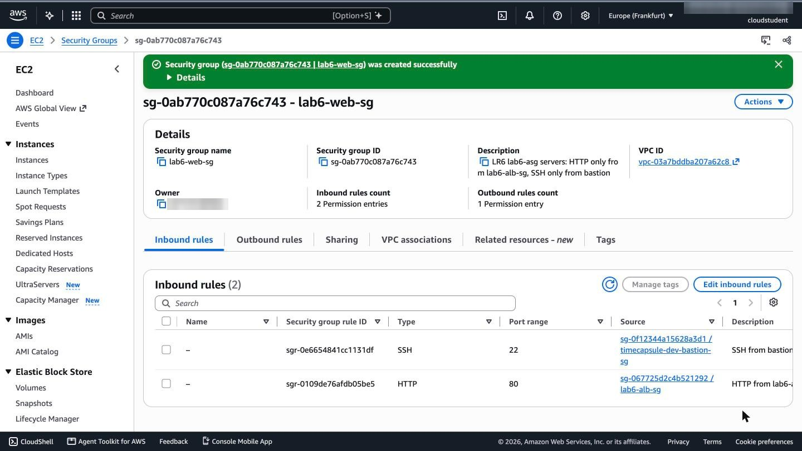
`lab6-web-sg`: источники правил — не адреса, а группы: HTTP 80 только от группы балансировщика, SSH 22 только
от группы `bastion`.

Целевая группа `lab6-tg`: тип целей `Instances`, HTTP 80, VPC `timecapsule-dev-vpc`, проверка `GET /health`
каждые 10 секунд (таймаут 5 секунд, 2 успешных ответа — `healthy`, 2 неудачных — `unhealthy`, ожидается код
`200`). Задержку отмены регистрации я уменьшил с 300 до 30 секунд: страница nginx отдаётся за миллисекунды, и
при сокращении группы ждать пять минут незачем.

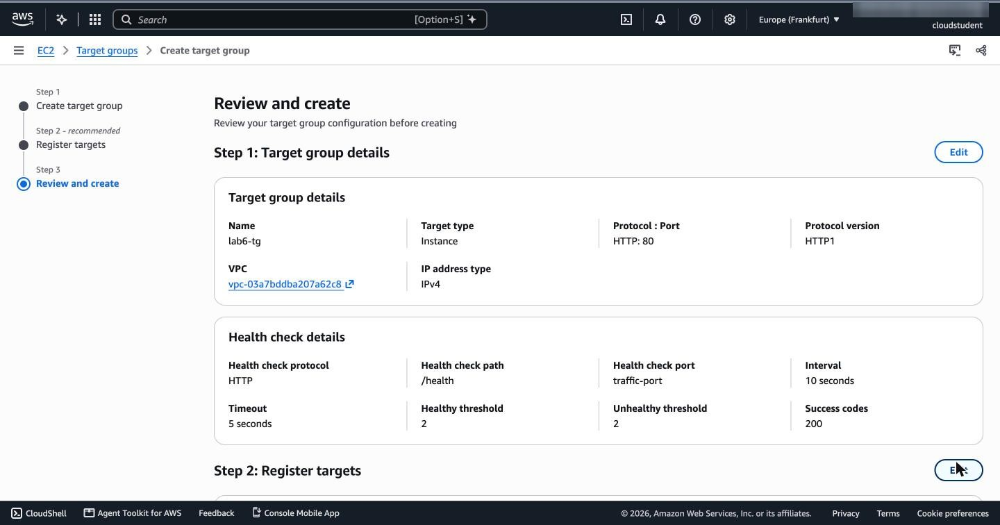
Проверка работоспособности `lab6-tg`: протокол HTTP, путь `/health`, интервал 10 секунд.

Балансировщик `lab6-alb`: Application Load Balancer, схема `Internet-facing`, IPv4, подсети `public-a` и
`public-b`, группа безопасности только `lab6-alb-sg` (группа `default` убрана), listener HTTP 80 с действием
по умолчанию «передать в `lab6-tg`».

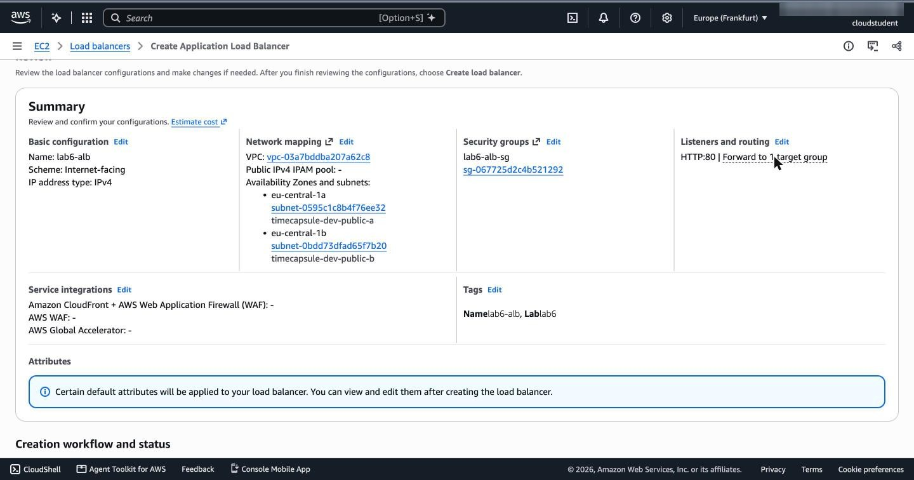
Сводка перед созданием: схема `Internet-facing`, две зоны и две публичные подсети, `lab6-alb-sg`, listener
`HTTP:80` → одна целевая группа, теги `Name` и `Lab`.

DNS-имя балансировщика — `lab6-alb-857291361.eu-central-1.elb.amazonaws.com`. Когда он перешёл в `Active`,
в целевой группе ещё не было ни одной цели:


`http://lab6-alb-857291361.eu-central-1.elb.amazonaws.com/` — `503 Service Temporarily Unavailable`, заголовок
`Server: awselb/2.0` (ответ сформировал сам балансировщик, а не nginx).

**Какой ответ вернул балансировщик и почему? Зачем ему подсети в двух зонах?**
Балансировщик ответил `503 Service Temporarily Unavailable`. Listener принял запрос и по правилу передал его в
`lab6-tg`, но в целевой группе нет ни одной исправной цели — серверов ещё нет, — поэтому ответ формирует сам ALB
(`Server: awselb/2.0`). Подсети в двух зонах нужны потому, что ALB ставит свой узел в каждую выбранную зону, а
DNS-имя возвращает адреса всех узлов: если одна зона откажет, запросы будет принимать узел в другой. ALB и не
создаётся меньше чем с двумя зонами, а цели принимает только в тех зонах, где у него есть узлы, поэтому серверы
группы тоже можно разнести по двум зонам.

### Задание 2. Группа Auto Scaling

Шаблон запуска `lab6-lt` (`lt-03e5c73f8a77483f1`), версия 1, с включённой подсказкой «Auto Scaling guidance»:

| Параметр | Значение |
|---|---|
| AMI | Amazon Linux 2023 `ami-0e75af8cec6f28266` (2023.12.20261109.0, kernel 6.18, x86_64) |
| Тип | `t3.micro` |
| Ключ | `danielmihai-keypair` |
| Подсеть | не указана (поле помечено «Not applicable for EC2 Auto Scaling») |
| Сеть | один сетевой интерфейс: группа `lab6-web-sg`, публичный IP — включён, удаление вместе с экземпляром |
| Теги экземпляра и диска | `Name=lab6-web`, `Lab=lab6` |
| User data | скрипт из условия: nginx, страница с именем сервера и зоной, `/health` → `OK` |

Публичный IP включён явно: в публичных подсетях нет NAT, и без адреса сервер не скачает nginx через Internet
Gateway. Входящий HTTP при этом всё равно разрешён только от `lab6-alb-sg`.

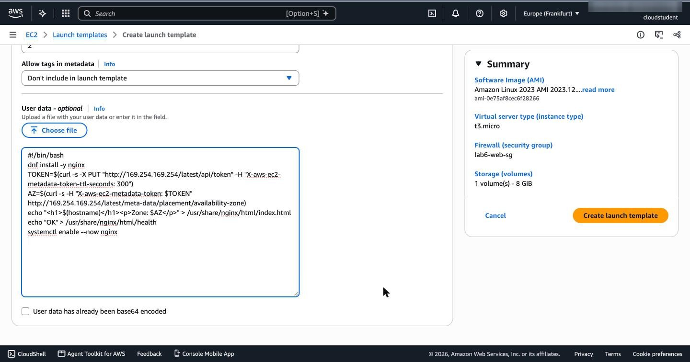
Поле `User data` шаблона `lab6-lt` — скрипт из условия без изменений.

Группа `lab6-asg`: шаблон `lab6-lt` (версия `Default`), подсети `public-a` и `public-b` (распределение
`Balanced best effort`), подключение к `lab6-tg`, проверки EC2 + ELB с отсрочкой 300 секунд, размер 2/2/4,
сбор метрик группы в CloudWatch. Политика target tracking `lab6-requests-per-target`: метрика `Application Load
Balancer request count per target` для `lab6-tg`, цель 50, прогрев экземпляра 60 секунд.

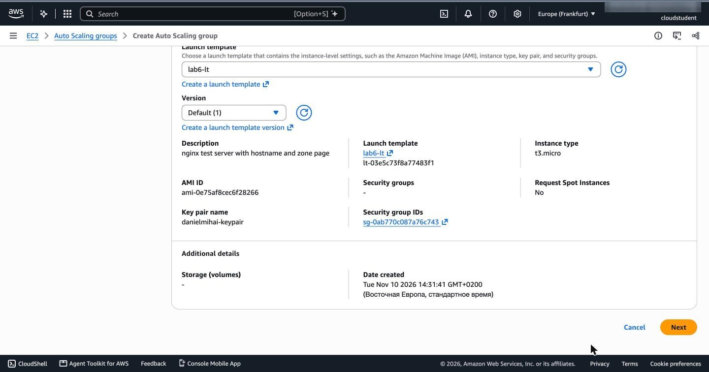
Первый шаг мастера: `lab6-lt` — `t3.micro`, `ami-0e75af8cec6f28266`, ключ `danielmihai-keypair`, группа
`sg-0ab770c087a76c743` (`lab6-web-sg`).

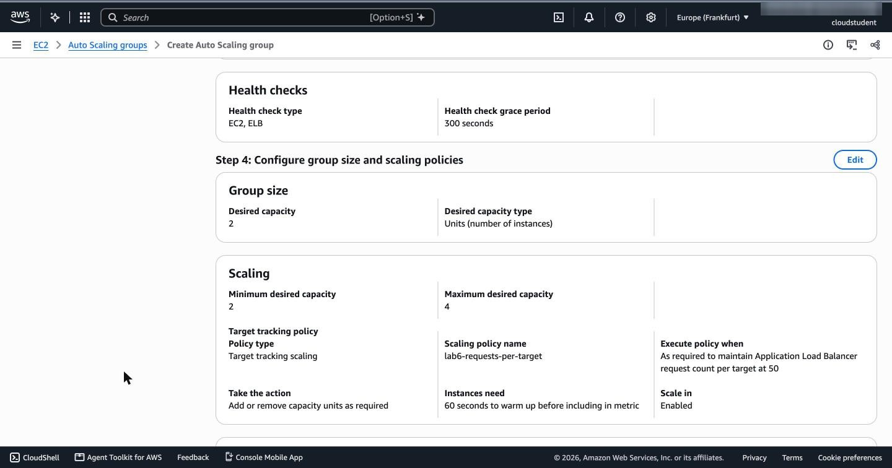
Проверка перед созданием: проверки `EC2, ELB`, отсрочка 300 секунд, желаемое 2, минимум 2, максимум 4, политика
target tracking держит `Application Load Balancer request count per target` на уровне 50, новым серверам нужно 60
секунд прогрева.

Группа создалась, а политика — нет:

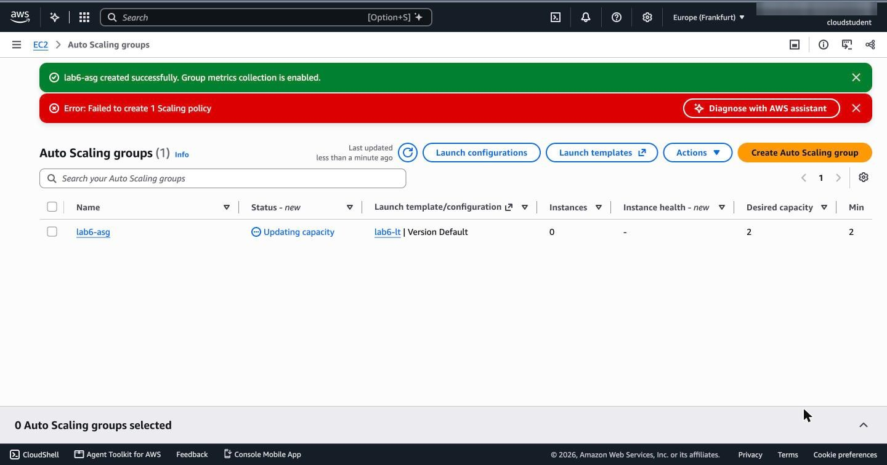
`lab6-asg created successfully`, но `Failed to create 1 Scaling policy`.

Это случай из таблицы «Частые проблемы»: `lab6-asg` — первая группа Auto Scaling в аккаунте, и служебная роль
`AWSServiceRoleForAutoScaling` была создана в ту же минуту, что и группа (14:37), — к моменту создания политики
она ещё не была готова. По той же причине группа запустила первые серверы не сразу, а через 3 минуты (12:40:47
UTC, см. задание 3). Через пару минут я добавил ту же политику на вкладке `Automatic scaling`:

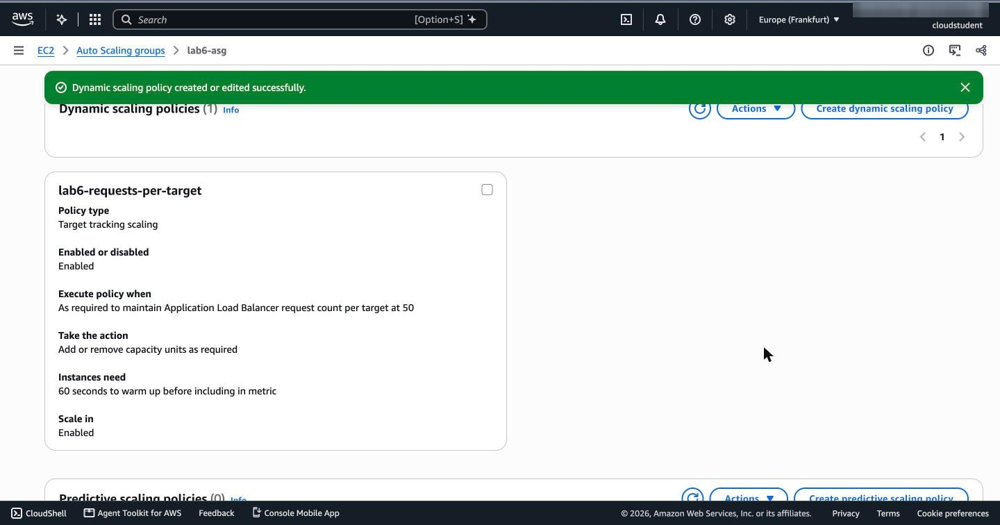
`lab6-requests-per-target`: target tracking, держит `Application Load Balancer request count per target` на 50,
прогрев 60 секунд, уменьшение группы разрешено.

Через несколько минут после запуска обе цели прошли проверки:

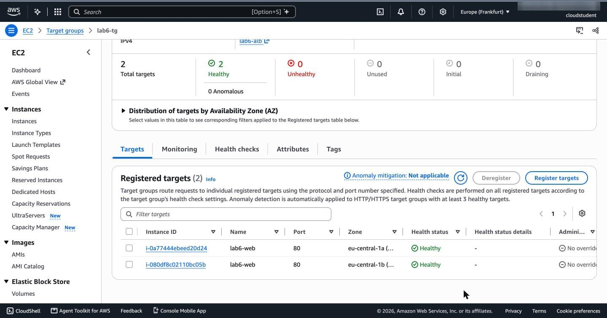
`lab6-tg`: 2 цели, обе `Healthy` — `i-0a77444ebeed20d24` в `eu-central-1a` и `i-080df8c02110bc05b` в
`eu-central-1b`, обе с тегом `Name=lab6-web` из шаблона.

Страница балансировщика, обновлённая несколько раз, показывает два разных сервера:

|  |  |
|---|---|
| `ip-10-7-0-25.eu-central-1.compute.internal`, `eu-central-1a` | `ip-10-7-1-69.eu-central-1.compute.internal`, `eu-central-1b` |

Восемь запросов подряд (`fetch` с `cache: 'no-store'`) чередовались строго по кругу: `0-25, 1-69, 0-25, 1-69,
…` — целевая группа использует round robin. Интересно, что при обычном обновлении страницы браузер долго
показывал один и тот же сервер: на каждую загрузку он отправляет два запроса — страницу и `/favicon.ico`, — и
при строгом чередовании страница всегда попадала на один сервер, а значок на другой. Один лишний запрос между
загрузками сдвинул очередь, и страница пришла со второго сервера.

**Чем группа Auto Scaling отличается от целевой группы? Почему в шаблоне нет подсети?**
Группа Auto Scaling отвечает за _количество_ серверов: по шаблону запускает их, заменяет неисправные и держит
желаемое число между минимумом и максимумом. Целевая группа — это список целей для балансировщика с настройками
проверки `/health` и выбора цели: решает, _куда_ отправить запрос, но серверов не запускает. Связаны они так:
группа сама регистрирует новые серверы в `lab6-tg` и снимает с регистрации удаляемые, а результат проверок
целевой группы (проверки ELB) использует, чтобы заменить сервер, который не отвечает. Подсети в шаблоне нет,
потому что шаблон описывает, _какой_ сервер запустить, а _где_ — решает группа: в ней две подсети в разных
зонах, и она выбирает подсеть при каждом запуске, чтобы серверов в зонах было поровну, а подсеть в шаблоне
привязала бы все серверы к одной зоне.

### Задание 3. Нагрузка

Нагрузка шла с моего компьютера: в браузере на странице балансировщика выполнялся тот же цикл, что и в условии,
— запросы один за другим в течение 10 минут (с 13:43:37 до 13:53:37 UTC). Заодно скрипт считал, какой сервер
ответил, по минутам:

```js
// то же, что end=$((SECONDS+600)); while [ $SECONDS -lt $end ]; do curl -s -o /dev/null http://$ALB/; done
const L = window.__load = {start: Date.now(), count: 0, errors: 0, perMin: {}, done: null};
const end = L.start + 10 * 60 * 1000;
(async () => {
  while (Date.now() < end) {
    try {
      const r = await fetch('/?load=' + Date.now(), {cache: 'no-store'});
      const t = await r.text();
      const m = t.match(/<h1>(.*?)<\/h1>/);
      const host = m ? m[1].split('.')[0] : ('status-' + r.status);
      const minute = new Date().toISOString().slice(11, 16);
      const b = L.perMin[minute] || (L.perMin[minute] = {});
      b[host] = (b[host] || 0) + 1;
      L.count++;
    } catch (e) {
      L.errors++;
      await new Promise(res => setTimeout(res, 200));
    }
  }
  L.done = Date.now();
})();
```

| Минута (UTC) | `ip-10-7-0-25` (1a) | `ip-10-7-1-69` (1b) | `ip-10-7-0-60` (1a) | `ip-10-7-1-156` (1b) | Всего |
|---|---|---|---|---|---|
| 13:44 | 702 | 702 | — | — | 1404 |
| 13:45 | 679 | 679 | — | — | 1358 |
| 13:46 | 661 | 661 | — | — | 1322 |
| 13:47 | 665 | 666 | — | — | 1331 |
| 13:48 | 672 | 672 | — | — | 1344 |
| 13:49 | 420 | 419 | 278 | 279 | 1396 |
| 13:50 | 346 | 347 | 347 | 347 | 1387 |

Около 1 350 запросов в минуту, то есть примерно 670 на сервер при цели 50. Ошибок не было ни одной.

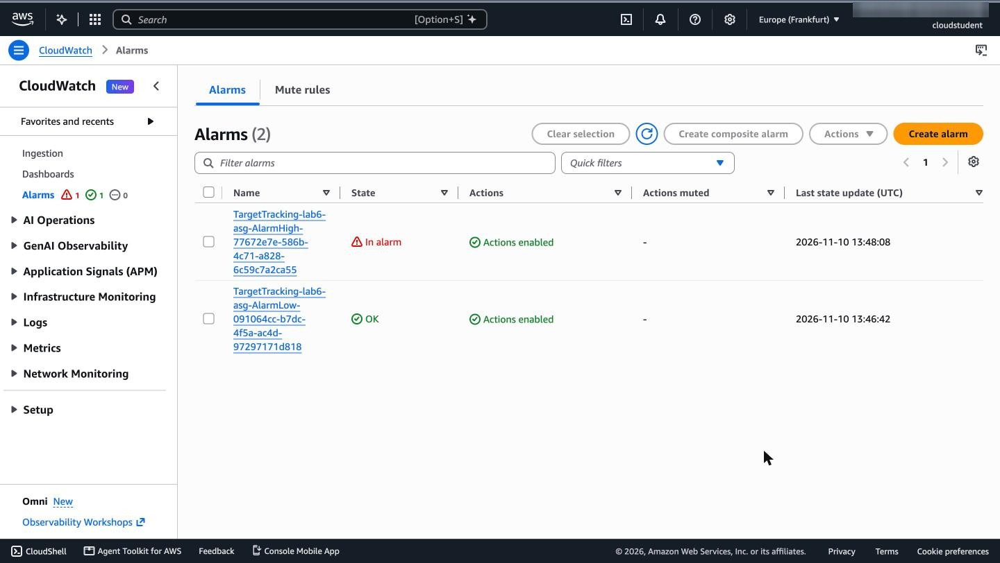
Политика создала две тревоги: `TargetTracking-lab6-asg-AlarmHigh-…` перешла в `In alarm` в 13:48:08 UTC, а
`AlarmLow-…`, которая была в `ALARM`, пока трафика не было, вернулась в `OK` в 13:46:42.

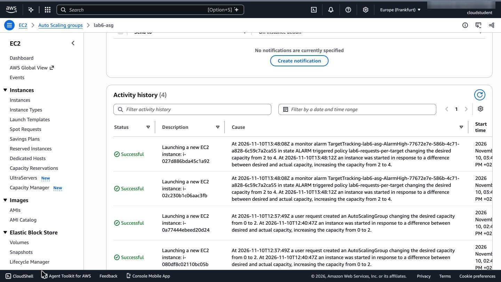
Вкладка `Activity`: в 13:48:08 UTC тревога `AlarmHigh` запустила политику `lab6-requests-per-target`, и та
изменила желаемое число с 2 до 4; в 13:48:12 запущены `i-02c230b1c06aac3fb` и `i-027d886bda45c1a92`. Ниже —
запуск первых двух серверов при создании группы (12:40:47).

С 13:49 запросы получают четыре сервера: новые `ip-10-7-0-60` и `ip-10-7-1-156` прошли две проверки `/health`
(интервал 10 секунд) примерно через минуту после запуска, и нагрузка на сервер упала вдвое. До конца нагрузки
(13:53:37) все четыре сервера получали поровну, примерно по 350 запросов в минуту. Всего за тест балансировщик
принял 13,7 тыс. запросов, и все получили ответ `2XX` (метрики `RequestCount` и `HTTPCode_Target_2XX_Count` за
13:40–13:56 UTC).

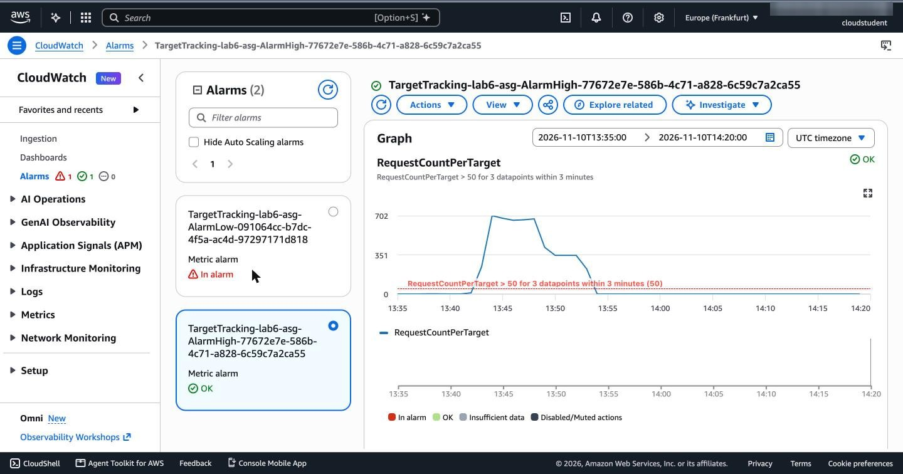
Тревога `AlarmHigh` за 13:35–14:20 UTC. С 13:43 метрика `RequestCountPerTarget` растёт до 702 запросов в минуту на
сервер и держится около 670. После 13:49 она падает примерно до 350 (серверов стало четыре), после 13:53 — до нуля.
Красная линия — условие тревоги: больше 50 три минуты подряд.

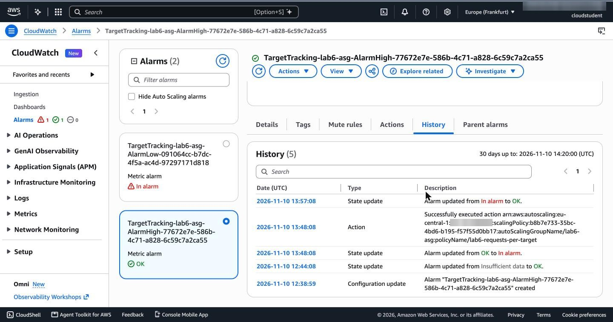
История `AlarmHigh`. Тревога создана в 12:38:59. В 13:48:08 она перешла из `OK` в `In alarm` и в ту же секунду
запустила политику `lab6-requests-per-target`. В 13:57:08 тревога вернулась в `OK`.

После окончания нагрузки метрика упала до нуля, но серверы удалились не сразу. Уменьшением группы управляет вторая
тревога, `AlarmLow`, с условием `RequestCountPerTarget < 35` 15 минут подряд.

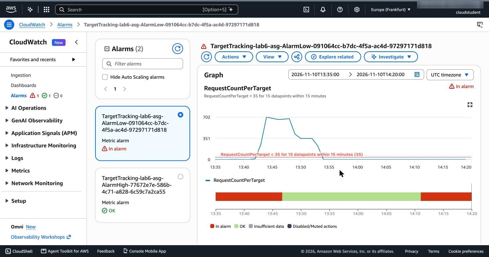
`AlarmLow` за тот же период. Полоса под графиком показывает состояние тревоги:
- `In alarm` до начала нагрузки, пока трафика не было;
- `OK` с 13:46:42;
- снова `In alarm` с 14:11:02, после 15 минут без запросов.

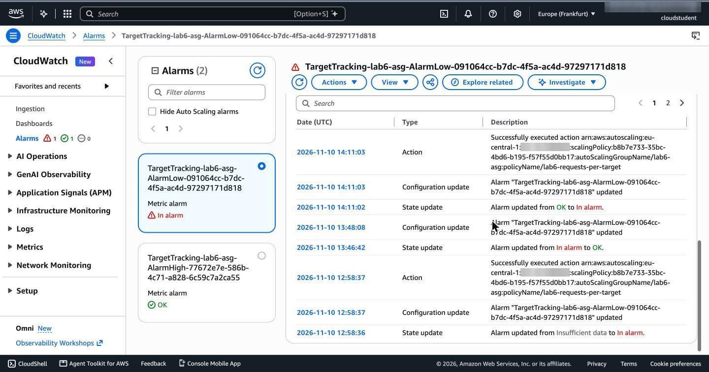
История `AlarmLow`. В 13:46:42 тревога перешла из `In alarm` в `OK`, в 14:11:02 — обратно из `OK` в `In alarm`, а в
14:11:03 запустила политику. Записи `Configuration update` в 13:48:08 и 14:11:03 оставил AWS: при каждом изменении
размера группы он сам обновлял эту тревогу. В описании обеих тревог написано `DO NOT EDIT OR DELETE`.

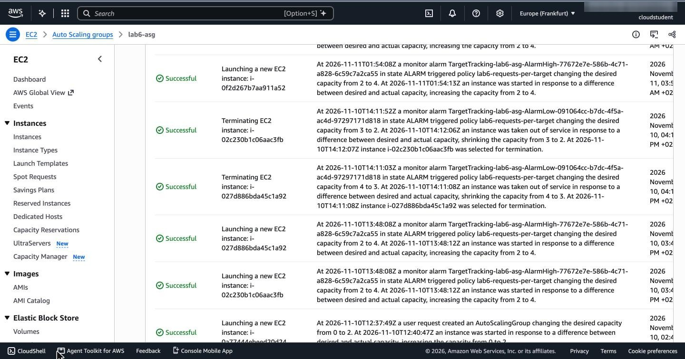
Вкладка `Activity`. В 14:11:03 политика уменьшила желаемое число серверов с 4 до 3 и удалила
`i-027d886bda45c1a92`. В 14:11:52 — с 3 до 2, удалён `i-02c230b1c06aac3fb`. Тревога всё это время оставалась в
`ALARM`, поэтому через 49 секунд политика сработала второй раз. Группа вернулась к двум серверам через 18 минут
после окончания нагрузки.

**Незапланированная проверка ночью.** Утром на вкладке `Activity` нашлись ещё четыре записи. В 01:54:08 UTC
`AlarmHigh` снова увеличила группу с 2 до 4, а в 02:29:22 и 02:30:51 `AlarmLow` вернула её к двум серверам. Я в это
время нагрузку не давал.

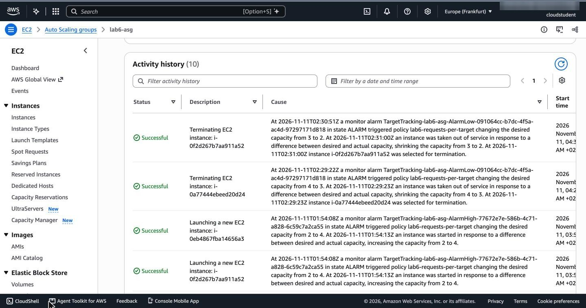
`Activity` за ночь: запуск двух серверов в 01:54:13, удаление двух серверов в 02:29:23 и 02:31:00. Группа удаляла
серверы так, чтобы в каждой зоне остался один.

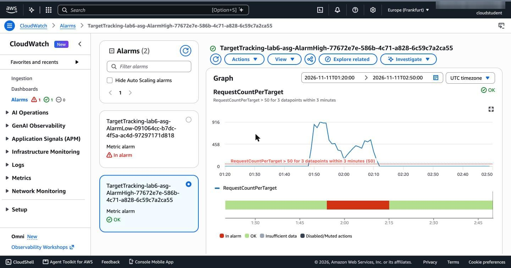
`AlarmHigh` за 01:20–02:50 UTC: с 01:48 до 02:12 метрика поднималась до 916 запросов в минуту на сервер.

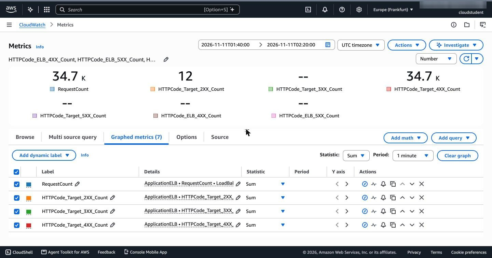
Сумма метрик балансировщика за 01:40–02:20 UTC: 34,7 тыс. запросов. Из них только 12 получили от серверов ответ
`2XX`, остальные 34,7 тыс. — ответ `4XX`.

Код `4XX` значит, что запрашивались страницы, которых на сервере нет: учебная страница nginx отвечает только на `/`
и `/health`. Скорее всего, балансировщик нашёл сканер, который обходит адреса в интернете и перебирает типовые
пути. Самих путей метрики не показывают, для этого нужны журналы доступа ALB, а они не включены. Метрика
`RequestCountPerTarget` считает все запросы, в том числе ошибочные, поэтому политика честно добавила серверы.

Вывод для части 2: у любого публичного балансировщика будет чужой трафик. Максимум группы ограничивает и расходы от
такого трафика. В настоящем проекте перед балансировщиком стоило бы поставить AWS WAF.

**Сколько серверов запустила группа и почему не больше четырёх?**
Группа запустила два сервера сразу, одним действием изменив желаемое число с 2 до 4. Target tracking считает,
сколько серверов нужно, чтобы метрика вернулась к цели: при 670 запросах в минуту на сервер и цели 50 двум серверам
понадобилось бы около 27 серверов. Но группа не может выйти за свой максимум 4: предел нужен, чтобы ошибка или
чужой трафик, как ночью, не запустили десятки платных серверов. Даже с четырьмя серверами метрика держалась около
350, выше цели, поэтому `AlarmHigh` оставалась в `ALARM` до конца нагрузки.

**Почему метрика упала после запуска новых серверов, хотя запросов не стало меньше?**
`RequestCountPerTarget` — это число запросов к целевой группе, делённое на число её исправных целей. Запросов
по-прежнему было около 1 350–1 400 в минуту, но с 13:49 их делили между четырьмя серверами, а не двумя. Поэтому
на сервер пришлось примерно 350 вместо 670, что видно и в таблице выше (13:48 — по 672, 13:50 — по 346–347).
Это и есть горизонтальное масштабирование: каждый сервер получает меньшую долю той же нагрузки.

**Почему группа добавляет серверы быстрее, чем убирает?**
Так устроены две тревоги target tracking: `AlarmHigh` срабатывает после трёх минут выше цели, и группа выросла
через 4,5 минуты после начала нагрузки, а `AlarmLow` — только после 15 минут ниже порога (35), который ниже цели, и
группа уменьшилась через 17,5 минуты после конца нагрузки, причём по одному серверу. Нехватка серверов означает
медленные ответы и ошибки для пользователей, а лишний сервер стоит лишь центы за несколько минут. Кроме того, новый
сервер готов не сразу (здесь от запуска до первых запросов прошла примерно минута: загрузка, nginx и две проверки
`/health`), и если быстро убирать серверы после каждого короткого спада, группа начнёт «раскачиваться» — запускать
и удалять серверы при каждом колебании трафика.

### Завершение Части 1

Утром 11 ноября я удалил всё, что создавал в части 1: группу `lab6-asg` (вместе с ней удалились её серверы, политика
и обе тревоги), балансировщик `lab6-alb`, целевую группу `lab6-tg`, шаблон `lab6-lt` и группы безопасности
`lab6-web-sg` и `lab6-alb-sg`. Группы безопасности удалились последними: пока их используют балансировщик и
серверы, AWS не даёт их удалить.

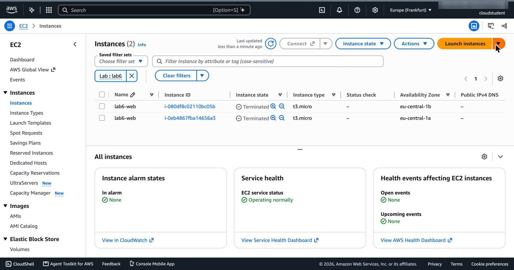
Экземпляры с тегом `Lab=lab6`: два последних сервера `lab6-web` в состоянии `Terminated`.

В списках шаблонов запуска и групп безопасности ресурсов с префиксом `lab6-` больше нет.

---

## Часть 2. Продвинутый уровень

Ресурсы части 2 названы по соглашению из ЛР3 и помечены тегами `Project=timecapsule`, `Environment=dev`,
`Owner=danielmihai` и `Lab=lab6`. Образ назван по таблице условия — `timecapsule-dev-app-lab6` (в тексте задания 5 он
называется `timecapsule-dev-app-image`).

### Задание 4. Сессии в DynamoDB

TimeCapsule написан на Laravel, поэтому ключ таблицы — `key`, а атрибут TTL — `expires_at`, как для варианта
`open_capsules_php_laravel`.

**Таблица** `timecapsule-dev-sessions`: ключ раздела `key` типа `String`, без ключа сортировки, режим `On-demand`,
шифрование ключом, которым владеет AWS.

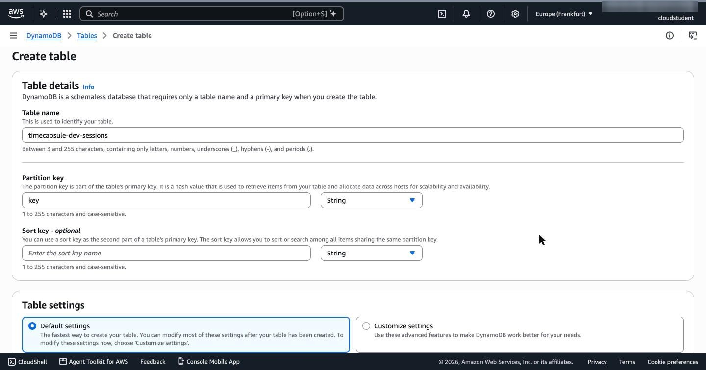
Мастер `Create table`: имя `timecapsule-dev-sessions`, ключ раздела `key` (`String`). Режим `On-demand` в настройках
по умолчанию уже выбран.

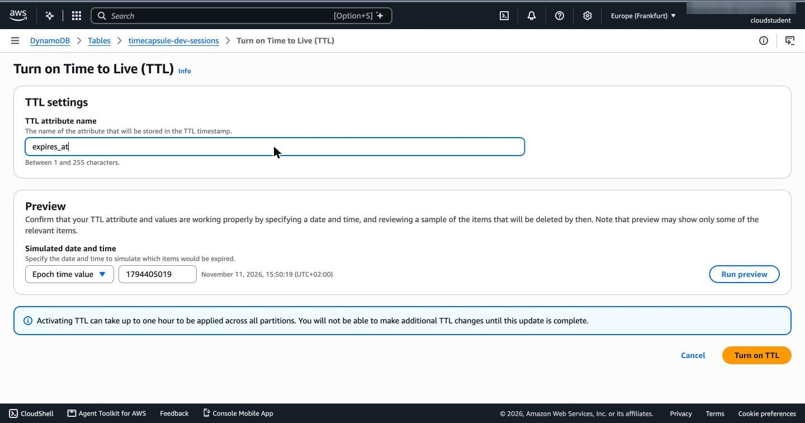
`Turn on Time to Live`: атрибут `expires_at`. В него Laravel записывает время истечения сессии в секундах Unix.

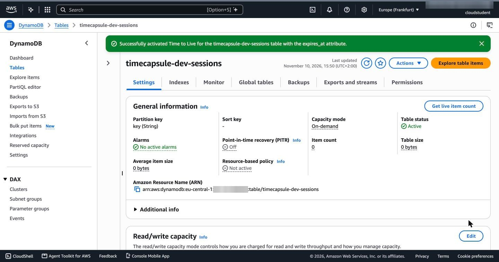
Таблица `Active`: ключ `key (String)`, режим `On-demand`, элементов пока нет, TTL включён.

**Политика** `timecapsule-dev-app-sessions` — управляемая политика с теми же тегами. Она прикреплена к роли
`timecapsule-dev-app-role` рядом с политикой S3 из ЛР4:

```json
{
    "Version": "2012-10-17",
    "Statement": [
        {
            "Sid": "VisualEditor0",
            "Effect": "Allow",
            "Action": [
                "dynamodb:GetItem",
                "dynamodb:PutItem",
                "dynamodb:UpdateItem",
                "dynamodb:DeleteItem"
            ],
            "Resource": "arn:aws:dynamodb:eu-central-1:<account-id>:table/timecapsule-dev-sessions"
        }
    ]
}
```

Других действий нет: роль не может ни читать всю таблицу (`Scan`), ни изменить или удалить её саму, ни обратиться к
другим таблицам.

**Код.** Laravel умеет хранить сессии в DynamoDB «из коробки»: драйвер сессий `dynamodb` пишет их в хранилище кэша с
тем же именем. Его нужно описать в `config/cache.php` (коммит `d284176`):

```php
// Sessions live here when SESSION_DRIVER=dynamodb (table key "key", TTL attribute "expires_at").
// No access keys: on the server the AWS SDK takes temporary credentials of the instance's IAM role.
'dynamodb' => [
    'driver' => 'dynamodb',
    'region' => env('AWS_REGION', 'eu-central-1'),
    'table' => env('DYNAMODB_CACHE_TABLE', 'cache'),
    'endpoint' => env('DYNAMODB_ENDPOINT'),
],
```

Ключей `key` и `secret` в хранилище нет. В этом случае Laravel создаёт клиент DynamoDB без учётных данных, и AWS SDK
for PHP (он установлен ещё в ЛР4 для S3) берёт временные учётные данные роли из метаданных экземпляра. В `.env` на
сервере две новые строки (в `.env.example` они описаны, по умолчанию там остаётся `file`):

```dotenv
SESSION_DRIVER=dynamodb
DYNAMODB_CACHE_TABLE=timecapsule-dev-sessions
```

**Выпуск.** Коммит `d284176` влит в `main`, и 11 ноября версия выпущена тем же способом, что в ЛР3–ЛР5: с `bastion` по
SSH скриптом `~/deploy.sh` на `app-server` (`git pull`, `composer install`, затем от `apache` — `package:discover`,
`migrate`, `config:cache` и перезагрузка PHP-FPM).

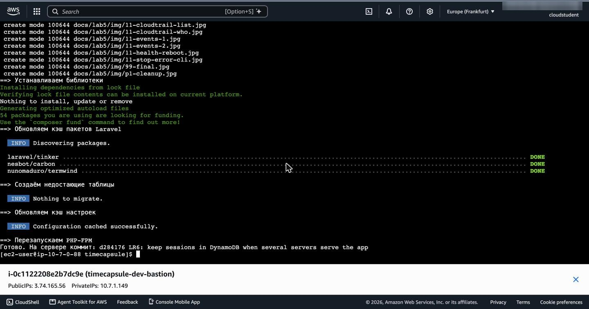
Первый запуск `~/deploy.sh`: на сервере коммит `d284176`.

После первого выпуска приложение не смогло прочитать `.env`. Две новые строки я добавил командой `sed -i`, а она
записывает файл заново, и `.env` потерял группу `apache`. PHP-FPM работает от `apache`, а `config:cache` от `apache`
собрал кэш настроек без значений из `.env`. Я вернул группу (`sudo chgrp apache .env`), сбросил кэш
(`php artisan config:clear` от `apache`) и выпустил версию ещё раз:

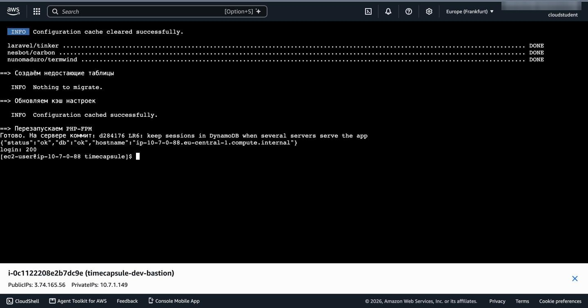
Повторный выпуск: `/health` отвечает `{"status":"ok","db":"ok",...}`, страница входа — код `200`.

**Сессия в таблице.** Свою сессию я нашёл, когда вошёл в приложение через балансировщик (задание 5). `Explore items`
→ `Scan` вернул два элемента: сессию гостя, который открыл страницу входа, и мою. Ключ элемента — префикс кэша
Laravel `timecapsule-cache-` и идентификатор сессии. В `value` лежит сериализованный массив сессии, где
`login_web_…` хранит номер вошедшего пользователя (`i:4`).

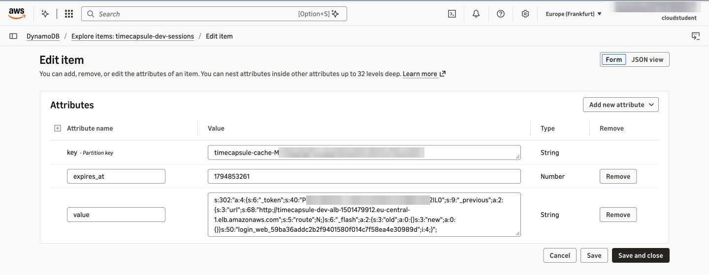
Элемент моей сессии, идентификатор сессии и CSRF-токен скрыты. `expires_at` = `1794853261`, то есть 16 ноября,
18:21:01 UTC: ровно 120 минут (`SESSION_LIFETIME`) после последнего запроса. Весь элемент занимает около 0,4 КБ.

**Почему сессии нельзя оставить в файлах, когда серверов несколько? Зачем Node.js нужен `initialized: true`?**
Файл сессии лежит на диске одного сервера, а балансировщик отправляет следующие запросы по кругу и на другие серверы,
где этого файла нет: там пользователь не залогинен, а при уменьшении группы сессии пропадают вместе с сервером.
Таблица DynamoDB общая, поэтому сессию прочитает любой сервер. `connect-dynamodb` (версия 3.0.5) перед первым
чтением или записью вызывает `DescribeTable`, а если таблицы нет — `CreateTable`, но политика
`timecapsule-dev-app-sessions` разрешает только четыре действия с элементами, и запросы падали бы с
`AccessDeniedException`. `initialized: true` пропускает эту проверку: таблица уже создана, и создавать её —
дело администратора, а не приложения.

### Задание 5. Приложение в группе Auto Scaling

**Образ** `timecapsule-dev-app-lab6` (`ami-0570528e781c001bb`) снят с `app-server` 11 ноября в 08:13 UTC, сразу после
выпуска версии `d284176`. В нём код с `vendor`, `.env` с `SESSION_DRIVER=dynamodb`, nginx, PHP-FPM и `deploy.sh`,
поэтому user data в шаблоне не нужен: сервер из образа после загрузки сразу готов отвечать.

**Доступ.** Сервер группы — копия `app-server`, поэтому шаблон использует ту же группу `timecapsule-dev-web-sg`. Её
уже разрешает группа базы `timecapsule-dev-rds-sg`, а SSH в ней и так открыт только от `bastion`. Осталось закрыть
HTTP: правило `HTTP 80 из 0.0.0.0/0` я заменил правилом `HTTP 80 от timecapsule-dev-alb-sg`. Изменить источник у
существующего правила консоль не дала (`You may not specify a referenced group id for an existing IPv4 CIDR rule`),
поэтому я добавил новое правило и удалил старое.

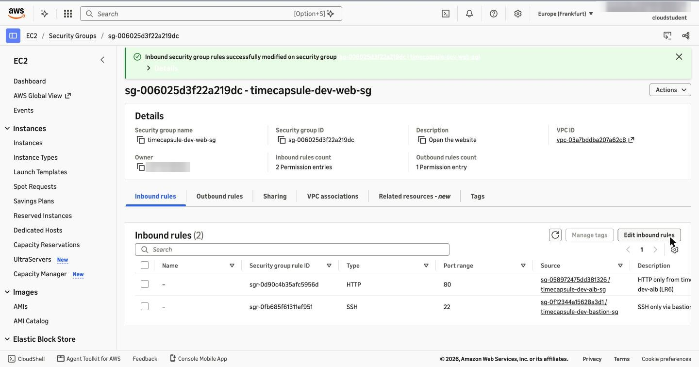
`timecapsule-dev-web-sg`: HTTP 80 только от группы балансировщика, SSH 22 только от группы `bastion`.

**Шаблон** `timecapsule-dev-app-lt` (`lt-01d980de75106a964`), версия 1:

| Параметр | Значение |
|---|---|
| AMI | `timecapsule-dev-app-lab6` (`ami-0570528e781c001bb`) |
| Тип | `t3.micro` |
| Ключ | `danielmihai-keypair` |
| Сеть | один сетевой интерфейс: группа `timecapsule-dev-web-sg`, публичный IP — включён, удаление вместе с экземпляром |
| Профиль IAM | `timecapsule-dev-app-role` (политики S3 из ЛР4 и `timecapsule-dev-app-sessions`) |
| Теги экземпляра и диска | `Name=timecapsule-dev-app-asg`, `Project=timecapsule`, `Environment=dev`, `Owner=danielmihai`, `Lab=lab6` |
| User data | нет |

Публичный IP нужен по той же причине, что в части 1: в публичных подсетях нет NAT, а без адреса сервер не выйдет в
интернет, например к DynamoDB.

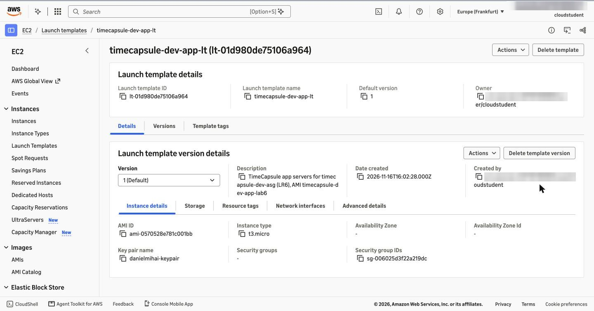
`timecapsule-dev-app-lt`: `ami-0570528e781c001bb`, `t3.micro`, ключ `danielmihai-keypair`, группа
`sg-006025d3f22a219dc` (`timecapsule-dev-web-sg`).

**Целевая группа и балансировщик** созданы так же, как в задании 1:
- `timecapsule-dev-tg`: тип целей `Instances`, HTTP 80, VPC `timecapsule-dev-vpc`, проверка `GET /health` каждые
  10 секунд (таймаут 5 секунд, по 2 ответа для `healthy` и `unhealthy`, код `200`), задержка отмены регистрации
  30 секунд;
- `timecapsule-dev-alb-sg` (`sg-058972475dd381326`): HTTP 80 из `0.0.0.0/0`;
- `timecapsule-dev-alb`: `Internet-facing`, IPv4, подсети `public-a` и `public-b`, только `timecapsule-dev-alb-sg`,
  listener HTTP 80 → `timecapsule-dev-tg`.

В отличие от учебной страницы nginx, `/health` приложения проверяет базу: выполняет `SELECT COUNT(*) FROM users` и
отвечает `200`, только если база работает. Маршрут объявлен вне группы `web`, поэтому проверки балансировщика не
создают сессий в DynamoDB.

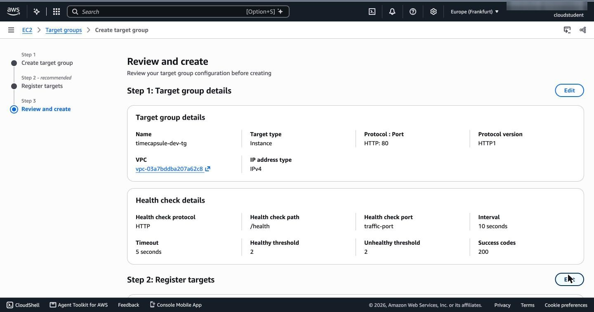
`timecapsule-dev-tg` перед созданием: HTTP 80, путь `/health`, интервал 10 секунд, таймаут 5 секунд, код `200`.

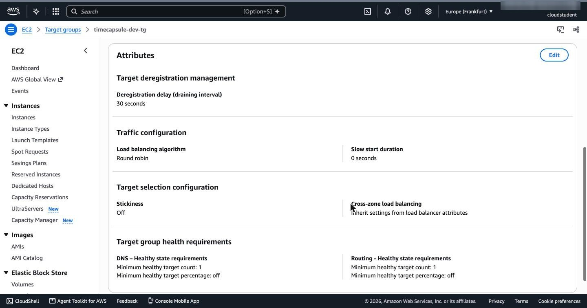
Атрибуты: задержка отмены регистрации 30 секунд, round robin, `Stickiness: Off`. Привязка сессий к серверу не нужна:
сессии в DynamoDB.

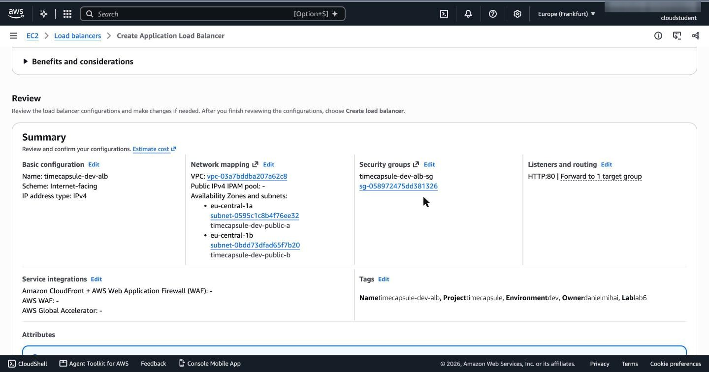
Сводка перед созданием балансировщика: `Internet-facing`, две зоны и две публичные подсети,
`timecapsule-dev-alb-sg`, listener `HTTP:80` → одна целевая группа, теги.

DNS-имя балансировщика — `timecapsule-dev-alb-1501479912.eu-central-1.elb.amazonaws.com`.

**Группа** `timecapsule-dev-asg` создана так же, как в задании 2: шаблон `timecapsule-dev-app-lt` (версия `Default`),
подсети `public-a` и `public-b` (`Balanced best effort`), подключение к `timecapsule-dev-tg`, проверки EC2 + ELB с
отсрочкой 300 секунд, размер 2/2/4, сбор метрик группы в CloudWatch, теги `Project`, `Environment`, `Owner` и `Lab`.
Политика target tracking `timecapsule-dev-requests-per-target`: метрика `Application Load Balancer request count
per target` для `timecapsule-dev-tg`, цель 50, прогрев экземпляра 60 секунд.

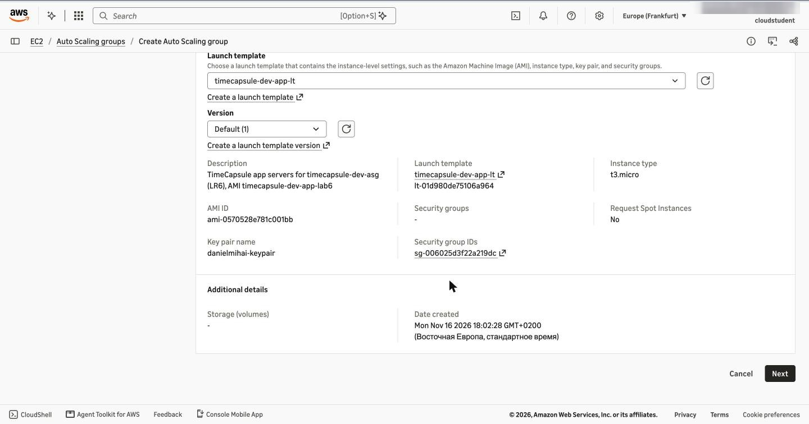
Первый шаг мастера: `timecapsule-dev-app-lt` — `ami-0570528e781c001bb`, `t3.micro`, ключ `danielmihai-keypair`,
группа `sg-006025d3f22a219dc`.

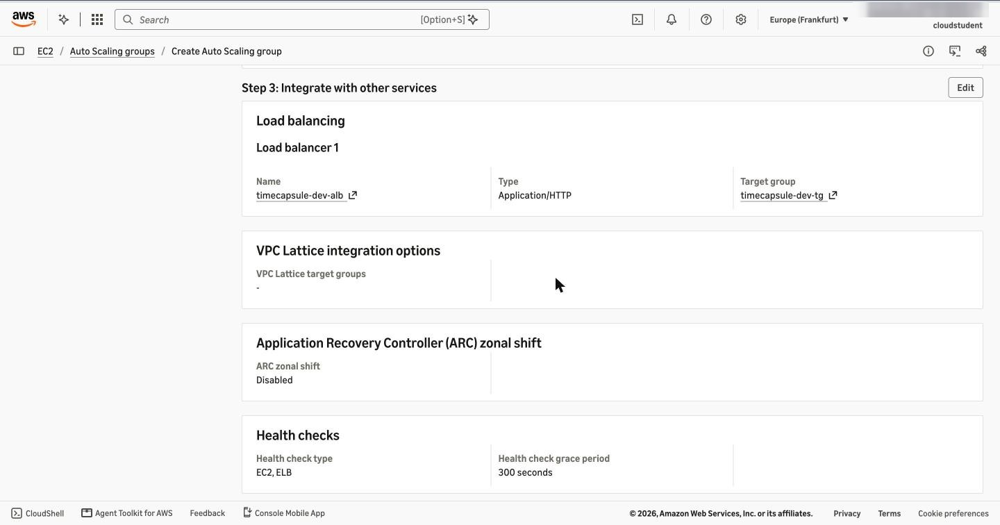
Проверка перед созданием: группа подключена к `timecapsule-dev-alb` через `timecapsule-dev-tg`, проверки `EC2, ELB`,
отсрочка 300 секунд.

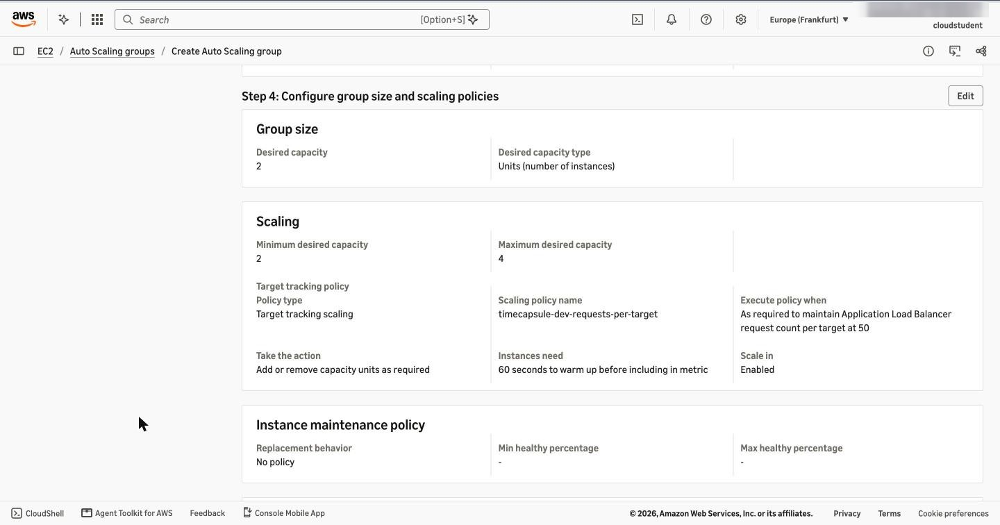
Желаемое 2, минимум 2, максимум 4; политика держит `Application Load Balancer request count per target` на уровне
50, новым серверам нужно 60 секунд прогрева.

В этот раз политика создалась вместе с группой (`1 Scaling policy created successfully`): служебная роль Auto
Scaling уже была готова. Через несколько минут обе цели прошли проверки:

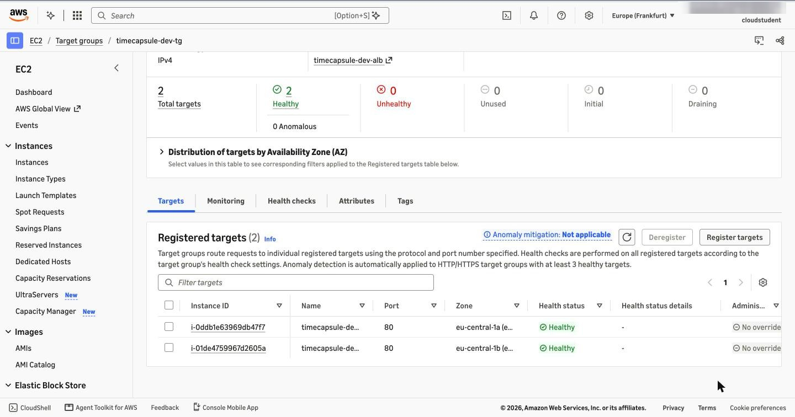
`timecapsule-dev-tg`: 2 цели, обе `Healthy` — `i-0ddb1e63969db47f7` в `eu-central-1a` и `i-01de4759967d2605a` в
`eu-central-1b`.

**app-server и Elastic IP.** Пользователей теперь обслуживает группа, поэтому `app-server` (`i-08dd33ebb505096f4`)
остановлен, а Elastic IP `3.64.208.134` (`timecapsule-dev-app-eip`) отвязан от него и освобождён.

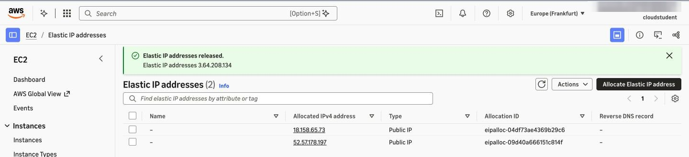
`Elastic IP addresses released`: адреса `3.64.208.134` в аккаунте больше нет. Два других адреса в списке к TimeCapsule
не относятся.

**Приложение по DNS-имени балансировщика.** В Chrome я открыл
`http://timecapsule-dev-alb-1501479912.eu-central-1.elb.amazonaws.com/` и вошёл. Для проверки зарегистрирована новая
учётная запись (адрес на скриншотах скрыт). При обновлении страницы сервер в строке `Served by` меняется, а вход
сохраняется:

| 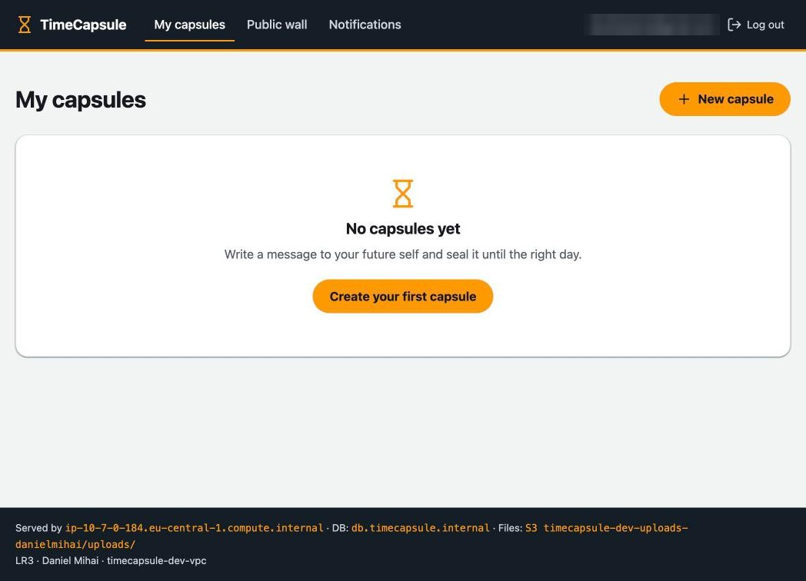 |  |
|---|---|
| `ip-10-7-0-184`, `eu-central-1a` | `ip-10-7-1-179`, `eu-central-1b` |

Три обновления подряд пришли с `ip-10-7-1-179`, `ip-10-7-0-184` и снова `ip-10-7-1-179`, и каждый раз открывалась
страница `My capsules`, а не форма входа.

**Ночная остановка базы.** Что станет с `/health` без базы, пришлось увидеть на деле. Расписание из ЛР5
(`timecapsule-dev-rds-nightly-stop`) остановило базу 16 ноября в 23:00 по Кишинёву (21:00 UTC), а балансировщик и
группа работали до утра:

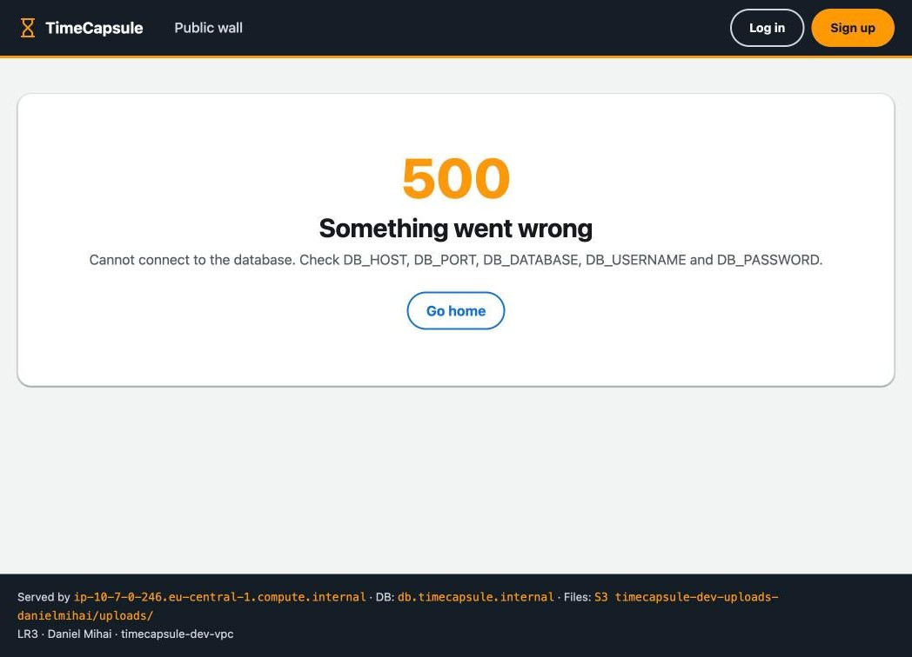
Утром 17 ноября страница входа отвечает `500`: `Cannot connect to the database`. Ответил `ip-10-7-0-246` — сервер,
которого вечером ещё не было.

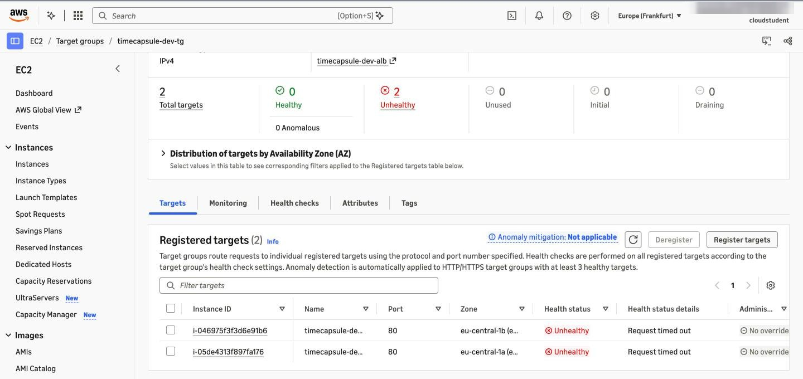
`timecapsule-dev-tg`: обе цели `Unhealthy`. Снимок сделан, когда база уже запускалась, но ещё не принимала
подключения: `/health` не успевал ответить за 5 секунд (`Request timed out`).

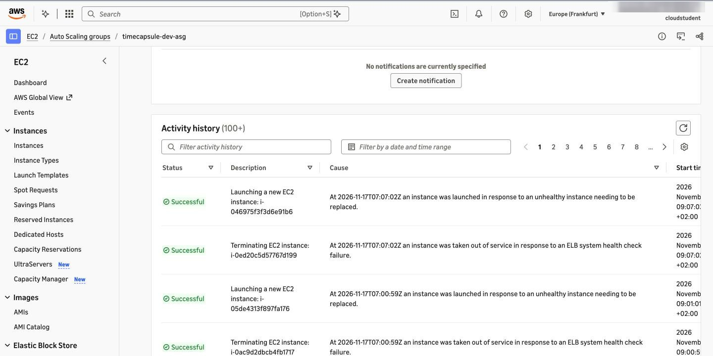
Вкладка `Activity`: группа считала серверы неисправными (`ELB system health check failure`) и примерно каждые 6
минут заменяла один из них новым. За ночь набралось больше 100 записей.

После запуска базы (`Actions` → `Start`, 07:09 UTC) новые серверы прошли проверки, и замены прекратились.

**Почему Elastic IP больше не нужен?**
Пользователи теперь приходят на DNS-имя балансировщика, а он передаёт запросы серверам по их частным адресам.
Серверы группы появляются и исчезают, и закреплять за каким-то из них постоянный адрес незачем. А за Elastic IP AWS
берёт плату, даже пока сервер остановлен, поэтому я его освободил.

**Почему у всех серверов группы одинаковые `.env` и секреты?**
Все серверы запускаются из одного образа, а `.env` с `APP_KEY` и паролем базы попал в образ вместе с кодом. Так и
должно быть: серверы взаимозаменяемы, любой из них должен расшифровать cookie, зашифрованную другим (ключ `APP_KEY`
один), и подключиться к той же базе и той же таблице сессий. С разными `APP_KEY` вход терялся бы при каждом переходе
на другой сервер, а за удобство платим тем, что секреты лежат в образе, и при смене пароля нужен новый образ.

**Что станет с проверкой `/health`, если базу остановить?**
`/health` перестанет отвечать `200`, и после двух неудачных проверок все цели станут `unhealthy`. Когда исправных
целей нет, ALB отправляет запросы всем целям подряд (fail open), но пользователи всё равно получают ошибку `500`. А
группа с проверками ELB считает серверы неисправными и бесконечно меняет их на новые, которые тоже не проходят
проверку, — ровно это и происходило ночью.

### Задание 6. Нагрузка на приложение

Первая попытка 16 ноября оборвалась: нагрузка с `bastion` прошла (16:26–16:36 UTC, `AlarmHigh` сработала в 16:31:47),
но браузер на моём компьютере в это время отключился, и пользоваться приложением, пока группа растёт, не
получилось. Поэтому утром 17 ноября, после запуска базы, я повторил задание целиком.

1. **Вход.** Моя сессия за ночь истекла (срок — 120 минут), поэтому я вошёл заново в Chrome по DNS-имени
   балансировщика.
2. **Нагрузка.** Скрипт из условия с DNS-именем `timecapsule-dev-alb` я запустил на `bastion` в фоне через `nohup`,
   чтобы он не зависел от окна терминала EC2 Instance Connect: окно в браузере может отключиться.

   ```bash
   ALB=timecapsule-dev-alb-1501479912.eu-central-1.elb.amazonaws.com
   nohup bash -c 'end=$((SECONDS+600)); while [ $SECONDS -lt $end ]; do curl -s -o /dev/null http://'$ALB'/; done' >/dev/null 2>&1 &
   ```

   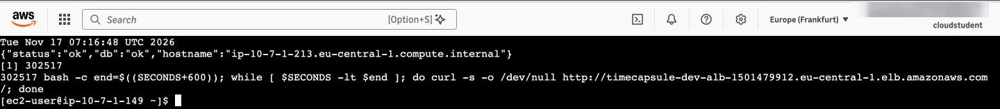
   07:16:48 UTC: `/health` через балансировщик отвечает `ok`, цикл запущен в фоне (PID 302517) и работает до 07:26:48.

   Один `curl` к `/` занимает около 0,19 секунды: гость получает редирект на `/login`, а Laravel успевает прочитать и
   записать сессию в DynamoDB. Получается около 5 запросов в секунду, то есть примерно 310 в минуту, или 155 на
   сервер при двух серверах и цели 50. `curl` не хранит cookie, поэтому каждый запрос создаёт новую гостевую сессию:
   после нагрузки `Get live item count` показал в таблице 3 058 элементов. Их удалит TTL: гостевые сессии первой
   попытки к утру уже были удалены.
3. **Метрика, тревоги и `Activity`.**

   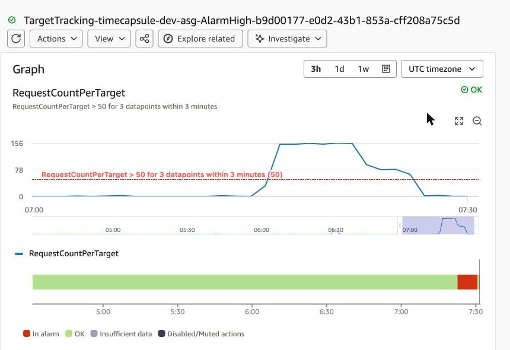
   `AlarmHigh` за 07:00–07:30 UTC. С 07:17 `RequestCountPerTarget` держится около 155 запросов в минуту на сервер,
   после 07:24 падает примерно до 78 (серверов стало четыре), после 07:27 — до нуля.

   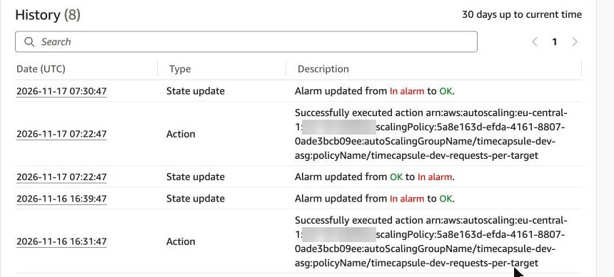
   История `AlarmHigh`: в 07:22:47 тревога перешла из `OK` в `In alarm` и в ту же секунду запустила политику
   `timecapsule-dev-requests-per-target`, в 07:30:47 вернулась в `OK`. Ниже — то же самое во время первой попытки 16
   ноября.

   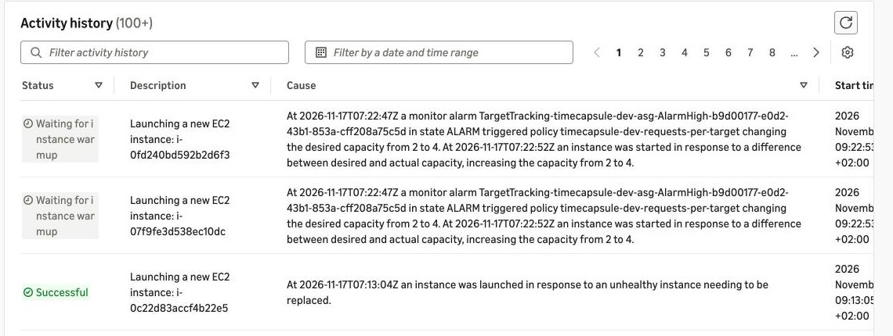
   Вкладка `Activity` во время нагрузки: в 07:22:47 UTC политика изменила желаемое число серверов с 2 до 4, в 07:22:52
   запущены `i-0fd240bd592b2d6f3` и `i-07f9fe3d538ec10dc`. Ниже — последняя ночная замена сервера.

   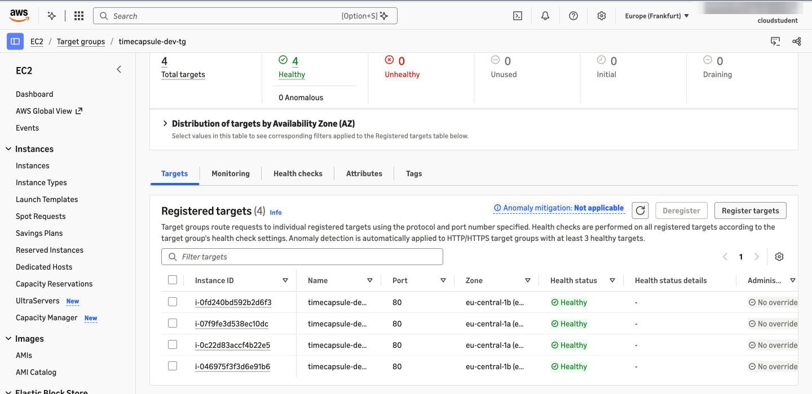
   К 07:24 в `timecapsule-dev-tg` четыре исправные цели, по две в каждой зоне.

   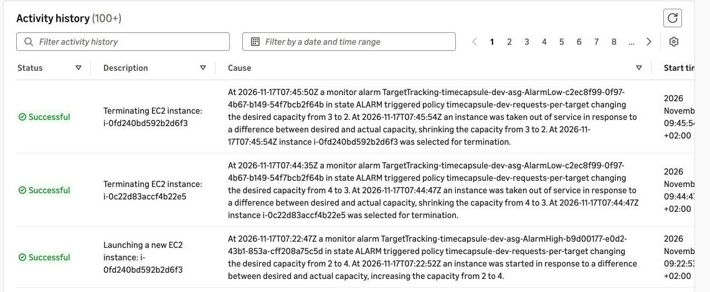
   После нагрузки метрика упала до нуля, и `AlarmLow` (`RequestCountPerTarget < 37,5` 15 минут подряд) в 07:44:35
   уменьшила группу с 4 до 3 серверов (удалён `i-0c22d83accf4b22e5`), а в 07:45:50 — с 3 до 2 (удалён
   `i-0fd240bd592b2d6f3`). Группа вернулась к двум серверам через 19 минут после конца нагрузки и оставила по
   одному серверу в каждой зоне. Порог `AlarmLow` AWS пересчитывает при каждом изменении размера группы: при четырёх
   серверах он был 37,5, а в задании 3 при двух — 35.

4. **Пользуюсь приложением.** Пока шла нагрузка, вкладка приложения раз в 5–20 секунд сама запрашивала `/` с моей
   cookie и записывала, какой сервер ответил и открылась ли страница `My capsules` (тот же приём, что в задании 3).
   В 07:23:53, через минуту после запуска двух новых серверов, я создал капсулу «LR6: capsule created during
   scale-out» с открытием в 09:30 по Кишинёву (07:30 UTC):

   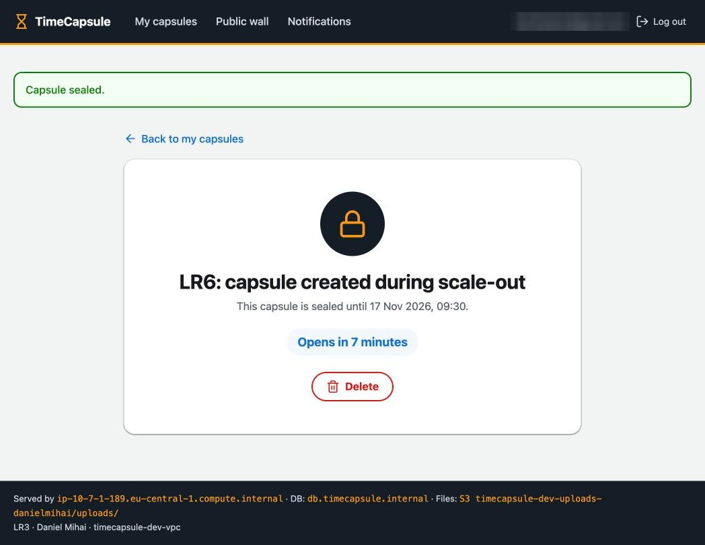
   После отправки формы страницу капсулы с сообщением `Capsule sealed.` отдал `ip-10-7-1-189` — сервер, запущенный
   минутой раньше. Сообщение Laravel хранит в сессии между двумя запросами, а вход я выполнил задолго до запуска
   этого сервера.

   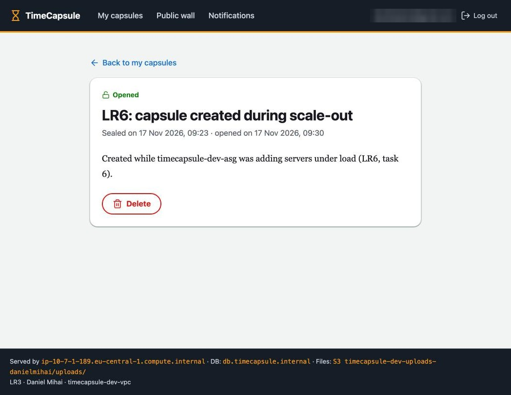
   В 07:30 UTC капсула открылась, страницу снова отдал `ip-10-7-1-189`.

   Капсулу открыл первый запрос после 07:30, и уведомление «is now open» на странице `Notifications` появилось
   ровно одно, хотя запросы обрабатывали четыре сервера: `CapsuleOpener` открывает капсулы одним атомарным
   `UPDATE … RETURNING`, и PostgreSQL не даст двум серверам открыть одну капсулу дважды. Открывал я и капсулу на
   публичной стене (`/capsules/2`).

   С 07:30 до 08:15 вкладка сделала ещё 36 запросов, из них 9 — после уменьшения группы, и их обслуживали только
   два оставшихся сервера, `ip-10-7-0-156` и `ip-10-7-1-213`. За всё время мою сессию по очереди обслуживали все
   четыре сервера: `ip-10-7-0-166` и `ip-10-7-1-213`, которые работали до нагрузки, и запущенные во время нагрузки
   `ip-10-7-0-156` и `ip-10-7-1-189`. Ни один запрос не вернул форму входа.

**Пришлось ли входить заново, когда группа добавляла или удаляла серверы? Почему?**
Нет: мою сессию по очереди читали все четыре сервера, в том числе два новых, и вход сохранился и после удаления двух
серверов. Сессия хранится не на сервере, а в DynamoDB, а cookie с её идентификатором зашифрована общим для всех
серверов `APP_KEY`, поэтому любой сервер группы, даже только что запущенный, находит сессию по cookie. Удалённый
сервер ничего не уносит с собой: сессии лежат в DynamoDB, файлы — в S3, данные — в RDS.

---

## Архитектура и ADR

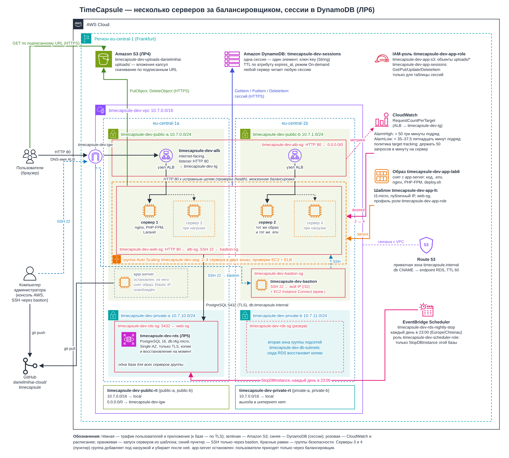

Схема ЛР5 дополнена по образцу рисунка 6.1 (исходник — [scaling-lab6.svg](../architecture/scaling-lab6.svg),
значки — AWS Architecture Icons):

* вместо одного `app-server` с Elastic IP пользователи приходят на DNS-имя `timecapsule-dev-alb`: его узлы стоят в
  `public-a` и `public-b` под группой `timecapsule-dev-alb-sg`, listener HTTP 80 передаёт запросы в
  `timecapsule-dev-tg` по проверке `/health`;
* серверы приложения — группа Auto Scaling `timecapsule-dev-asg` из 2–4 серверов в двух зонах, все из образа
  `timecapsule-dev-app-lab6` и шаблона `timecapsule-dev-app-lt`; серверы 3 и 4 нарисованы пунктиром — группа
  добавляет их под нагрузкой и убирает после неё;
* `timecapsule-dev-web-sg` принимает HTTP только от группы балансировщика, SSH — только от `bastion`;
* сессии — в таблице DynamoDB `timecapsule-dev-sessions` (синяя стрелка `GetItem` / `PutItem` / `DeleteItem`), права
  на неё — политика `timecapsule-dev-app-sessions` у роли `timecapsule-dev-app-role`;
* CloudWatch: метрика `RequestCountPerTarget` и тревоги target tracking, которые меняют желаемое число серверов;
* `app-server` показан серым: он остановлен, из него снят образ, Elastic IP освобождён. База, S3, Route 53 и
  ночное расписание остались как в ЛР5.

Решение записано в [ADR-0005. Где хранить сессии пользователей](../adr/0005-session-storage.md): сравнены сессии на
сервере с привязкой в балансировщике (sticky sessions), таблица сессий в RDS и таблица DynamoDB; выбрана DynamoDB.
Привязка не спасает вход, когда группа удаляет или заменяет сервер, а таблица в RDS добавила бы чтение и запись на
каждый запрос единственной базе `db.t4g.micro`, которая к тому же по ночам остановлена. В разделе «Последствия» —
стоимость (меньше доллара за миллион просмотров страниц), срок жизни сессий и TTL, согласованность чтения и
зависимость от ещё одного регионального сервиса.

## Итог

После работы, как требует условие продвинутого уровня, удалены группа `timecapsule-dev-asg` (вместе с её серверами)
и балансировщик `timecapsule-dev-alb`, остановлены база `timecapsule-dev-rds`, `bastion` и `app-server`. Из
`timecapsule-dev-bastion-sg` удалено временное правило SSH из диапазона EC2 Instance Connect, а временная роль
`timecapsule-dev-bastion-role` отвязана от `bastion` и удалена вместе со встроенной политикой.

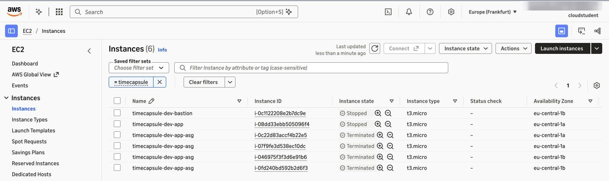
`bastion` и `app-server` — `Stopped`, серверы группы — `Terminated`.


В `timecapsule-dev-bastion-sg` осталось только постоянное правило SSH с моего IP (адрес скрыт).

Для следующих работ, как требует условие, оставлены таблица `timecapsule-dev-sessions`, целевая группа
`timecapsule-dev-tg`, политика `timecapsule-dev-app-sessions`, образ `timecapsule-dev-app-lab6` и шаблон
`timecapsule-dev-app-lt`. Осталась и группа `timecapsule-dev-alb-sg`: на неё ссылается правило HTTP в
`timecapsule-dev-web-sg`. Ресурсов части 1 (`lab6-*`) не осталось. Чтобы снова открыть приложение, нужно запустить
базу, а затем заново создать балансировщик и группу: целевая группа и шаблон для этого сохранены.

## Контрольные вопросы

Письменные ответы на вопросы заданий — в конце каждого задания. Ниже — ответы на дополнительные вопросы
продвинутого уровня, подготовленные к защите.

**1. Как проходит запрос от браузера до базы и таблицы сессий?**
Браузер получает по DNS адреса узлов `timecapsule-dev-alb` в двух зонах и отправляет запрос через Internet Gateway;
listener HTTP 80 передаёт его в `timecapsule-dev-tg`, и балансировщик по кругу выбирает исправный сервер, а
`timecapsule-dev-web-sg` пропускает соединение, потому что его источник — группа балансировщика. На сервере nginx
передаёт запрос PHP-FPM, и Laravel по идентификатору из cookie читает сессию из `timecapsule-dev-sessions`
(`GetItem` по HTTPS, подписанный временными ключами роли `timecapsule-dev-app-role`). Данные приложение берёт из
PostgreSQL по имени `db.timecapsule.internal` (CNAME в приватной зоне Route 53 на endpoint RDS) по TLS на порт 5432,
который `timecapsule-dev-rds-sg` открывает только для `web-sg`. В конце запроса Laravel записывает сессию обратно
(`PutItem` с новым `expires_at`), а ответ возвращается через балансировщик.

**2. Чем проверка балансировщика отличается от проверки группы Auto Scaling?**
Проверка целевой группы решает, _куда_ отправлять запросы: каждые 10 секунд балансировщик запрашивает `/health` и
после двух неудач перестаёт слать запросы серверу, но сам сервер не трогает. Проверка группы решает, _какой сервер
заменить_: по умолчанию группа смотрит только на состояние экземпляра EC2, а с включёнными проверками ELB учитывает и
`/health`, удаляет неисправный сервер и запускает вместо него новый из шаблона. Первые 300 секунд после запуска
(`health check grace period`) группа результаты проверок не учитывает, чтобы сервер успел загрузиться.

**3. Что произойдёт при отказе зоны `eu-central-1a`?**
Балансировщик и группа отказ переживут: DNS-имя ALB перестанет возвращать узел в `1a`, серверы в `1a` не пройдут
проверки, и группа запустит замену в `public-b`, а сессии в DynamoDB и файлы в S3 сохранятся — эти сервисы хранят
данные в нескольких зонах. Но приложение всё равно остановится: база `timecapsule-dev-rds` — Single-AZ и стоит в
`private-a`, то есть в `1a`, и `/health` на всех серверах начнёт отвечать ошибкой, а группа, как этой ночью, будет
без конца менять серверы. Восстановить работу можно только вручную: восстановить базу из резервной копии в
`private-b` и направить на неё CNAME `db.timecapsule.internal`; с Multi-AZ RDS переключилась бы на резервный
экземпляр в `1b` сама за минуту-две, но это вдвое дороже (ADR-0004).

## Вывод

В части 1 перед серверами nginx в двух зонах поставлен Application Load Balancer, а группа Auto Scaling с политикой
target tracking (50 запросов в минуту на сервер) под нагрузкой выросла с двух до четырёх серверов и через 18 минут
после нагрузки вернулась к двум; по истории тревог видно, почему рост быстрый, а уменьшение медленное. В части 2
TimeCapsule перестал хранить состояние на сервере: сессии перенесены в DynamoDB (таблица с TTL, политика на четыре
действия, учётные данные роли вместо ключей), из `app-server` снят образ, и приложение работает в группе из 2–4
одинаковых серверов за балансировщиком, а `app-server` остановлен и его Elastic IP освобождён. Под нагрузкой группа
добавила два сервера и потом убрала их, а я всё это время оставался в системе, создал и открыл капсулу, и
уведомление об открытии появилось ровно одно. Ночная остановка базы показала слабое место: проверка `/health`
зависит от единственной базы Single-AZ, и без неё группа всю ночь заменяла исправные серверы. Решение о хранении
сессий записано в ADR-0005 и показано на схеме.

## Источники

1. Лекция 8 «Масштабируемость и балансировка нагрузки. Elastic Load Balancing, Amazon EC2 Auto Scaling», Hands-on 8.1 «Балансировщик для двух серверов» и Hands-on 8.2 «Группа Auto Scaling».
2. Условие лабораторной работы №6: [MSU-Courses/cloud-computing, Lab/06_Load_Balancing_And_Scaling](https://github.com/MSU-Courses/cloud-computing/tree/main/Lab/06_Load_Balancing_And_Scaling).
3. Elastic Load Balancing, User Guide for Application Load Balancers: [Health checks for target groups](https://docs.aws.amazon.com/elasticloadbalancing/latest/application/target-group-health-checks.html), [CloudWatch metrics for your Application Load Balancer](https://docs.aws.amazon.com/elasticloadbalancing/latest/application/load-balancer-cloudwatch-metrics.html) (`RequestCountPerTarget`), Target group attributes (deregistration delay, stickiness).
4. Amazon EC2 Auto Scaling User Guide: [Target tracking scaling policies](https://docs.aws.amazon.com/autoscaling/ec2/userguide/as-scaling-target-tracking.html), [Health checks for instances in an Auto Scaling group](https://docs.aws.amazon.com/autoscaling/ec2/userguide/ec2-auto-scaling-health-checks.html), Launch templates, Service-linked role for Amazon EC2 Auto Scaling.
5. Amazon DynamoDB Developer Guide: [Using time to live (TTL)](https://docs.aws.amazon.com/amazondynamodb/latest/developerguide/TTL.html), On-demand capacity mode, Read consistency.
6. Laravel 12: [HTTP Session](https://laravel.com/docs/12.x/session) (драйвер `dynamodb`), [Cache](https://laravel.com/docs/12.x/cache) (хранилище DynamoDB).
7. [connect-dynamodb](https://github.com/ca98am79/connect-dynamodb), версия 3.0.5: `lib/connect-dynamodb.js`, функция `initialize()`.
8. Amazon EC2 User Guide: Create an Amazon EBS-backed AMI, Elastic IP addresses (pricing of public IPv4 addresses).
9. AWS Architecture Icons.
